# ned changelog

The newest release is described in the [README](README.md#whats-new-in-66). Older releases:

## What's new in 6.5.1

- **C wrappers written one parameter a line** — the way ned's formatter (and nph) lays them out, `):` under
  `proc` — are understood: the C signature beside them, the C documentation on hover (on the wrapper's name, its
  calls and `importc: "printf"`), the check against the header, and Alt+Enter › *Rewrite this wrapper from its C
  declaration*, which keeps the layout. A comma after the last parameter is no longer read as part of its type.
- **`varargs[T]` for C's `...` is flagged**: it is a Nim array (a pointer and a length), not C's variable
  arguments. The wrapper wants C's own parameters and `{.varargs.}` —
  `proc cprintf(format: cstring): cint {.importc: "printf", varargs, header: "stdio.h", discardable.}` — and
  Alt+Enter writes it.
- **Lined-up declarations stay lined up with type hints** (`nim.format.align`): a hint goes over the spaces before
  the `=`, and every line of the run moves its `=` by the same amount — with a hint on every line, on some or on
  none (`opcodes = toLookupTable(data)` under `data: string = "mov;…"`); with the hints off, the lines look as
  the formatter wrote them.
- **Zen mode without git's change marks** in the gutter (`zen.gitChanges` brings them back).
- **A shorter File menu**: SSH, clone and the workspace under *Open more*, a file's history and comparisons under
  *This file*, settings, theme, keys and settings sync under *Preferences*.

The C engine and ligatures came in [6.5](#whats-new-in-65); [C: ned's own engine](README.md#c-neds-own-engine)
describes it.

## What's new in 6.5


**C without clangd.** ned has its own C engine now — nothing to install (`c.engine`: `auto` uses it when clangd is
not installed; `builtin`, `clangd` or `both`):
- **Members after `.` and `->`** through typedefs, pointers, arrays, casts, calls and macros (`#define atime tv[0]`,
  `P_OPERAND(p)->`), and in designated initializers (`{ .x = 1, .`) — each with its type and comment.
- **Hover** with the comment that documents a declaration — above it, or after it on its line; a definition
  without one shows its prototype's from the header.
- **F12 through `#include`s**: a function declared in a header goes to its body, in the project's other `.c` files
  too; a definition's name to its prototype and back; `goto x` to the label. `#include "` and `<` complete the
  headers there.
- **References and rename** (with a preview — a local in its function, the rest across the project's C files),
  **signature help**, the **outline**, symbols in the file.
- **The C compiler's errors while you type**, on the unsaved text (a private copy, removed after), and **Alt+Enter
  adds a missing `#include`** for a standard function, type or macro (`printf` → `<stdio.h>`).

Measured against clangd 22 — with a `compile_commands.json` and its background index, at its best — on OpenSSH and
zsh ([tests/engine](tests/engine/README.md#c-ned-against-clangd)): go to definition gives the same answer 97.8% and
97.3% of the time; member completion offers the member written there 100% and 99.4% of the time (clangd: 95.1% and
97.4%); ned reads a file and every header it includes in 13 ms where clangd takes 0.2 s, and uses 31–37 MB of memory
to clangd's 160–270 MB. clangd stays the more precise where only the build's configuration decides
(`#ifdef HAVE_…`), for declarations made by macros, and for C++: with clangd installed, `auto` uses it.

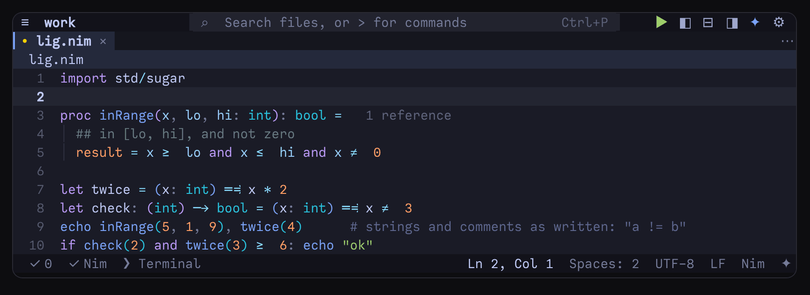

**Ligatures** (`editor.fontLigatures`, *View › Editor › Ligatures*): `font` keeps each operator in one colour and
style, so a terminal with a ligature font (Kitty, WezTerm, iTerm2, Ghostty, Windows Terminal) joins it; `symbols`
has ned draw them itself, in any terminal — Termux too: `─→ ═⇒ ≠ ≤ ≥ ≔` in the same columns, never in strings or
comments, and the line with the cursor shows what is really there.

Also: after a rename's preview, ned goes back to the file the rename started in (not the tab beside the preview).

## What's new in 6.4

**The Nim engine goes further** — still no nimsuggest, still a fraction of a millisecond per answer:
- **Parameter names before arguments**: `draw(width: 10, height: 20, filled: true)` — before numbers, strings,
  `true`/`false`/`nil` and literal collections, where a reader cannot tell what they mean (`nim.parameterHints`:
  `literals`, `all` or `off`). Never for one-parameter routines, one-letter names, an argument that already is the
  name, or named arguments.
- **A generic routine's instance on hover**: hovering `biggest(3, 4)` shows what it is here —
  `biggest(a: int, b: int): int   (T = int)`.
- **More types known**: `let a = 1; let s = "x"` (statements after `;`), `Box[string](val: x)`, `Box[int]()` and
  `Box(val: "x")` (a generic object built without its arguments: the field values tell), `if c:value` written without
  a space, `not(…)`; after a `.` on a value whose type is a **concept** (`x: Shape`, `[T: Shape]`), what the
  concept asks of it comes first.
- **Organize imports** (*Nim › Refactor*, palette): the imports the compiler found unused go, the rest are sorted —
  the standard library in one `import std/[…]`, then packages, then the project's own modules.
- **An import from your own project**: Alt+Enter on an undeclared name offers to import the project's module that
  exports it (`import ./extra`), next to the standard library's.
- F12 on a name inside `defined(…)` explains the define.

Measured against nimsuggest on the same 23 files as before, go to definition now agrees 95.5% (was 94.7%), type hints
94%, variables' types 91%, member completion 90.5% (nimsuggest 74%). The first question in a file whose imports
pull in a hundred modules takes 0.05–0.15 s (the compiler's own `semexprs.nim`: 0.15 s), every later one 0.1–0.3 ms —
fast enough that a cache on disk would only add something to go stale.

## What's new in 6.3

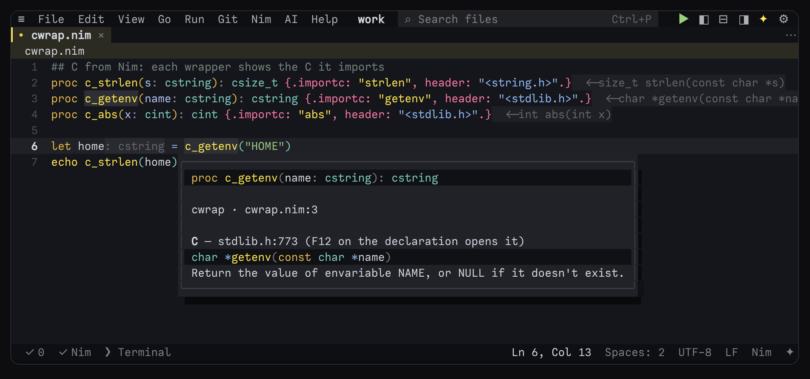

**C from Nim, explained.** A proc that imports C now tells you what it imports:
- **The C documentation in the hover and in completion**: the declaration from the header (or the `{.emit.}`), short
  and readable — `char *getenv(const char *name)` — with the comment written above it in the header. The standard
  library's procs that come from C (`posix`, `c_printf` …) get theirs from your system's headers.
- **The C signature beside each wrapper**, dimmed (`nim.cSignatureHints`): a wrong type stands out at once.
- **`header: "…"` and `importc: "…"` have colours of their own**: the hover on a header tells where it is, what it
  says it is and how much it declares; F12 opens it. On `importc: "…"`, the C declaration.
- **A wrapper written from C**: Alt+Enter on an importc proc › *Rewrite this wrapper from its C declaration* — the
  parameters and result in the Nim types C asks for (`size_t` → `csize_t`, `char *` → `cstring`), the pragmas kept.
- **A new wrapper completed**: type `proc ` and part of a C name in a file that uses headers — the functions not
  wrapped yet are offered, and accepting one writes the whole wrapper.

**The formatter, your way** (new settings; the layout ones start out as nph does):
- `nim.format.lineLength` (88), and how lists are laid out — `nim.format.params`, `nim.format.arguments` and
  `nim.format.collections`: `fit` (as nph), `onePerLine` (one per line when too long), `always` (one per line when
  there are two or more) or `keep` (your line breaks).
- `nim.format.imports`: `sort`, or `merge` — `std/os` and `std/strutils` become `std/[os, strutils]`.
- `nim.format.align` lines up an object's field types and the `=` of const/let/var sections;
  `nim.format.reflowDocComments` re-wraps long `##` paragraphs; `nim.format.maxBlankLines` keeps up to 3.
- **The C in `{.emit.}` is formatted with the Nim around it** (`nim.formatEmitC`): with clang-format and your
  `.clang-format` when installed, else with ned's own C formatter — which also formats `.c` files when there is no
  clang-format (indentation and spaces; your line breaks stay; it checks its result like the Nim one).
- **Pasted code takes the indentation of where it goes** (`editor.formatOnPaste`: `indent`, `format` — the Nim
  formatted too — or `off`). At column 0 a paste stays exactly as copied.

**Git for new folders and other people's projects.** *File › Clone from a link…* (and on the Welcome screen: `g`)
takes any link as it is copied — GitHub, GitLab, Codeberg, a `/tree/branch` link, `user/repo`, ssh — offers
*Latest version only*, opens the README, and offers `nimble install --depsOnly` for a Nim project; a link with a
password or token in it is refused. *Initialize a repository here* is in the Git dock, the File tree's menu and
the palette (it asks first inside another repository), a new Nim project gets its first commit, and git asks your
name and email once when it does not know them.

**Eight new themes**, ned's own, every colour checked for contrast (`tests/themes/contrast.py`): `frankincense`,
`desert-dusk`, `lagoon`, `sea-glass`, `paper-ink`, `rose-quartz`, and two old terminals, `amber-crt` and
`green-phosphor` (Alt+T).

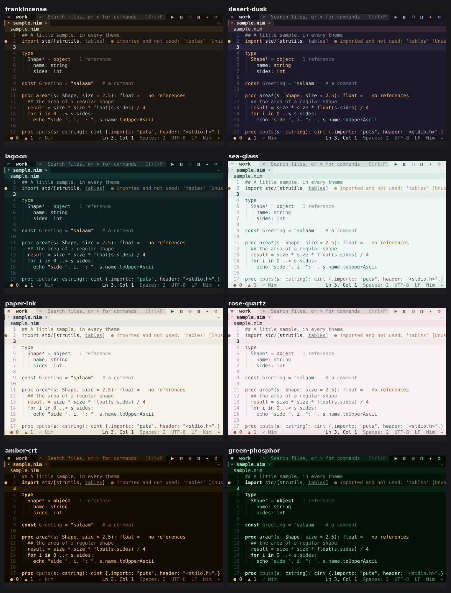

And: TODO and NOTE marks on the scrollbar (and errors) move with their code as you type; CONTRIBUTING.md,
SECURITY.md and issue templates for working on ned in the open.

## What's new in 6.2

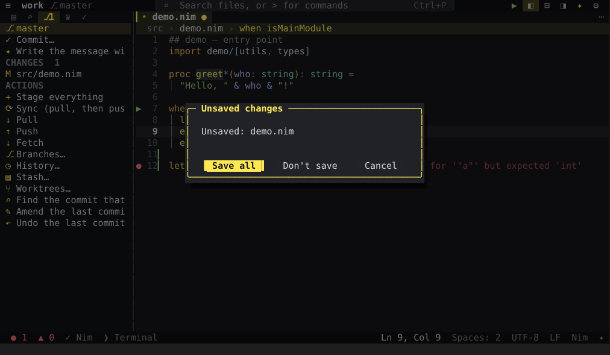

**A calmer, more desktop-like look.**
- **Soft shadows.** Popups, menus, dialogs, the completion list, toasts and tooltips cast a shadow half a cell wide
  and half a cell high, drawn with block characters, instead of a full dark row and column; text that falls under
  a shadow stays readable.
- **Rounded-looking buttons** in dialogs and toasts, and a rounded search box in the title bar.
- **The part with the keyboard is tinted**: a dock's header, or the panel's, takes a touch of the accent colour
  (in place of the underline across it).
- **Quieter lists**: the Git dock's actions, the outline and the assistant's suggestions are in the text colour,
  with coloured icons, rather than all in the accent colour.
- **The mouse pointer changes like in a desktop app**: a hand over what can be clicked, an I-beam over the text you
  edit, the arrow elsewhere — in terminals that let programs set it (OSC 22: kitty, foot, WezTerm, Ghostty, xterm;
  the others ignore it). `ui.pointerShapes: false` leaves the pointer alone.
- The completion list's documentation goes above or below the list rather than over a dock when there is no room
  beside it in the editor.

## What's new in 6.1

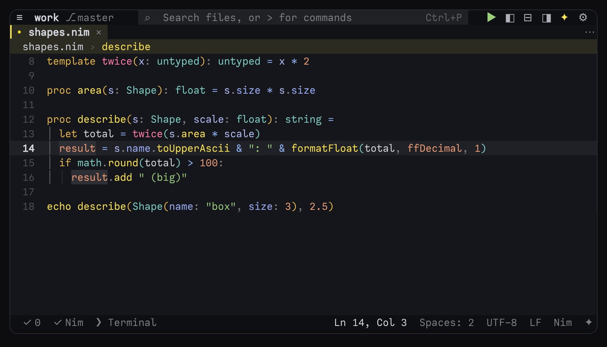

**Smarter colours.** Names were coloured by what the engine knows they are; now also by where they stand:
- a routine's **parameters** (and `result`) have a colour of their own inside it, so what comes from outside
  stands out from what the routine makes;
- after a dot, a **field** and a **call** look different (`p.name` · `p.size(n)`); a name that is both somewhere
  and written without a call (`x.len`) keeps the colour its shape gives it rather than a guess;
- **templates and macros** are in the macro colour, not a proc's (`twice(x)`, `check`);
- a **module name** before a dot is in the type colour (`strutils.join`).

**Faster colours.** What the imported modules declare is worked out once and kept while they stay the same;
after an edit only the file's own names are gone through again. *Nim: language server status* shows how long the
last update took.

**The engine knows more.** The same questions to ned's engine and to nimsuggest on the 23 files of the
comparison ([tests/engine](tests/engine)), 6.0 → 6.1:

| | 6.0 | 6.1 | nimsuggest |
|---|---|---|---|
| member completion: the member written there is offered | 88.9% | 90.5% | 73.8% |
| type hints: the same as nimsuggest's | 91.1% | 93.0% | — |
| go to definition: the same place | 94.0% | 94.6% | — |
| a variable's type: the same | 90.0% | 90.7% | — |

What it learned:
- **types declared inside a routine** — `type Date = tuple[year, month: int]` in a proc — their fields after a
  dot, hover and go to definition (member completion in `times.nim`: 99 → 114 of 120);
- **routines declared inside a routine**, called with a dot (`shape.addQuadratic(…)`);
- a receiver that **starts on an earlier line** (`{"a": 1,⏎ "b": 2}.toTable`);
- **arithmetic on two number types** gives the wider one (`uint8 * uint32` is a `uint32`), a bare number takes
  the other side's type (`1 / x.float32` is a `float32`, `0 ..< n` with `n: int32` a slice of `int32`), and an
  operator on another type asks that type (`(prev + next) / 2` on vectors is a vector);
- **types as receivers**: `float32.high`, `Color.low`, `high(int8)` are of that type;
- `newException(ValueError, "…")` is a `ref ValueError`; `@({"a": "b"})` a `seq[(string, string)]`; a routine
  that returns a `ref` says so;
- an integer converts to an enum with a dot (`i.Color`, offered after `i.`).

**Light and quick.** On the Nim compiler's own `sem.nim` (123 files with what it imports), measured with
`tests/engine/bench.nim`: ned's engine reads everything in 0.16 s, answers again after an edit in 5 ms and lists
completions in 7 ms, holding 17 MB. nimsuggest (which nimlangserver runs underneath) takes 8.5 s for its first
answer and then 0.5 s, holding 460 MB.

**For working on the engine:** `NED_NS_CACHE=/tmp/ns tests/engine/corpus.sh /tmp/out` keeps nimsuggest's answers,
so comparing a new build of the engine over the whole corpus takes 15 seconds instead of an hour, and
`tests/engine/bench.nim` times the engine on your own code (cold, after an edit, completion) with the memory it
holds.

## What's new in 6.0

**ned is a project now, not one file.** The 53 000 lines of `ned.nim` are about 215 files in `src/`, one subject
each — the file tree, the menus, the find widget, the Nim index's type inference, the clangd bridge, the
assistant's MCP client — grouped in folders (`core`, `editor`, `ui`, `nim`, `lsp`, `ai`, `git`, `term`, `debug`,
`c`, `format` …; [the layout](README.md#the-source)). Finding your way around, or sending a patch, is easier.
- Still the standard library only, still one binary, built with one command: `nim c -d:release src/ned.nim`, or
  `nimble release` / `nimble termux` / `nimble install` as before.
- The parts that stand on their own are **modules**: the Nim index (`ned/nim/index`), the formatters
  (`ned/format/formatters`), the regular expressions (`ned/editor/regex`) and the text measuring they share
  (`ned/core/text`). They compile to C of their own, in parallel with the rest, and other programs can use them:
  `import ned/nim/index` gives you ned's Nim engine as a library.
- The engine follows `include`s up to three folders up, so ned keeps completion, hover and go to definition across
  ned's own files (and any project laid out like it). A forward declaration in one file and its body in another are
  one routine: hover shows it once, not as two overloads.

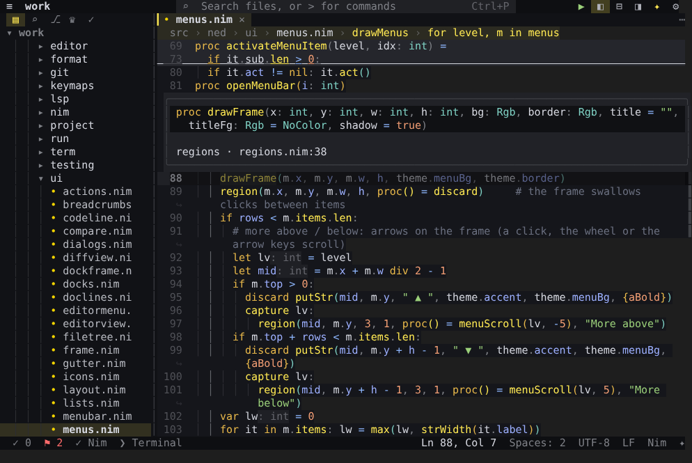

**The tests are in the repository**, with a GitHub workflow that runs them on every push
([tests/README.md](tests/README.md)):
- `nimble test` — unit tests of the Nim index, the formatters (formatting ned's own source a second time changes
  nothing) and the regular expressions;
- `tests/ui` — the UI suite: the whole editor driven through tmux, about 730 checks of every feature, with a
  mock AI server that answers like the real APIs. The tools some tests need (language servers, clangd, gdb, fish,
  an SSH server) are used when installed, and their tests skipped — saying what they need — when not;
- `tests/fuzz` — the fuzzer: random keys, mouse events, pastes, palette commands and resizes;
- `tests/engine` — ned's Nim engine against nimsuggest (the numbers in *How good it is*);
- `tests/build/cross.sh` — Linux, macOS and Android builds from one machine (with zig).

**Safer:**
- **Libraries open read-only.** Go to definition often lands in the standard library or in an installed nimble
  package, and a stray key followed by a save would change it for every project. Those files now open read-only:
  the status bar says *Read-only*, and a click on it (or palette › *File: allow editing this file*) unlocks the
  file. The project you have open is never locked — working on Nim itself or on a package in place is unchanged.
  `files.protectLibraries: false` turns this off.
- The private temporary files of a ned that was killed (the unsaved text it was checking) are removed at the next
  start.
- Fixed (found by the fuzzer): vim's `f` `t` `F` `T` `;` `,` and `b` with the cursor past the end of a line that a
  change elsewhere had shortened; any cursor left past the end of its line is put back on the text before a key
  moves it.

## What's new in 5.29

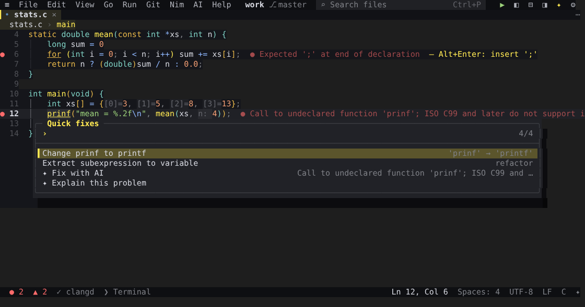

**clangd's "(fix available)", made usable.** ned asks language servers to send their fixes with the problems
(clangd does), so the line says what Alt+Enter will do — `● Expected ';' at end of declaration — Alt+Enter:
insert ';'` — and a click or tap on it does it.
- Alt+Enter on the line where the `;` is missing finds the fix, though clang reports the problem where the next
  statement starts.
- A fix clang names after a note ("'printf' declared here") is titled by what it does — *Change prinf to
  printf* — and each fix shows what it changes (`'prinf' → 'printf'`, `insert ';'`). The same fix is no longer
  listed twice, and the one the server prefers comes first.
- F8 (next problem) and the Problems panel say what the fix is too.

**runnableExamples.** A comment after `runnableExamples:` no longer hides the block: the ▶ is beside it again
and *Run the examples here* finds it. What the examples print is shown in a popup when they pass (failures go to
the Output panel, on their lines, as before).

**Menus fit a 10-inch screen.** A menu taller than the screen scrolls (wheel, arrow keys, PgUp/PgDn, or the ▲ ▼ on
its frame), and the Nim and Git menus are shorter: their tools are grouped in submenus (*Run*, *Inspect*,
*Refactor*, *Documentation*, *Toolchain*, *Language server* · *Stage*, *History*, *Compare* …).

**5 themes from vim**: `molokai`, `jellybeans`, `iceberg`, `sonokai` and `papercolor-light` (Alt+T).

## What's new in 5.28


**nimsuggest is off by default: ned's engine does the whole job.** Completion, hover, go to definition,
type definition, implementations, type hierarchy, references, rename, signature help, type hints, the outline
and quick fixes come from ned's own index; errors while you type and macro expansion from `nim check` on the
unsaved text. Nothing has to start, compile the project or hold it in memory first. `"nim.nimsuggest": true`
turns nimsuggest back on as a second opinion for what the index cannot tell. How the two compare is in
[the Nim IDE section](README.md#nim-ide-the-built-in-engine).

**Navigation without a language server.**
- **Type hierarchy** (*Type hierarchy* in the palette): what an object type inherits from, up to `RootObj`,
  and every type in the project that inherits from it, indented by depth. On a variable, its type's.
- **Go to implementation**: on a `method`, every override for its type and the types below it; on a type, the
  types that inherit from it. An override's reference count includes the calls of the method it overrides,
  which dispatch to it.
- **Operators**: hover, go to definition and Find references on `+`, `==`, `$`, `+=`, `-x` … pick the overload
  the operands' types call. The references of your `` `+` `` for `Vec` are the `a + b` of `Vec`s, not
  `1 + 2`, and its declaration gets a count beside it like any proc.
- **Fields in constructors**: in `Vec(x: 1)`, `x` is the field — Find references and rename include it, and a
  variable `x` that is also in scope is not mixed up with it.

**Code actions (Alt+Enter).**
- **Fill in the missing fields** in an object constructor: `Item(name: "x")` gets every field not given yet,
  inherited ones too, each with a value of its type — `0`, `""`, `@[]`, `false`, the enum's first value, or the
  default the type declares. When the call is written one argument per line, so are they.
- **Write its body** on a forward declaration nothing implements yet: its header with `discard` as the body, at
  the end of the file.

## What's new in 5.27

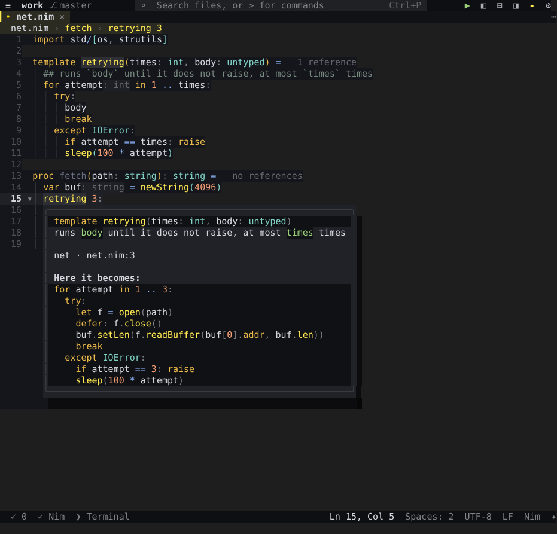

**Templates and macros written out — no nimsuggest needed.**
- **Alt+M on a template call** shows it written out, with the arguments in place, at once: `sq(3 + 1)` is
  `(3 + 1) * (3 + 1)`, and a template taking a block gets the block where its body says `body`. Named arguments
  and defaults are filled in, and names joined with backticks (`` `lower 2` ``) are joined up.
- **Hover on a template call** shows the same, under its documentation: *Here it becomes:* …
- **Alt+M on a macro call** asks the compiler: `nim check --expandMacro` on the unsaved text (from stdin, in the
  file's folder), and shows the expansion of the call under the cursor — `twice: echo "hi"` becomes
  `echo ["hi"]` twice.

**Completion.**
- **Arguments by name**: inside a call, where an argument starts, its parameters are offered as `timeout = `,
  `retries = ` — the ones not given yet.
- **`of` in a `case`** on an enum offers its values, the ones that already have a branch last; so does `x == `.
- **Inside `fmt"{…}"`** and `&"{…}"`, the code in the braces completes like any other.
- **Signature help picks the overload that fits** the arguments written so far: `show(2.5, ` shows
  `show(x: float, digits: int)`, not the first `show`.

**Hover.**
- **A constant's value, worked out**: `const BufSize = 4 * KiB + 16` shows `= 4112`; strings joined with `&` too.
- **A selection's type**: select `a & $b`, Alt+H: `a & $b: string`.

## What's new in 5.26

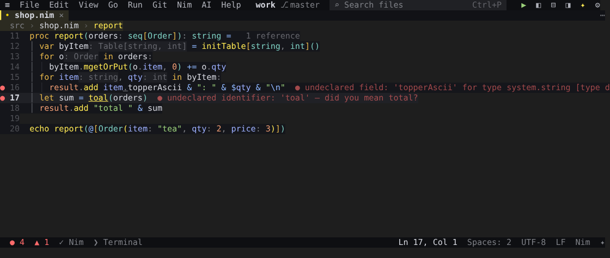

**Errors while you type, from the compiler itself — no nimsuggest needed.** After a pause in typing, ned hands
the unsaved text to `nim check`. It reads the module from stdin, in the file's own folder, so it sees what a check
of the saved file would: the same imports (relative ones too), the same `nim.cfg` and `config.nims`, the same
nimble packages. What it says is shown on the lines as you left them. Nothing is saved for it; the copy it reads
is private to ned and removed afterwards.
- The errors are the ones `nim c` would give — no stale state to go wrong, as nimsuggest's can.
- A project file shows its errors as soon as it opens, before any edit.
- A big project whose check takes over 10 s is checked while you type by nimsuggest instead, when it runs (it
  keeps the project in memory). `"nim.liveDiagnosticsFrom"` chooses: `auto` (this), `compiler` or `nimsuggest`.
- A file another one `include`s is checked on save, through its includer, as before.

**A misspelled name, at once.** Before the compiler has answered, ned's engine marks a name that nothing
declares and that is a letter or two — or two swapped letters — away from one that is declared:
`toal` → *did you mean total?*, and Alt+Enter changes it. It speaks up only where it is sure: not in templates
or macros, not in a `when` branch, not in what a template call is given, and not for a name written anywhere
else in the file or in the modules it imports. Over the whole standard library, the compiler, the corpus's nimble
packages and Nim's own test suite (2 500 files) it found nothing to complain about.

**Quick fixes.**
- An undeclared field (`s.topperAscii`): Alt+Enter offers the members ned knows for `s`, the closest first —
  *Change to toUpperAscii*.
- The fixes for the problem on the line come first, before the refactorings the word under the cursor allows;
  *Change signature* and *Inline* are offered for the project's own procs only (not for `echo`).
- *Change to …* no longer suggests words from strings and comments.

**Also.**
- A type hint after a name the compiler says is unused is shown again (fading the name hid it).
- Type hints that run out of time the first time round, while the imported modules are read, are finished on
  the next rounds instead of staying half done.
- `when defined(windows) and not someConst` is known to be false (a constant used to make the whole condition
  unknown).

## What's new in 5.25


**Types everywhere, without nimsuggest.** ned's own engine now knows the types of far more of a program, so
the hints beside each `let`, completion after a dot and hover need nimsuggest less:
- **loop variables** get hints too — `for p: Person in people`, `for name: string, p: Person in byName` — from
  a type's own `items` and `pairs` iterators (`for key, val in headers`) and through aliases
  (`Config = OrderedTableRef[…]`);
- **values over several lines**: `let x = if c:` … `else:` …, `case`, `try:`, `block:`, and `let x =` with
  the value on the next line;
- **literals and conversions**: `[Person(…), Person(…)]` is an `array[2, Person]`, `{'0'..'9'}` a
  `set[char]`, `10'i64` an `int64`; `fd.AsyncFD`, `5.Natural`, `BiggestUInt 1`;
- **arithmetic as Nim types it**: `5 * x` has x's type, `n - 1` of a `Natural` is an `int`, `len-1` and `60*60`
  need no spaces;
- **overloads by all their arguments**: `sock.recv(10)` is a `string` and `recv(sock, buf, 10)` an `int`;
  `Time - Duration` is a `Time` and `Time - Time` a `Duration`; a generic bound by a later argument
  (`convert(Seconds, Nanoseconds, x)`) or through an alias (`Vec2 = GVec2[float32]`: `v.x` is a `float32`);
- **routines inside routines** (their parameters and `result`), headers over two lines (`{.multisync.} =` on
  the next one), an async proc's `result` (what its Future holds), a macro's `untyped` arguments (`NimNode`);
- **what a template declares**: `genVecConstructor(vec, Vec, float32)` makes `vec2`, `vec3` … with their
  types, for completion and hover; go to definition lands on the line that calls the template (and rename says
  to rename it there);
- **`when defined(…)` follows `nim dump`**: a symbol the project does not define is false, so a library's
  branch for another configuration (vmath has three kinds of vectors) is left out instead of mixed in;
- an `import` with its modules on the lines below it (as the compiler's own sources write it) is followed;
- on a declaration's own name, hover and go to definition give that declaration (this overload, this field);
- type hints stay on a long line that wraps.

**Measured against nimsuggest.** The same questions to both, on 23 files — the standard library
(`json`, `strutils`, `tables`, `os`, `times`, `httpclient`, `asyncdispatch` …), nimble packages (chronos,
jsony, pixie, jester, cligen, karax, vmath) and the compiler (`semexprs`, `lookups`):

| | 5.24's engine | 5.25's engine | nimsuggest |
|---|---|---|---|
| type hints: the same as nimsuggest's | 49% | **91%** | — |
| go to definition: the same place | 88% | **94%** | — |
| a variable's type: the same | 77% | **90%** | — |
| member completion: the member written there is offered | 66% | **89%** | 74% |
| time for one question | 0.5 ms | 0.6 ms | 250 ms |

ned also shows 1 698 type hints where nimsuggest shows none (loop variables, mostly). Where the two disagree,
nimsuggest is not always the one that is right: it answers nothing inside many templates.

nimsuggest crashed 52 times on these files (it was started again each time). The comparison is in
[.github/ci/engine](.github/ci/engine) — `./build.sh && ./compare.py yourfile.nim` runs it on your code.

**Completion.** Pragmas the file and its include files define (`{.pragma: rtl, …}` → `{.rtl.}`); after `x.` on
a number, the distinct number types in scope (`.AsyncFD`, `.SocketHandle`).

**Find references: one row per line.** A line that names it twice is listed once, with both uses marked.

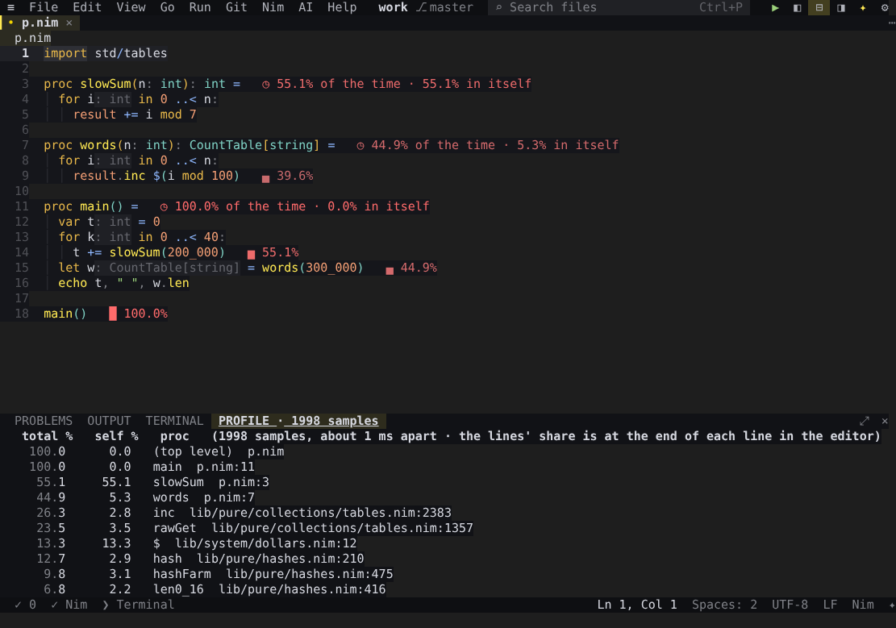

**Profiler.** *Nim: profile* builds the program with a sampling profiler (about every millisecond it notes where
the program is), runs it, and shows:
- beside each proc, the share of the time spent in it and in what it calls, and in itself:
  `◷ 64.0% of the time · 64.0% in itself`;
- at the end of a line that calls something, its share: `▆ 64.0%`;
- in the panel, the procs that took the most time, the standard library's too (Enter or a click goes there).

The program is built with `--profiler:on --stackTrace:on --lineTrace:on`, in release mode otherwise. *Nim: show
the profile* brings back the last one, *Nim: hide the profile* takes it away. A file changed since it was
profiled shows no numbers (they would point at the wrong lines).

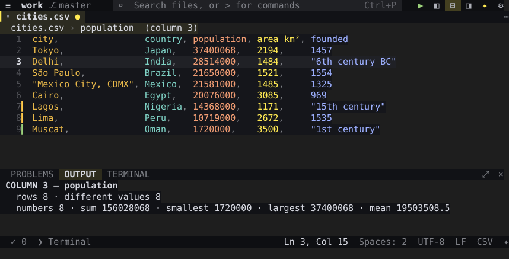

**CSV and TSV files as tables.**
- The columns are lined up on screen; the file itself is not changed (`"csv.alignColumns": false` turns it
  off). Quoted fields with commas in them count as one.
- The breadcrumbs show the column the cursor is in by its heading: `population  (column 3)`.
- *CSV: sort by this column* (and *…, largest first*): numbers by their value, words with numbers in them in the
  order people read them (`box 2`, `box 9`, `box 10`); the heading row stays on top; Ctrl+Z undoes it.
- *CSV: summary of this column*: how many values, how many different, and for numbers the sum, smallest,
  largest and mean; for words, the most common.

## What's new in 5.24


**Logpoints.** *Debug: logpoint on this line…* prints a message each time the line runs, without stopping:
`{o.qty} × {o.price} = {cost}, total was {total}` shows those values in the Debug panel's output. A ◇ marks the
line; F9 takes it away. With gdb (Nim), ned works out each `{expression}` itself — locals, their fields and the
program's globals by their Nim names. Through the Debug Adapter Protocol, an adapter that has logpoints
(debugpy, delve …) prints them, and for one that has none, ned does it. Logpoints are kept with the folder's
session, like breakpoints.

**Stop when a value changes.** *Debug: stop when this changes…* (a variable or a field, `p.count`) stops the
program right after it changes and says how: *‖ stopped: total changed (6 → 11) at shop.nim:10*. With gdb these
are hardware watchpoints — a global can be watched before the program starts (F5 then debugs even with no
breakpoint), a local once the program has stopped in its function. Through DAP they are data breakpoints, where
the adapter has them. The Debug panel lists them under *Stop when it changes*; Enter removes one.

**Format everything.**
- **Built-in formatters for JSON, Markdown and CSS**, used when no formatter of their own is installed (no
  prettier on a phone). JSON gets one member per line, with comments kept and every number written as it was
  (`1e5` stays `1e5`, big integers stay whole). Markdown gets its tables lined up. CSS gets one declaration per
  line, `prop: value;`, with `url(…)` left alone. Each one checks that only the layout changed, as the Nim
  formatter does.
- ***Format: every file in the project…*** (or *Format the files in this folder…* in the Files dock) formats
  every file the way Alt+F would. It works in the background, then lists the files that would change: format
  them all, look at one side by side, or leave it. Files open in the editor change there (save them); the others
  are written with a copy in the local history, and the toast's *Undo* puts everything back. What git ignores
  stays out, and so do `node_modules`, `nimcache` and other build folders.
- **The code in a Nim string**: in a `"""…"""` holding JSON, CSS, HTML, SQL or the C of an `{.emit.}`,
  Alt+Enter offers *Format the JSON in this string* (or *Format: the code in this string* in the palette). The
  text is formatted as that language (clang-format for C, prettier for HTML when installed) and put back at the
  string's indentation.
- **Format on save for some languages only**: `"editor.formatOnSaveLanguages": ["nim", "json"]`.
- **From the shell, for folders too**: `ned --format src/ README.md` formats Nim, JSON, Markdown and CSS files in
  place; `--check` only lists them.

**Nimble: dependency tree.** What the project requires, what each of those requires in turn, and the version
installed for each, read from the installed packages (`pkgs2`, `pkgs`, `nimbledeps/`, atlas's `deps/`):

```
├── nim >= 2.0.0                            2.2.12 ✓  (the compiler)
├── jsony >= 1.1.0                          1.1.5 ✓
└── chronos ^= 4.0                          4.0.3 ✓
    ├── results                             0.4.0 ✓
    ├── bearssl >= 0.2.5                    ✗ not installed — Enter installs it
    └── httputils                           0.3.0 ✓
        └── stew >= 0.3.0                   0.2.0 ✗ does not meet >= 0.3.0 — Enter installs one that does
```

Enter on a package opens its `.nimble` file; on a missing or too-old one, it offers `nimble install`. Nimble's
version rules (`>=`, `^=`, `~=`, `&` …) decide what counts as meeting a requirement.

**Also.**
- *Nim: exports nothing uses…* stops early when ned's terminal goes away.
- In a debug session, a value at the end of a line is no longer a bare address (`o = 0x7ffff…`): an object
  passed by pointer shows in the Variables list, where ▸ opens it.

## What's new in 5.23


**Files pulled in with `include` are understood.** A Nim file that another one `include`s has no imports of its
own: it sees what its includer sees. Now ned knows that too. Completion, hover, go to definition, type hints and
reference counts in such a file use the includer's imports, its declarations (the private ones too: it is all
one module) and its other include files. A proc used only in a sibling include file is counted, and F12 goes
there. ned looks for the includer in the file's folder and the one above it. In the Nim compiler's sources,
`discardCheck` now shows 9 references, as `grep` does (7 before).

**Type hints from ned's own engine.** A `let`, `var` or `const` written without a type shows it after the name —
`let found: seq[string] = wordsOf(text)` — worked out by the built-in engine for the lines on screen, at once and
without nimsuggest. They used to come from nimsuggest, which took seconds in a big file and never answered on a
phone with `"nim.nimsuggest": false`. `let (u, v) = …` gets one type per name. `"nim.typeHints": "nimsuggest"`
takes them from nimsuggest as before; `editor.inlayHints` turns them off.

**The engine knows more types:**
- `system`'s file procs — `readFile`, `writeFile`, `stdin`, `open` … (`std/syncio`, which `system` exports; the
  engine assumed `-d:nimPreviewSlimSystem` and missed them);
- `/` of two integers is a `float`, `a ..< b` an `HSlice`, `flags and 0xFF` an `int` (not a `bool`);
- a literal's methods: `"a,b".split(',')` is a `seq[string]`;
- overloads by their number of arguments: `stdin.readLine()` is a `string`, `readLine(f, s)` a `bool`;
- generic constraints: `toHex[T: SomeInteger]` is not offered after the `.` of an object;
- what your project's config defines (`-d:ssl` …, as `nim dump` reports it) for `when defined(…)`.

**Fixes.**
- A Nim character literal holding a quote — `'"'` — was coloured as the start of a string, and with a `"""` later
  on the line everything below it became a string too: in `ned.nim` itself, almost 12 000 lines. Character
  literals are coloured as characters now, and `'('` no longer counts as a bracket.
- After a save, nimsuggest could go on reporting errors that were already fixed: it was not told that the file
  had changed unless some other request had passed it the unsaved text first. It is now handed the saved file
  once.
- Go to definition, references and rename could pick the wrong column when the declared name also appears inside
  an earlier word on its line (`let t` found the `t` of `let`). The name is matched as a whole word.

## What's new in 5.22

**A big file shows at once.** Opening `ned.nim` itself (48 000 lines) took 120 ms to the first frame; now
23 ms. What used to run before the file showed — checking its C wrappers against their headers, and the
whole-file parse behind the names' colours — runs a moment later, while ned is idle. The Nim engine reads a file
about a third faster (fewer copies while it splits each line), and the TODO and C-wrapper scans skip the lines
that cannot matter.

**Less memory in big projects.** The reference counts (5.19) kept the text of every Nim file in the project, and
where each word is: with a file of the Nim compiler open, ned grew to 100 MB. Now only which words each file uses
is kept, and a file is read again when a count needs it — 26 MB there in all. Forward declarations no
longer get a count (their callers are often in files they include).

**Format from the shell.** `ned --format file.nim …` formats Nim files in place with the built-in formatter
(nph's style, with the same safety check as in the editor); `ned --format --check …` only lists the files it
would change and exits with 1 — for a CI step or a git pre-commit hook.

**How fast, measured.** 5.21 against 5.22, from outside (the time until the status bar is on screen; a 2-core
Linux VM, the median of five runs):

| | first frame, 5.21 | 5.22 | memory, 5.21 | 5.22 |
|---|---|---|---|---|
| an empty folder | 10 ms | 8 ms | 7 MB | 7 MB |
| `ned.nim` (48 000 lines) | 120 ms | 23 ms | 18 MB | 19 MB |
| `compiler/sem.nim` in Nim's source tree, after 20 s | 38 ms | 32 ms | 102 MB | 26 MB |

`ned --startup-time [file …]` shows where the time goes on your machine: it starts as usual, quits once
everything has settled, and prints each step, the memory, and what the Nim engine has read:

```
$ ned --startup-time ned.nim
ned 5.22.0 — startup (ms since the program started)
  settings                           0.8   +0.3
  …
    opened ned.nim                   8.4   +7.5
  files opened                       8.7   +0.3
  first frame                       13.0   +2.0
  settled                          313.8   +300.9
  memory first frame                13.1 MB
  memory settled                    18.5 MB
  Nim index: 1 module, 4180 names, docs 69 KB, other text 100 KB
```

**A performance check in CI.** `.github/ci/bench.py` runs those startups (five times each; the median counts) and
`ned --bench` (time per frame), and fails the build when a number goes over `.github/ci/bench-budget.json`; the
numbers also go to the job's summary. `nimble perf` runs it on your machine.

## What's new in 5.21

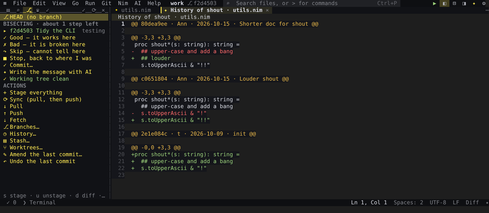

**Remote folders, finished.**
- **Any login shell on the server.** What ned runs there — saves, git, Run, tasks, the assistant's commands —
  goes through `sh`, so an account whose login shell is fish (or tcsh, nushell …) works like any other. The
  terminal still opens your own shell.
- **Changes on the server come over by themselves.** Every 10 seconds (`remote.autoSync`), files changed on the
  server — by a build, a formatter, git or someone else — are copied into the local copy; open tabs without
  unsaved changes reload, and one with unsaved changes says the file changed on disk when you save it. After Run,
  a task or one of the assistant's commands this happens at once.
- **The assistant's commands run on the server**, once your saves are there, and what they change is copied back
  before it reads on.
- Run waits for saves still on their way to the server, and Output shows the command as you typed it (*on host*).

**Git.**
- **History of these lines** (right-click › Changes, the Git menu, the palette): every commit that changed the
  selection — or the Nim proc the cursor is in — each with the diff of just those lines (`git log -L`). Enter on
  one opens the commit.
- **Find the commit that broke it (bisect).** Pick a commit where it still worked. Then say *Good*, *Bad* or
  *Skip* in the Git dock at each step (it shows how many steps are left and which commit is being tested) — or
  give a command that succeeds when it works (`nimble test`, `! grep -q broken out.txt` …) and git runs it at each
  step. Once found, ned shows the commit and takes you back to where you were.
- **Worktrees…** — list them, open one (or add it to the workspace), make one for a new or an existing branch in
  a folder of its own, remove one, prune.
- **Submodules…** — each with its state (not checked out, at another commit, up to date): update one or all,
  record its current commit, add one. Checked-out submodules show in the Git dock as repositories of their own.

**Also:**
- Fixed: *Format* (the built-in Nim formatter) refused some files — `ned.nim` itself among them — with "would
  change the block structure". A field list with a long comment after it (`a, b, c: string   # …`) was wrapped
  as if the comment were code, and fields of a `type X = object` written on one line were not read as fields
  once wrapped. Now the comment goes on the line below and the fields wrap like nph's. Also fixed: a comment
  between a type section's members (it ended the section for the formatter), `const ## doc` on one line, import
  paths written `.. / x`, and a `;` before `)`. Every file of the Nim compiler and standard library now formats
  (in Nim's whole source tree, with its tests, 41 of 4 292 files are still left alone — 56 before).

## What's new in 5.20

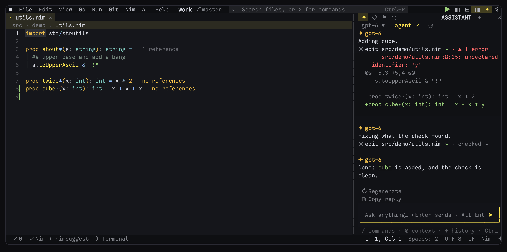

**The assistant checks its own edits.** After the agent edits files, ned checks them before the results go back
to the model: Nim with `nim check` — the edited module and the project's main module, so a changed proc that
breaks its callers shows up too — Python with ruff or py_compile, JavaScript with `node --check`, shell with
`bash -n`, Rust with `cargo check`, Go with gofmt, C and C++ with the compiler's `-fsyntax-only`. The errors go
back with the edit's result, so the model fixes its own mistakes before it says it is done. The chat marks each
edit *checked ✓* or *▲ 2 errors* (a click shows them, with the diff). `ai.checkEdits: false` turns it off.

**Tests from the AI, kept only when they pass.** *AI: write tests* on a Nim file (palette, the editor's AI menu,
or *Write tests* in an empty chat): the model writes `tests/test_<module>.nim` with std/unittest — for the
exported proc the cursor is in, or for the whole module — and ned compiles and runs it before you get it:
- a file that does not compile goes back to the model with the errors (twice at most), and is removed if it
  still does not;
- a test that fails is taken out: either it expects the wrong thing or the code has a bug, so the failed ones open
  in a tab with what they got (*twice(-1) was -2*) — worth a look;
- what is left runs once more and is kept only when it passes; the Tests dock shows ✓ beside each test.

For other languages *Write tests* asks the assistant in the chat, as before (and its edits are checked).

## What's new in 5.19

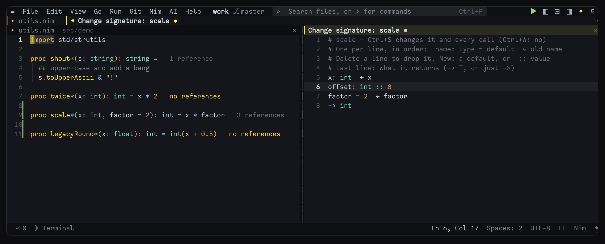

**Reference counts.** After each top-level proc, func, template, macro, iterator and type in a Nim file, dimmed:
*3 references* — counted by the built-in engine the way *Find references* counts (the name resolved at each
place, not just matched), for what is on screen, while you are not typing. A click lists them. An exported one
that nothing in the project uses says *no references* in yellow. *Nim: exports nothing uses…* lists all of them
in the project — procs, types and consts to un-export or delete. `nim.referenceCounts: false` (or *Nim: toggle
reference counts*) turns the counts off.

**Change signature.** Alt+Enter on a proc's name or on a call of it › *Change signature of scale…* opens its
parameters, one per line:

```
x: int  ← x
offset: int :: 0
factor = 2  ← factor
-> int
```

Move lines to reorder, rename (`← factor` says which parameter the line was), change a type or a default,
delete a line to drop that parameter, add one with a default or with `:: value` — what every existing call
passes — and change the return type on the last line. **Ctrl+S** rewrites the declaration, its forward
declarations, the uses of a renamed parameter in the body, and every call in the project: arguments move with
their parameters, dropped ones go, and once one is left out the rest are passed by name. What ned cannot rewrite
safely (command syntax `scale x`, arguments that do not match, a dropped parameter the body still uses) is
listed to do by hand.

**Inline a proc.** *Inline twice* replaces each call of a proc, func or template whose body is one expression
with that expression, the arguments in place of the parameters (parenthesized where needed). The imports the
body needs are added to the files the calls are in. A call whose argument would then run twice, or in another
module when the body uses something private, is left and listed. Once no call is left, ned offers to delete the
declaration.

**Move to another module.** On a top-level proc or type: *Move scale to another module…* › a project file or
*New module…*. The comments above it go along, the imports it needs too; it is exported when other modules use
it, and they import the new module. If it uses private things of its module (they would import each other),
ned says which to move first.

All of them are in the editor's right-click menu under *Refactor* and in the palette (*Nim: change signature…*,
*Nim: inline this proc*, *Nim: move to another module…*). The edits land in tabs: Ctrl+Z undoes one file's,
*Save all* saves them.

**Also:**
- The built-in engine resolves a parameter used in a one-line routine (`proc f(x: int): int = x * 2`): go to
  definition, hover and references on that `x` work.
- Fixed: lists where you pick one of several things acted on the last one, whichever you picked — saved
  macros, a terminal's commands (and a click on a command's ● when several are on screen), debugger watches and
  expanded variables, C headers to wrap, and MCP resources attached to the same message.

## What's new in 5.18

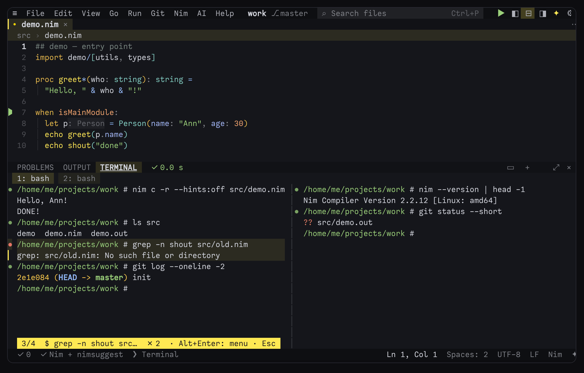

**Keyboard macros.** **Alt+Shift+R** records what you type, **Alt+Shift+R** again stops, **Alt+Shift+M** plays
it back. *Edit › Macros* also plays it N times, once on each selected line, or again and again down to the end of
the file; a playback undoes in one step. *Save the last one…* keeps it under a name: it becomes the command
*Macro: <name>* (give it a key in settings › `keys`), it is kept in `macros.json` (readable: typed text as text,
other keys by name) and Settings sync carries it. The other key bindings have theirs: vim's `qa` … `q`, `@a`,
`3@a`, `@@` · Emacs' `C-x (` … `C-x )`, `C-x e` · Helix's `Q` … `Q`, `q`. While recording (and playing),
completion lists only open with Ctrl+Space, so the keys play back the same way; mouse clicks are not recorded.

**The terminal knows your commands.** bash, zsh and fish mark each prompt, command line, output and exit code
(OSC 133 — ned adds this when it starts the shell; your `.bashrc`, `.zshrc` or `config.fish` is still read):
- a **●** beside each command in the terminal's gutter, **red when it failed**; the panel header shows the last
  result (*✓ 1.2 s* or *✗ exit 2*), and a terminal tab whose last command failed says so;
- **Ctrl+↑ / Ctrl+↓** go from one command to the next (its lines tinted); **Alt+Enter** — or a click on its ● —
  opens its menu: *Copy its output*, *Copy the command*, *Run it again*, *Open its output in a tab*;
- palette: *Terminal: commands…* (the list, newest first), *run the last command again*, *copy the last command's
  output*. `terminal.shellIntegration: false` turns it off.

**Two terminals side by side:** ◫ in the panel header (or *Terminal: split*); a click or **Ctrl+PgUp/PgDn**
moves between them.

**Also:**
- Fixed selecting text in the terminal with the mouse — a click only gave the terminal the focus; now a drag
  selects, and the right-click menu's *Copy* (or Ctrl+Shift+C where the terminal sends it) copies it.
- Fixed: Ctrl+\\ in *Open shell full screen* could close ned along with the shell.
- Fixed: an internal error when a terminal's scrollback was cleared (`clear`) while it was scrolled back.
- Fixed: Enter in quick open (Ctrl+P) while the project's files were still being listed made an empty file of
  the name typed — now it says to wait a moment.

## What's new in 5.17

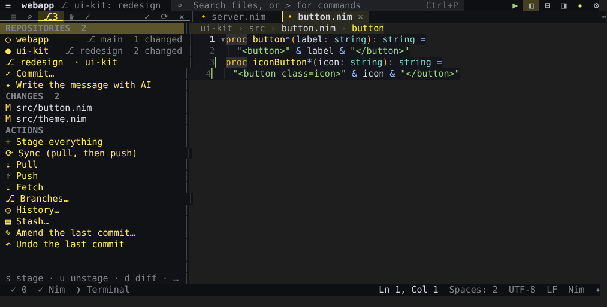

**Git for every folder of a workspace.** When the folders of a multi-root workspace are separate repositories,
the Git dock lists them under **REPOSITORIES**, each with its branch, how many files changed and what is to push
or pull. The dock — and every git command: stage, commit, branches, stash, history, push and pull — works on
one of them at a time: the one you click, or the one of the file you are editing, which the dock follows by
itself. The title bar names it (`ui-kit: redesign`), the commit box says which repository it commits to, and
the Files tree marks changed files in all of them.

**Remote folders over SSH: git on the server, and deletes and renames copied there.**
- Deleting, renaming or moving a file or folder in the Files tree does the same on the server (the question
  says *here and on devbox*), and so do a new folder, a new file, the assistant's file changes and their undo,
  *Add to .gitignore*, a project-wide replace and the other files ned writes there itself.
- When the remote folder is a git repository, git runs **on the server**, on its real repository: the Git
  dock shows the server's branch and changes (*git on devbox*), and stage, commit, branches, stash, merge,
  rebase, pull and push all happen there. What a git command changes in the files — switching a branch, a
  pull, a stash, discarding changes, a merge's conflicts — is copied into the local copy, and the files it
  deletes are removed from it. The change marks in the gutter, blame and the file's history come from the
  server too. A folder that is not a repository yet gets *git init on devbox*.
- *Remote: pull the latest files* now also removes files that were deleted on the server since the last copy
  (never one you saved here since, or one open with unsaved changes).

**Also:**
- *Reveal file in tree* switches the left dock to Files when another view had it.
- In a workspace, the breadcrumbs of another folder's file start at that folder's name.
- In the Git dock, **P** and **L** push and pull like the dock's Push and Pull (a login is asked in the terminal).
- Fixed: *Nim: language server status* could crash ned with nimlangserver before it had a project mapping.

## What's new in 5.16

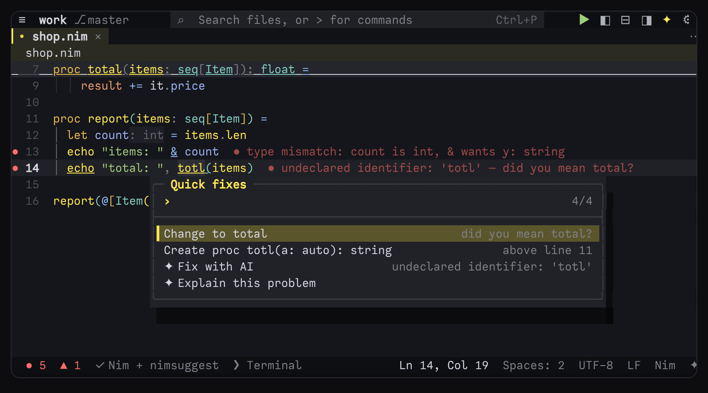

**Quick fixes from the Nim compiler.** Alt+Enter on a line with a Nim error or warning now offers fixes worked
out from the compiler's message:
- `'x' cannot be assigned to` → make its `let` a `var` (for a parameter: a `var` copy at the top of the proc);
- `has to be used (or discarded)` → `discard` it;
- a type mismatch → the argument or value converted: `float(i)`, `$n`, `parseInt(s)` (adding `std/strutils`),
  `s.cstring`, `@arr`;
- `undeclared identifier` → the names close to it (in the file, and the compiler's own candidates); *Export
  hidden from other.nim* when a module of the project has it without the `*`; *Create proc totl(a: auto): string*
  when it is called and nobody declared it — besides *Import std/…* as before;
- `undeclared field` → the type's fields close to it;
- `not all cases are covered` → the missing `of` branches;
- `can raise an unlisted exception` → add it to `{.raises: […].}`, or catch it on that line;
- `ambiguous identifier` → *Use m1.counter* / *Use m2.counter*;
- a deprecated name → the one the deprecation message says to use; a bare `except:` → `except CatchableError:`.

**Fix all like this in the file:** unused results, bare `except:`, unused imports and deprecated names are
fixed everywhere in the file at once, in one undo step.

**AI fixes checked by `nim check`.** *Fix with AI* on a Nim error sends the model the error, the whole top-level
declaration it is in, and the declarations that code uses. Its answer is written into a copy of the file beside
it and checked with `nim check` first, and applied only when the error is gone and nothing new is wrong. When it
does not compile, the model gets the new error and one more try; if that fails too, a toast shows the error and
offers *Apply it anyway*. The copy is deleted after the check.

**Also:**
- The quick-fix list opens beside the line it fixes, as wide as its items, instead of across the top of the
  screen, so the problem stays in view.
- Fixed: an internal error when a hover answer came back after you switched tabs or deleted lines.

## What's new in 5.15

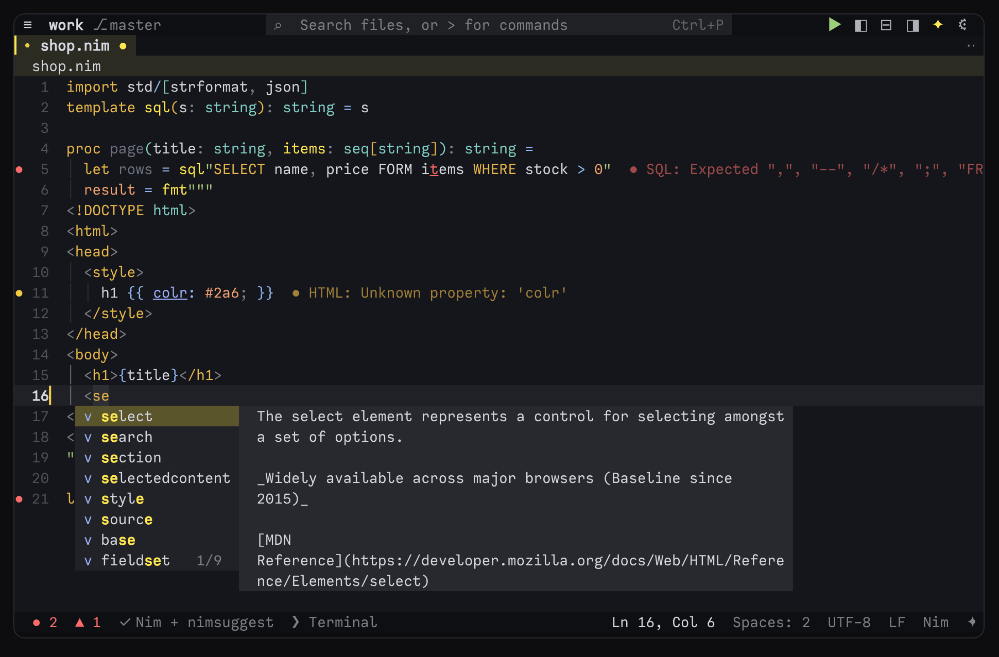

**Code in strings gets its language server.** The HTML, CSS, SQL and JSON that ned colours inside Nim strings
(`fmt"""<html>…"""`, `sql"…"`, `parseJson("""…""")`, a `#[css]#` string …) now go to that language's server
when it is installed:
- **errors and warnings on the `.nim` line:** an unknown CSS property in a page's `<style>`, a SQL syntax error,
  a broken JSON value;
- **completion:** tags and attributes in HTML, properties and values in CSS, keywords (and, with a database
  connection, tables and columns) in SQL;
- **hover**, and the servers' **fixes on Alt+Enter** (*Rename to 'font-weight'*).

strformat's `{expressions}` count as a value, so `margin: {pad}px` is not an error, and `{{ }}` are read as one
brace. Each SQL string is one statement. The servers are the ones ned already uses for those files:
`vscode-html-language-server`, `vscode-css-language-server` and `vscode-json-language-server`
(`npm install -g vscode-langservers-extracted`), and `sqls` or `sql-language-server` for SQL.

**C in emits:** clangd now also gets the `-D` defines from `{.passC.}`, `config.nims`, `nim.cfg` and the
`.nimble` file, and sees one-line emits (`{.emit: "static int n = 0;".}`) and the array form
(`{.emit: ["…", x, "…"].}`).

**Also:**
- `.html` files use `vscode-html-language-server` when it is installed (completion, hover, and the CSS and
  JavaScript inside them).
- The CSS server's quick fixes work in `.css` files too (ned now sends back the problem's code, and runs the
  fix command the server leaves to its client).
- Pictures in documentation popups (the HTML server's "Baseline" badges) are left out instead of shown as
  base64 text.
- A language server that prints to its output besides its messages (sql-language-server's timings) no longer
  loses replies.

## What's new in 5.14

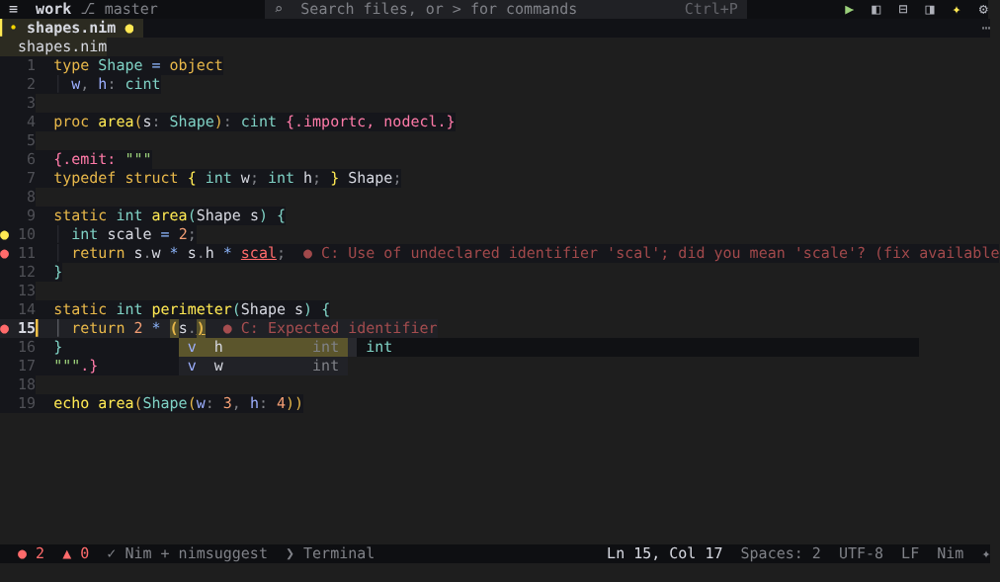

**C in `{.emit.}` through clangd.** When clangd is installed (Termux: `pkg install clang`; Debian/Ubuntu:
`apt install clangd`), the C a Nim file emits gets a real C language server:
- completion as you type, members after `.` and `->` included;
- errors while you type, on the `.nim`'s own lines, with clangd's fixes on **Alt+Enter** (a missing `;`, a
  misspelt name …);
- parameter hints after `(`, hover, and F12 to locals, fields and anything in the headers.

clangd sees the C the way Nim's compiler does: `nimbase.h` first (`NI`, `NIM_BOOL` …), the headers the file's
`header:` pragmas bring in, and the project's include folders. Names the Nim code declares (an `{.exportc.}`
proc called from the C) are not reported as unknown. ned keeps a hidden C copy of the emitted code, on the same
lines and columns as in the `.nim`, so nothing has to be translated. Without clangd, or with
`"nim.emitClangd": false`, the 5.13 features work as before: completion from the headers ned reads itself, and
the C compiler's errors on save.

## What's new in 5.13

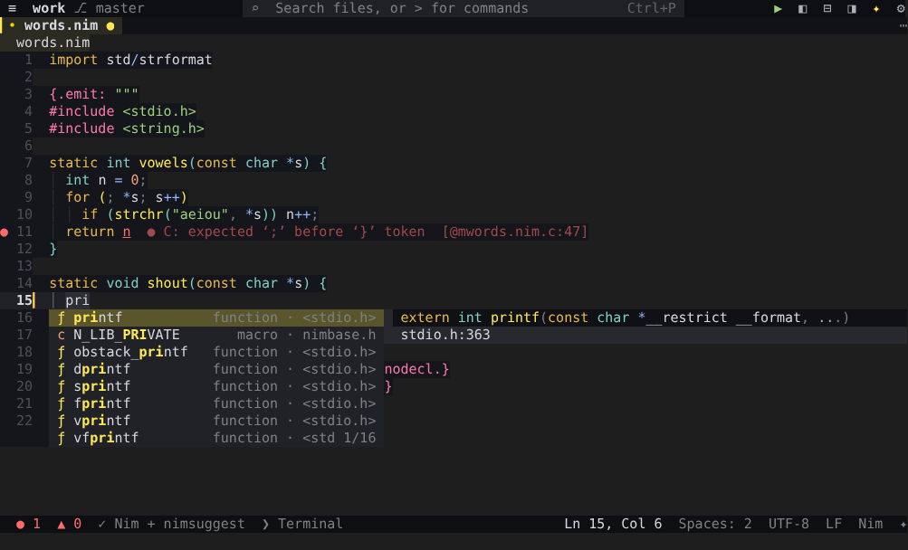

**C inside `{.emit: """…""".}` now edits like C:**
- **Indentation and comments:** Enter after `{` indents, a `}` you type moves back, and **Ctrl+/** comments with
  `//`. The same goes for the other code inside strings: HTML gets `<!-- -->`, SQL `--`, and a Markdown code
  block its own language's comments and indentation.
- **Errors from the C compiler show on your Nim lines.** When you save, ned has Nim write the module's C and
  checks it with the C compiler (`-fsyntax-only`), so a C error appears on the emit's line like a Nim error, and
  goes away once you fix it and save. A build or Run maps its C errors back the same way, instead of pointing
  at the generated file in nimcache. It works with the built-in engine and with nimlangserver.
- **Completion:** the functions, variables and macros the emit defines, everything its `#include`d headers and
  the file's `header:` pragmas declare, Nim's `nimbase.h` (`NI`, `NIM_BOOL` …), and C keywords and types, each
  with its declaration beside the list.
- **Hover** on a C name shows its declaration and where it is; a function the file imports into Nim says so.
- **F12** on `proc twice(x: cint): cint {.importc, nodecl.}` goes to `twice` in the emit (in this file or
  another file of the project), and F12 there comes back. F12 on a use inside the emit goes to its definition,
  in the emit or in a header.
- **The wrapper check covers emitted C:** a Nim declaration that does not match the C function the emit
  defines (`int` for C's `int`, a parameter too many …) gets the same warning and Alt+Enter fix as one that
  does not match its header.

## What's new in 5.12

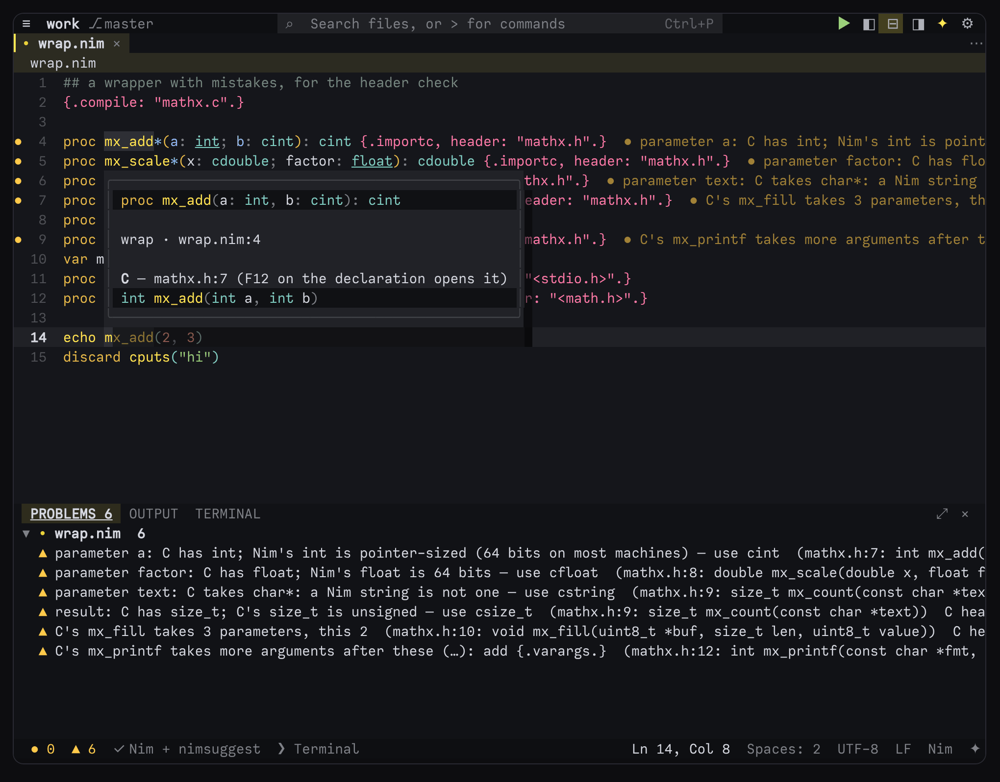

**Nim and C, side by side:**
- **F12 on an `importc` declaration opens its C prototype** in the header, and the hover on any use of it shows
  the prototype. ned looks for the header the way the C compiler does: the file's folder, the project, the `-I`
  flags in `config.nims`, `nim.cfg`, the `.nimble` file and `{.passC.}`, Nim's lib folder, then the compiler's
  own include folders, following the header's own `#include`s.
- **Wrappers are checked against their headers** when a file is opened or saved:
  - the number of parameters, and a missing `{.varargs.}`;
  - `int` for C's `int` (`cint`), `float` for C's `float` (`cfloat`), `int` for `size_t` (`csize_t`);
  - `string` for `char*` (`cstring`), and a value where C takes a pointer;
  - a result where the C function returns nothing.

  Each one is a warning with its fix on **Alt+Enter**. `"nim.checkWrappers": false` turns the check off.
  Functions that a header declares through macros (glibc's `math.h`) are not found, so they are not checked.
- **Completion** in `header: "…"` (system and project headers) and in `importc: "…"` (the functions and macros
  that the header declares).
- *Nim: wrap a C header (c2nim)…* writes the Nim module for a header with c2nim, or sets up futhark. When neither
  is installed, it offers to install c2nim.
- *Nim: write compile_commands.json for clangd* writes the C compiler's commands as Nim builds the project. clangd
  then understands the project's own `.c` files (`{.compile.}`) with the right flags and include folders.

**Fixed:**
- *Find references* on a name used everywhere (`int` in a file of 30,000 procs) froze ned for over 20 s, and for
  minutes when the uses were in files that were not open. It now answers in a few seconds. On a truly huge
  project it stops after 10 s and says the list is incomplete, and *Rename* then refuses rather than rename only
  some of the uses.
- Typing `{.` on the line of a proc gave an internal error from the Nim index.
- Clicking the completion list, or pressing Enter, just as it got shorter gave an internal error.
- Asking the language server for inlay hints just after the text got shorter gave an internal error.

## What's new in 5.11

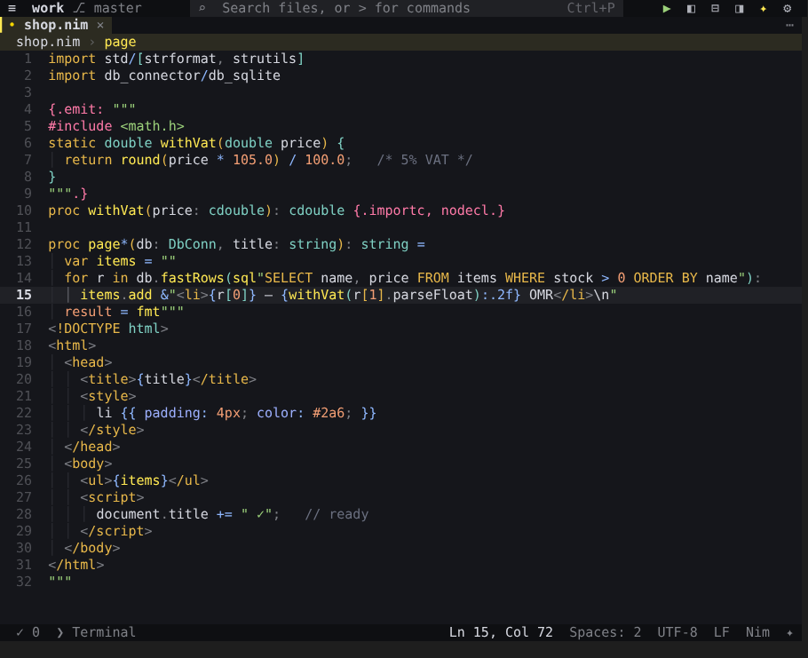

**Code inside Nim strings is coloured as its own language:**
- `{.emit: """…""".}` as C (C++ or JavaScript, following the backend).
- `sql"…"` as SQL, `re"…"` and `peg"…"` as regular expressions and PEGs, `parseJson("…")` as JSON.
- In `fmt"…"` and `&"…"`, the `{expressions}` are Nim.
- A triple-quoted string that starts with an HTML tag is HTML, with its `<style>` as CSS and its `<script>` as
  JavaScript. One that starts with `SELECT`, `INSERT`, `CREATE` … is SQL. In a strformat string, the
  `{expressions}` in that HTML or SQL stay Nim.
- Any other string: put `#[html]#` (or `#[c]#`, `#[sql]#`, `#[css]#` …) just before it.
  `"nim.embeddedLanguages": {"render": "html"}` colours the strings you pass to your own procs.
- Nim's completion and hover stay out of that code.
- **Fixed:** everything after a multi-line `{.emit: """…""".}` was coloured as one long string.

**Also coloured by language now:** Markdown code blocks (```` ```nim ````, ```` ```sql ```` …), `<script>` and
`<style>` in HTML files, and Nim source-code-filter templates (`.nimf`, or `#? stdtmpl` on the first line): the
`#` lines as Nim, the rest as HTML, with `$name` and `${expr}` marked.

**Fixed:** an error stayed after you fixed it and saved, until *Nim: check project*.
- With nimlangserver, the errors from the last Run or build were never checked again.
- With the built-in engine, an error caused by another file stayed after you fixed that file.

After a save, ned now checks again every file that shows an error from a build or check. An error that the
language server and the build both report is counted once.

## What's new in 5.10

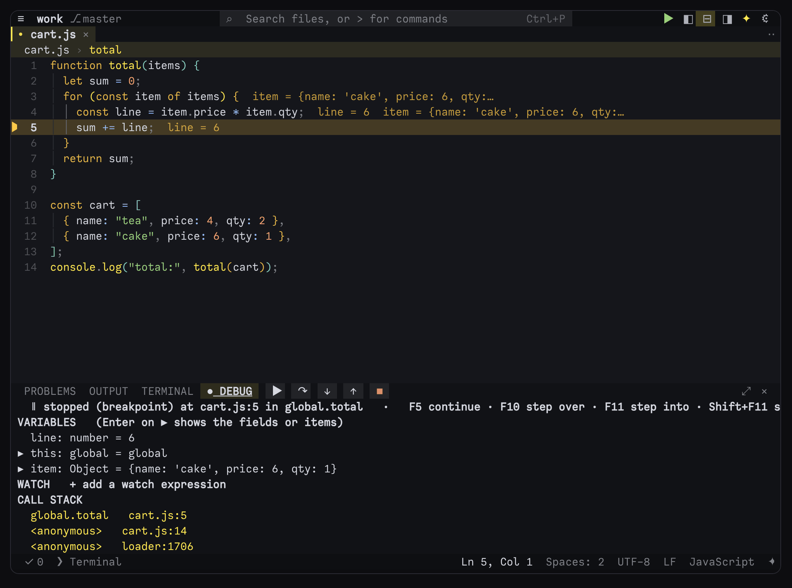

**Debugging:**
- JavaScript and TypeScript debug with **vscode-js-debug** (Node). TypeScript runs as is on Node 22, or through
  `tsx`.
- C, C++ and Rust can use **codelldb** as well as gdb and lldb-dap.
- *Debug: check the debugger for this file* says what F5 will use, whether it is installed and how to get it.
- *Debug: choose…* picks another debugger, and *Debug: install…* installs one in the terminal.

**Large files:** files of 16 MB or more, and files with a line of 10,000 characters or more (minified JSON or JS,
one-line logs), open in **large-file mode**. There is no soft wrap, language server, minimap or word highlight, so
scrolling and typing stay instant. Typing in a 12 MB line no longer copies it. *Large file mode* in the palette turns
it off for one file; `editor.largeFileSize` and `editor.longLineLimit` set the limits.

**Send to REPL:**
- **Shift+Enter** sends the selection, or the statement at the cursor with its whole block, to the language's REPL in
  a terminal tab of its own. The REPLs are `inim` (else `nim secret`), the project's `.venv` Python, `ipython`,
  `node`, `tsx`, `irb` and `lua`.
- In a file with `# %%` cells, Shift+Enter runs the cell and moves to the next one, and a ▶ on each cell runs it.
- *REPL: send the proc / the whole file* sends larger pieces.
- REPLs that take bracketed paste get one paste; others get each line, with the blank lines Python and Nim need to
  end a block.

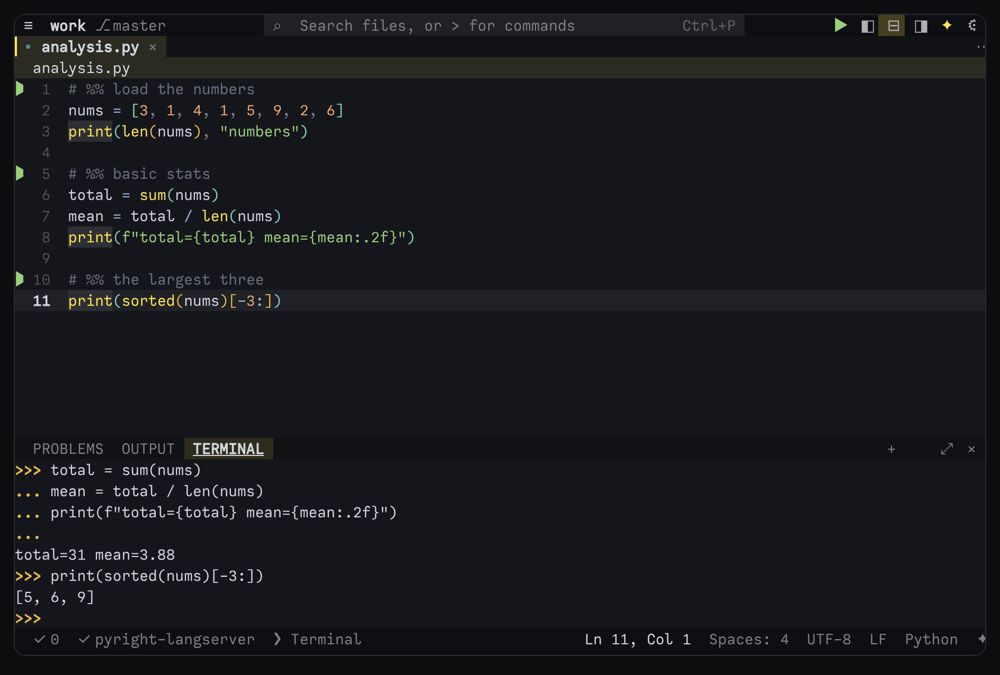

**Merge editor** (*Git: merge editor*, or the button when a file with conflicts opens): ours and theirs side by
side above the result.
- *✓ Accept* on either side, *Accept both*, ◀ ▶ between conflicts.
- The result is the file itself, so you can also edit it.
- Once none are left, *Save and stage*.

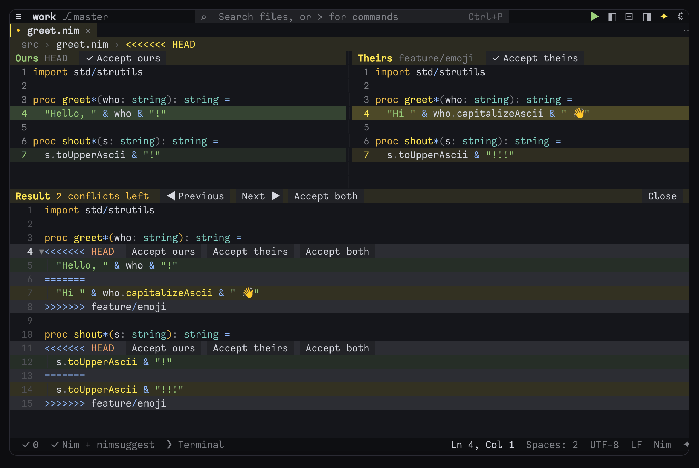

**Spell check:**
- Misspelled words are underlined in Markdown and commit messages. With `"editor.spellCheck": "on"`, comments and
  strings in code are checked too.
- Names your code uses, `code`, URLs and paths are left alone.
- **Alt+Enter** on a word suggests the spelling, adds the word to your dictionary or ignores it.
- ned reads hunspell dictionaries (affix rules included) or a word list. *Spell check: download a dictionary…*
  gets one of 14 languages.

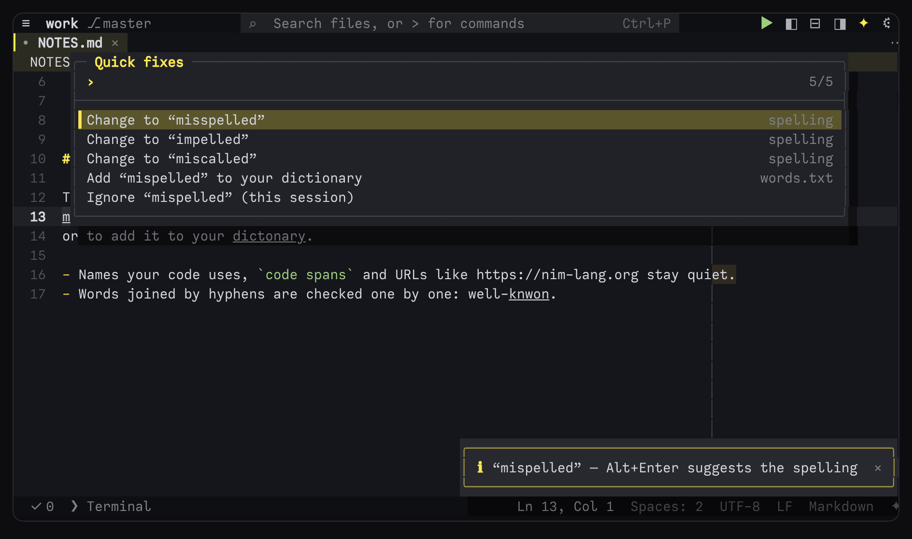

**Tests and coverage:**
- **testament** spec files (`discard """ output: … """` in `tests/`) get a ▶ and a ✓ or ✗, through testament,
  or through ned's own check of the spec when testament is not installed.
- **PHPUnit**, **dotnet test** (xUnit, NUnit, MSTest) and **Gradle/Maven** (JUnit, Kotlin and Java) tests get the
  ▶ in the gutter and the test explorer.
- *Test coverage: run* colours the line numbers in Python (coverage.py), Go, Rust (cargo-llvm-cov or tarpaulin) and
  JS/TS (Node's own). *Load an lcov file* reads any other tool's report.

**Nimble:** *newer versions of the dependencies* reads each package's version tags and lists what has a newer
release. Choosing one, or all, moves the `requires` up and offers `nimble install` (`nimble upgrade` with a lock
file).

**New languages:** Kotlin, C#, PHP and SQL, with colours, comments, run commands, and language server and
formatter defaults.

**AI and MCP:**
- An MCP server's **prompts** are `/server:prompt` commands in the chat.
- Its **resources** attach with `@server:uri`; typing **@** lists them with the other mentions. The agent can also
  read them itself.
- **Fixed:** `@file`, `@diff` and the other mentions were dropped from the message whenever the current file was sent
  with it, which is the default.

**Emmet for CSS:** in a rule, Tab expands `m10-20`, `w100p`, `df`, `posr`, `jcsb`, `c#333`, `bd1-s-#ccc`, `lh1.5`
and `fz14!` (with !important). A property alone puts the cursor in its value.

**Settings sync:** your settings, key bindings, snippets, themes and dictionary words go to one file. You can
export and import it, or push and pull it from a private git repository of yours. API keys, tokens and MCP
environment values never leave the device, and each device keeps its own.

**Key bindings:** besides vim, now **Emacs** and **Helix** keymaps (*Key bindings: default · vim · emacs ·
helix…*):
- Emacs: C-f C-b C-n C-p, C-k and C-y, C-SPC for the mark, C-x C-s, C-x b, M-x, M-g g and the rest.
- Helix: select, then act — `w` `x` `%` select, `d` `c` `y` `p` act, space mode, `g` goto, `:w`.

**Accessibility mode:**
- Plain ASCII for every frame, bar and symbol, so screen readers read the screen sensibly.
- Letters beside the colours: E and W in the gutter, + ~ _ for git, B for breakpoints, + and − for coverage.
- ASCII icons, no minimap, and a high-contrast theme (turning it off brings your theme back).

**Multi-root workspaces:** *Workspace: add a folder…* puts another folder beside the project in the file tree, quick
open, project search and the language servers. *Save as…* writes a `.ned-workspace` file that `ned` opens again,
and VS Code's `.code-workspace` files open too.

**Remote folders over SSH:** *Remote: open a folder over SSH…* (`user@host:/path`, or a `Host` from
`~/.ssh/config`):
- ned copies the folder (leaving out `.git`, `node_modules` and other generated folders) and you edit it here, with
  the tree, search and language servers as usual.
- **Every save goes to the server**, and the terminal, Run, tasks and tests run there, in the folder. Compiler
  messages point back at your files.
- One shared ssh connection is used, so a password or passphrase is asked once, in the terminal, and never put on a
  command line.
- *Pull the latest files* brings in changes made on the server.

**Also:** a sibling folder whose name starts like the project's (`work2` next to `work`) is no longer mistaken for
part of it. A debug adapter no longer stays behind as a zombie process.

## What's new in 5.9

The rest of the list from VS Code and Zed.

**Debugging in more languages.** F9 and F5 now work in Python, C, C++, Rust and Go too, with the same Debug panel,
keys, conditional breakpoints, watches and run to cursor. ned speaks the Debug Adapter Protocol: **debugpy** for Python
(`pip install debugpy`), **gdb's own DAP mode** (gdb 14 and newer) or **lldb-dap** for C, C++ and Rust (ned builds
the program with debug information first: `cc -g`, `cargo build`), **delve** for Go. `"debug.adapters"` sets any
other adapter, per language. While stopped, each line of the function shows the **values of the variables it uses**
at its end (`"debug.inlineValues"`) — for Nim too.

**Language servers do more:**
- *Go to type definition*, *Go to implementation* and *Type hierarchy* (Go menu). For Nim the built-in engine finds
  the type's declaration.
- The uses of the symbol under the cursor are marked by the server (the same name in another scope is not).
- Folding follows the server's ranges; **Alt+F** with lines selected formats just those through the server.
- When a language has no server installed, ned says once which one to install, with an **Install** button
  (Python, Rust, Go, C, JS/TS, Lua, Ruby, shell, CSS). New defaults: Ruby, JSON, YAML, Markdown, CSS, Dockerfile.

**Your own languages:** `"languages": {"zig": {"extensions": ["zig"], "lineComment": "//", "keywords": "fn const
pub return", "types": "u8 i32", "languageServer": ["zls"], "run": "zig run $file"}}` — colours, comments,
indentation, run, formatter and language server for a language ned does not know, or changes to one it does.

**Tests in Python, Go and Rust** get the ▶ in the gutter and the test explorer: pytest (with the project's
`.venv`), `go test`, `cargo test` — one test, a file or all, each result ✓ or ✗.

**Refactors** (Alt+Enter and Nim › Refactor): *extract into a variable* (Nim, Python, JS/TS, Go, Rust, Lua, Ruby —
and its other copies in the block), *inline a variable*, `"Hello, " & name & "!"` → `fmt"Hello, {name}!"` (the
import added), and *evaluate at compile time*: the value of a `const` or any constant expression.

**Problems with their code:** *Problems: all of them with their code* opens every error and warning with the lines
around it in one editable multibuffer (Ctrl+S saves the files), each with its message.

**HTML:** renaming an opening tag renames its closing tag (and back), in one undo step; **Emmet** — Tab after
`ul>li.item$*3`, `div#main.box>p{Hello}+a[href=/]`, `(header>nav)+main` or `!` expands it.

**AI:**
- **MCP servers** give the agent their tools: `"ai.mcpServers": {"github": {"command": "npx", "args": ["-y",
  "@modelcontextprotocol/server-github"], "env": {"GITHUB_TOKEN": "…"}}}` (Claude Desktop's format works as is).
  Each call asks first unless `ai.autoApprove` is `all`; tokens in `env` go to the server only, never onto a
  command line. *AI: MCP servers…* shows each one, its tools and why one failed.
- **Review the assistant's changes:** the toast after a run (or *AI: review the assistant's changes…*) shows each
  file it changed side by side with how it was; **r** undoes one change, and *Undo all of it* puts every file back.

**Also:** the active indent guide (the block the cursor is in) is brighter; a program ned starts can no longer take
the terminal away from it (a debugger's launcher could make ned quit).

## What's new in 5.8

Five things borrowed from VS Code and Zed, for Nim and every other language:

- **EditorConfig.** A project's `.editorconfig` is followed for each file: `indent_style`, `indent_size`,
  `tab_width`, `trim_trailing_whitespace` (every line, as the project asks), `insert_final_newline`,
  `end_of_line` for new files and `max_line_length` as the ruler's column. The status bar says
  *Spaces: 4 (EditorConfig)*; *File: EditorConfig for this file* lists what applies and from which file.
  Saving an `.editorconfig` applies it at once. `"editor.editorConfig": false` ignores them.
- **Tasks** (Run › Run task…, **Shift+F4**): one list of what the project can run — Makefile targets (with their
  `## comments`), `package.json` scripts (npm, pnpm, yarn or bun, from the lock file), `just` recipes, Taskfile
  tasks, cargo and go commands, nimble tasks and your run configurations; in a sub-project, its own too. The ones
  you ran come first. **F4** runs the last one again.
- **Readable Nim errors.** A type mismatch says what is wrong on the line itself — *"a" is string, foo wants
  b: int*, *missing argument b: string*, *one argument too many* — and Alt+H shows it as a table: each argument,
  its type and what the closest overload wants, with generic parameters filled in (`openArray[T] (T = int)`).
  An unknown name gets *did you mean greet?*. The errors Nim adds after them on the same line (*expression ''
  has no type*, *'let' symbol requires an initialization* …) are left out.
- **Colour swatches.** A small block in the colour before `#RRGGBB` (and `#RGB`, `#RRGGBBAA`), `rgb()`, `hsl()`
  and Nim's `0xRRGGBB`. Click it to copy the colour as hex, rgb or hsl, or to make it lighter or darker.
  `"editor.colorSwatches": false` turns them off.
- **Run the examples.** A ▶ beside `runnableExamples:` runs that proc's examples, the way `nim doc` does (in a
  module that imports yours, with the block's `-d:` flags); it turns ✓ or ✗. A failed `assert` is shown on its
  own line. *Nim › Run all examples in the file* runs every block at once.

## What's new in 5.7.1

**Rulers**, like VS Code's: thin vertical lines at the columns you choose, to keep lines short.

- **View › Editor › Rulers** puts one at column 80 (and hides or shows them later). Other columns:
  *View: set ruler columns…* or `"editor.rulers": [80, 120]` — in a project's `.ned/settings.json` each project
  can have its own.
- The line is drawn only in empty cells, so it never hides code, and it scrolls with the text.
- **Too-long lines stand out:** the part of a line past the last ruler gets a light warning tint
  (`"editor.rulerTint": false` turns it off).
- Off by default; hidden in zen mode. The colour follows the theme — `"theme.colors": {"ruler": "#…"}` changes it.

## What's new in 5.7

More for the AI assistant, Nim, git and themes.

**AI**

- **Undo what the assistant did.** Before the agent changes a file, ned keeps a copy. When a run ends, a toast
  offers *Undo*; *AI: undo the assistant's changes…* lists the runs of this session and puts any one's files back.
- **What a chat costs.** The assistant panel counts the tokens sent and received; with `ai.price` (dollars per
  million tokens: `{"input": 3, "output": 15, "cacheRead": 0.3}`) it shows dollars too. A request bigger than
  `ai.warnTokens` (60 000) asks first.
- **Fast or smart.** Set `ai.fastModel` and the ⚡ button in the assistant (or *AI: fast / smart model*)
  switches between it and `ai.model`.
- **Answers that know your Nim code.** With a Nim file, the request carries the definitions of the procs and
  types the code uses, found by the built-in engine (`ai.nimContext`).
- **AI review of staged changes.** *AI: review staged changes* sends the staged diff and puts each finding in
  the Problems panel on its line, next to the compiler's (*AI: clear review findings* removes them).

**Nim**

- **Run configurations** (Run › Configurations): named ways to run the project — main file, arguments,
  environment, defines, release or danger, backend, folder, or any shell command — kept in the project's
  `.ned/settings.json`. The chosen one shows as **▶ name** in the status bar and Alt+R runs it.
  *Run: current file with arguments…* remembers the arguments for each file. (A cloned project's
  configurations run only after *Workspace: trust this folder*.)
- **What can this proc raise?** (Nim menu) asks the compiler (`{.effects.}`) for the exceptions and effects
  of the proc at the cursor, with their lines, and copies the matching `{.raises: […].}`.
- **Benchmark a call** (Nim menu): any expression from the file, timed in a release build, with the median,
  fastest and slowest time per call.
- **Nimble: release a new version** sets the version in the .nimble file, commits it, tags `v1.2.3` and
  pushes both.

**Git**

- **Interactive rebase** (Git menu): pick where to start and the plan opens as text — change `pick` to
  `reword` (and edit the message on the line), `squash`, `fixup`, `drop` or `edit`, move lines with Alt+↑/↓,
  then Ctrl+S runs it. Uncommitted changes are put aside while it runs.
- **Cherry-pick** a commit from another branch, and **compare with a branch**: the files that changed since
  the branches split, each one a side-by-side diff.
- **Branch graph**: the history of every branch, coloured; Enter on a commit lists its files (each one a
  diff) and can start a branch there, cherry-pick it or revert it.
- **GitHub** (needs `gh`): pull requests (check out, changes, checks), issues and Actions runs. The CI result
  of the current branch shows in the status bar — **CI ✓**, **CI ✗** or **CI ⟳** — and is checked again after a push.

**Themes**

- **Nine new themes**, 37 in all: *modus-vivendi* and *modus-operandi* (made for readability, WCAG AAA),
  *catppuccin-frappe*, *catppuccin-macchiato*, *tokyo-night-day*, *rose-pine-dawn*, *kanagawa-lotus*,
  *ayu-light* and *github-dark-dimmed*.
- **`"theme": "auto"`** asks the terminal for its background colour and uses `theme.light` or `theme.dark` to match.
- **Your colours:** `"theme.colors": {"comment": "#8a8a8a", "[nim-crown]": {"bg": "#101010"}}` changes any colour
  of every theme, or of one.
- **Import a VS Code or base16 theme** (palette › *Theme: import…*): a VS Code `.json` (comments and all) or a
  base16 `.yaml` becomes a ned theme in `~/.config/ned/themes/`. *Theme: make my own copy of this theme* writes the
  current one there to edit — saving the file shows the change straight away.

## What's new in 5.6.4

A final pass for speed, safety and bugs before publishing:

- **Saving changes only what you changed.** Trailing spaces are removed from the lines you edited, not from
  the whole file (`"editor.trimAllLines": true` for the old behaviour), so saving someone else's file does not
  fill its diff with whitespace. A file that is just one empty line stays that way. Saving a read-only file
  asks first. A file with both CRLF and LF line ends says so when it opens. Tested on awkward files — CRLF, no
  final newline, a BOM, invalid UTF-8, emoji, tabs, a 100 000-character line, control characters, symlinks,
  executables — which come back byte for byte.
- **Temporary files are private.** AI requests, nimsuggest's copies of unsaved code, the formatter, debug
  builds, coverage and the clipboard use a folder only you can read, never a fixed name in the shared `/tmp`.
- **Faster where it shows:** the TODOs dock and its counts are built once per change instead of on every frame
  (a 4 000-file project with 560 tags types as fast as an empty one); semantic colours wait for a pause in
  typing; release builds are stripped (`-d:strip`), about 1 MB smaller.
- **Bugs found by random-input testing** (about 30 000 random key, mouse, paste and resize bursts): a crash
  opening search results in a multibuffer after a file got shorter, and one with very many tabs open.

## What's new in 5.6.3

- **Open folder is a folder browser.** *File › Open folder…* (or **d** on the Welcome page) lists the folders to
  tap through: Enter or → goes into one, Backspace or ← goes up, the first line opens the folder you are in, and
  Alt+Enter opens the highlighted one straight away. Projects are marked ◆ with what makes them one (git, nimble,
  cargo …), it starts beside the project you have open with that one highlighted, typing filters the list, and a
  typed `/path` or `~/path` jumps there. In the Files tree, right-click a folder › *Open as the project*, or the
  project row › *Open another folder…*. (*File: open folder by path…* keeps the typed prompt.)

## What's new in 5.6.2

- **Format on save keeps the cursor where you were.** When the formatter removed the blank line the cursor was
  on (typically after pressing Enter at the end of a file), the cursor jumped to the start of the last line; it
  now stays at the end of the line above, and on a blank line when one is left.

## What's new in 5.6.1

- **Runs on macOS and under Windows (WSL)** as well as Linux and Termux: the built-in terminal now uses the
  portable POSIX pseudo-terminal calls, the clipboard uses `pbcopy`/`pbpaste` on macOS and the Windows
  clipboard under WSL, and *Check setup* knows both. Building natively on Windows stops with a message that
  points to WSL. Install steps for each are under [Installing](#installing), and a GitHub Actions workflow
  builds and tests every platform on each push.
- **TODO comments:** the Files tree shows ⚑3 next to a file with three tag comments, in the colour of the most
  urgent one; *Create a GitHub issue* (right-click in the TODOs dock, or i) makes an issue from the comment
  with a permalink and the code around it (after asking, with `gh`).
- **Fixes from a code review:** deleting a TODO comment is a normal edit (undo, the modified mark) and keeps a
  block comment's `/*` or `*/`; piped input works on macOS; links copied from git never contain a token from
  the remote's address; a branch name can no longer inject a shell command on the first push; *Stage selected
  lines* uses the file's own repository and keeps CRLF files intact; temporary text (clipboard, commit messages,
  staged lines) lives in a private folder instead of a shared `/tmp` file; pushing and pulling keep your own
  ssh command; local branches named `you/topic` are no longer shown as remote; `yes | head` works in the built-in
  terminal; big files and big projects no longer slow typing while TODOs are counted.

## What's new in 5.6

**TODO comments, like VS Code's Todo Tree.** Keep writing plain comments — ned does the rest.

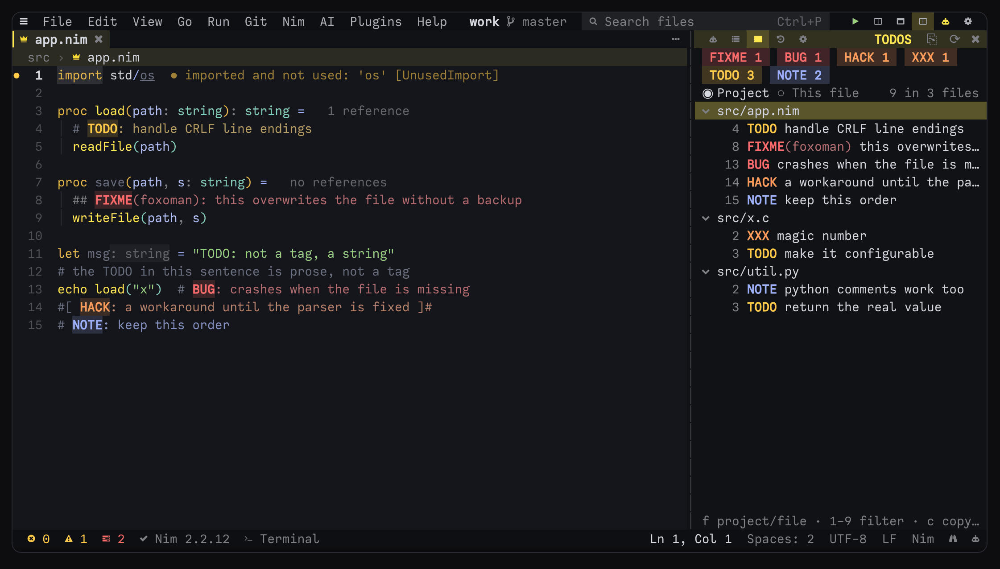

- **Coloured in the code.** A comment that starts with `TODO`, `FIXME`, `BUG`, `HACK`, `XXX` or `NOTE` shows
  the tag as a coloured badge — red for FIXME and BUG, orange for HACK and XXX, yellow for TODO, blue for NOTE,
  taken from your theme — with `TODO(name):` and the message tinted to match. It works in every language ned
  colours (`#`, `##`, `#[ ]#`, `//`, `/* */`, `--` …). Only an upper-case word at the start of a comment counts,
  so prose and strings are left alone. The tags are marked on the scrollbar too.
- **The TODOs dock** (View › TODOs, or the ⚑ icon in the right dock): a chip per tag with its count — tap one
  to hide or show that kind (keys 1–9) — then every tag grouped by file, the files with FIXME and BUG first.
  Enter or a tap jumps to it. *Project* or *This file* (key f). Open files update as you type; the rest of the
  project is scanned in the background (ripgrep when it is installed, grep otherwise) and again every 30 s
  while the dock is open.
- **⚑ 3 in the status bar** counts the FIXME and BUG comments in the project; a tap opens the dock.
- **Alt+V / Alt+Shift+V** jump to the next / previous tag comment in the file (also in the Go menu).
- **Edit › Insert TODO comment…** writes `# TODO: ` with the right comment marker for the language (on a blank
  line at its indentation, after the code otherwise). `"todo.withName": true` adds your git name:
  `# TODO(Foxoman): `.
- **Done?** Right-click a line in the dock (or press x) to delete the comment — Ctrl+Z brings it back.
  *Copy the list as Markdown* (⎘, or c) gives a checklist ready for an issue or the release notes.
- **Your own tags:** `"todo.tags": {"TODO": "yellow", "FIXME": "red", "REVIEW": "purple", …}` — colours are red,
  orange, yellow, green, blue, purple, accent or `#RRGGBB`; red ones are counted in the status bar.
  `"todo.highlight": false` turns the colours off.

## What's new in 5.5

Small things that make the first day with ned smoother:

- **Help › Check setup** (or `ned --check` in the shell) lists what ned found — Nim, nimble, nimsuggest, gdb,
  git, gh, ripgrep, curl, the clipboard helper, true colour, the AI key (never the key itself) — and gives the
  install command for anything missing, for Termux or your Linux distribution.
- **Help › Copy info for bug report** puts ned's version, Nim's version, the system, the terminal and the tools
  on the clipboard, ready to paste into an issue.
- **Piped input:** `git log | ned`, `nim check app.nim 2>&1 | ned -` or `git diff | ned` opens what the command
  printed (diffs in diff colours, colour codes removed) and still takes keys from the terminal.
- **Typos in settings are reported:** `"editor.tabsize"` → *did you mean "editor.tabSize"?* — the same for the
  wrong case, a small typo or the right name in the wrong section, in your settings file and in a project's
  `.ned/settings.json`.
- **Unknown options are errors** instead of new files: `ned --verison` says so; `ned -- -odd-name.txt` opens a
  file whose name starts with `-`.
- ned now needs **Nim 2.2 or newer**, and the package ships its MIT **LICENSE** file.

## What's new in 5.4.1

- **Four new themes:** *everforest-dark* and *everforest-light* (the soft, low-glare Neovim favourite) and
  *night-owl* and *light-owl* (the VS Code theme made for night coding, with readability in mind). They follow
  their published palettes, with the same readability pass as every other theme. Alt+T previews them.

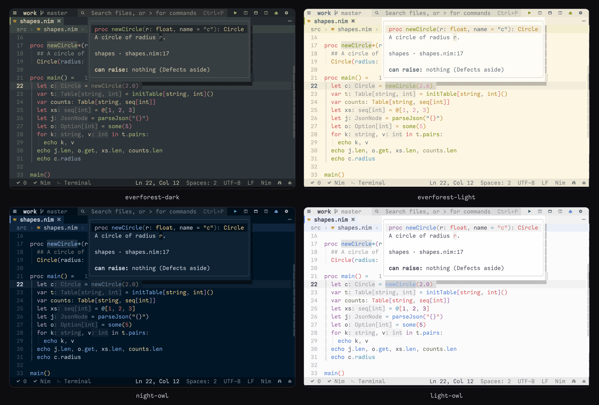

## What's new in 5.4

**Git, much more of it.** There is a new **Git** menu, and the Source control dock has the new actions too.

- **Branches.** Click the branch in the title bar: switch, create, rename, merge or delete branches, or pick a
  remote one to get a local branch that follows it. The title bar shows ↑ commits to push and ↓ to pull, with a
  ⟳ sync button (pull with rebase, then push).
- **Push and pull that don't hang.**
  - When the server asks for a username, password or SSH passphrase, the same command opens in the
    terminal so you can type it.
  - A new branch's first push sets its upstream by itself.
  - Also: fetch, and pull with rebase.
- **Committing:**
  - a message box (Ctrl+S commits, Ctrl+W cancels, # lines are left out);
  - amend the last commit;
  - undo the last commit (its changes stay staged);
  - when nothing is staged, ned asks whether to commit every changed file.
- **Changed files open in the side-by-side diff** (Source control › a file › Open diff): against the index,
  or HEAD against staged. *Open diff as text* keeps the old unified view.
- **Stage selected lines:** only the changed lines inside the selection go into the commit.
- **History:** *Git: history…* lists the commits with their branches and tags. Pick one to see its files, each
  in the diff view, or to copy its hash, revert it or start a branch there. In the Timeline, a version of the
  file opens side by side with your copy.
- **Stash:** stash, with new files or without, then apply, pop, show or drop.
- **Merges and rebases:** while one is in progress the dock says so, lists the files with conflicts (and how
  many each has left), and has *Continue* and *Abort*.
- **Blame:** *Git: blame this file* shows the commit, date and author of every line. Enter opens that commit.
- **More:**
  - clone a repository (it opens when done);
  - *Add to .gitignore* in the Files dock;
  - create and push tags;
  - *Copy link to this line* (GitHub, GitLab, Codeberg: a permalink at this commit, lines too);
  - *Create a pull request* with `gh`.

## What's new in 5.3.2

- **Undo survives closing a file.** Close a file, or ned itself, and Ctrl+Z still undoes your earlier edits the
  next time you open it. This only applies if nothing else changed the file in between. The history is kept in
  `~/.local/state/ned/undo` (`editor.persistentUndo`).
- **Debugger:**
  - strings inside objects and seqs show as text (`name = "Ann"`), using Nim's own gdb pretty printers when
    the toolchain has them;
  - the C runtime's frames (`main`, `NimMain`…) are hidden from the call stack, and module-level code shows as
    *(top level)*;
  - conditions can compare strings: `name == "Ann"`, `n != ""`.
- **Rename preview** shows each change as the old line (−) and the new line (+), in diff colours. Space moves
  on to the next change.
- **Multibuffer:** each file's section starts with a proper header bar. A click on it, or Enter, opens that
  place in the file.
- **Diff view:** when the window is narrow, its header keeps a short form of the keys instead of dropping them.
- **Your commands in the settings UI:** *Your commands…* (or `commands` in Settings) lets you add a command,
  then change its shell command, where its output goes and what it reads, run it or delete it, without
  editing JSON. `keys` in Settings opens the shortcuts editor.

## What's new in 5.3.1

- **F1 lists the new keys.** It covers Alt+<, Alt+Shift+T, Alt+F12, Alt+drag, the debugger keys (F9, F5, F10, F11,
  Ctrl+F10), resizing with Ctrl+Alt+arrows and the panel's ⤢. Long lines wrap instead of being cut off.
- **The menus have the new commands:**
  - File: compare with another file, rename or move, reopen closed tab, keyboard shortcuts;
  - Edit: format selection, multibuffer;
  - View: Debug panel, recent messages, Markdown preview;
  - Go: peek definition and references, call hierarchy, go forward, stage and compare changes, merge conflicts;
  - Run › Debug: breakpoints, stepping, watches, debug a test, plus test coverage and profiling;
  - Nim › Refactor: extract proc, sort imports, missing case branches, generate procs, doc comment; also run
    the selection, docs browser, Playground, switch compiler and the Nimble view.
- **Right-click menus** add peek, call hierarchy, Git stage/revert on changed lines, a Nim *Refactor* submenu
  and a *Debug* submenu. A tab's menu can reopen the last closed tab.
- **New screenshots** in the nim-crown theme, including the diff view and the debugger.

## What's new in 5.3

- **Messages pop up, whole.** Info, warnings and errors appear in a popup, wrapped onto as many lines as
  they need, instead of being cut to fit the status bar.
  - Info goes after a few seconds, warnings after 7 and errors after 12. A click or Esc closes them.
  - A repeated message is shown once.
  - *Show recent messages* lists the last 100.
  - `"ui.messages": "statusbar"` brings back the old way.
- **Documentation popups wrap long lines**, code and signatures included, instead of cutting them off.
- **A real diff view.** *Git: compare with last commit*, *File: compare with saved* and the new *File: compare
  with another file…* open a side-by-side diff:
  - lines are aligned, with blank rows where one side has nothing;
  - removed lines are red on the left, added lines green on the right, and the changed words are marked;
  - both sides scroll together, F7 / Shift+F7 (or n / p) go from change to change, and Enter opens the line in
    your file;
  - ⟲ (or r) reverts a change in your file. The view follows your edits as you type.

  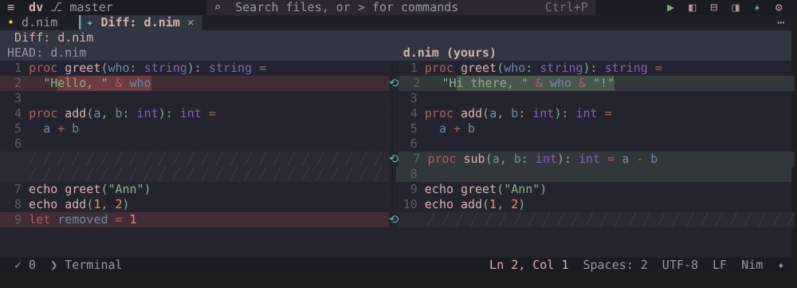
- **Rename preview.** F2 first lists every change: file, line and the line as it will read. Space unticks
  one, a toggles all, Enter applies the ticked ones and Esc cancels. This works for the Nim engine,
  nimsuggest and language servers. `"editor.renamePreview": false` renames at once, as before.
- **Debugger:**
  - **expand variables**: objects, tuples, arrays and seqs show ▸; Enter or a click lists their fields or
    items;
  - **watch expressions**: *Debug: add a watch expression…* (or *+ add a watch expression* in the panel)
    takes a Nim expression such as `total * 2` or `p.name`. It is evaluated at every stop and kept with the
    session;
  - **debug one test**: *Debug: debug the test at the cursor* (or Alt+Enter on a `test` line) runs only that
    test under gdb. If the file has no breakpoints it stops at the test's first line;
  - breakpoints stop on exactly the line you set them on. Before, a line could also match the next line of
    Nim's top-level code.

  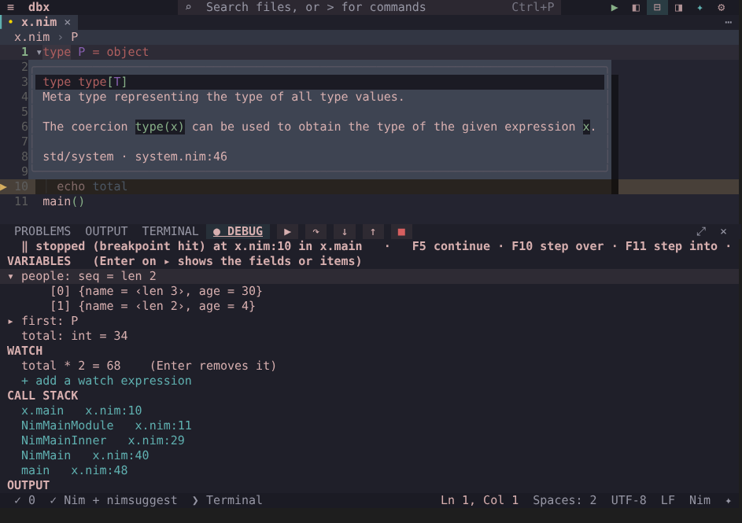
- **Your own commands.** The `commands` setting adds palette commands that run shell commands:

  ```jsonc
  "commands": {
    "Upper case": {"run": "tr a-z A-Z", "output": "replace"},
    "Word count": {"run": "wc -w $file", "output": "popup"},
    "Open in browser": "xdg-open $file"
  }
  ```

  - placeholders: `$file $dir $root $name $ext $line $col $word $selection`;
  - `output`: `panel` (the default), `replace` (the selection, or the whole file), `insert`, `popup`,
    `message` or `terminal`;
  - `input`: `selection`, `file` or `none` is sent to the command;
  - bind keys to them with `keys`. In project settings they wait until you trust the folder, because they run
    programs.
- **Formatter:** a long declaration with several names (`a, b, c: T = v`) puts the names on one line and the
  type under them, as nph does.
- **Huge files:** opening a 77 MB log takes about 0.25 s and 70 MB less memory, because lines are split
  without copying the file first. Files over 16 MB show "Opening …" while they load.

## What's new in 5.2.2

**nim-crown is the default theme.** (If your settings file names another theme, that choice stays; Alt+T
switches.)

**Like VS Code and Zed:**
- **Go forward**: Alt+< (Alt+Shift+,) after jumping back with Alt+,.
- **Reopen a closed tab**: Alt+Shift+T.
- **Box (column) selection**: Alt+drag with the mouse puts a cursor on each line over the same columns.
  (Alt+Shift+↑/↓ already added cursors from the keyboard.)
- **Peek**: Alt+F12 shows the definition's code in a popup without leaving your file; Alt+Shift+F12 lists
  every reference with its line of code.
- **Stage a change from the gutter**: click a git change mark (▎) for *Stage this change*, *Revert this
  change* and *Show the change*. *Git: unstage this file* undoes it.
- **Call hierarchy**: *Call hierarchy (callers and calls)* lists who calls the proc at the cursor (←) and what
  it calls (→). It uses the Nim index for Nim and the language server for other languages.
- **Renaming a module updates its imports.** *File: rename or move this file…* (or rename in the Files dock)
  offers to fix every `import` that names it, in open tabs and on disk.
- **Keyboard shortcuts editor**: *Keyboard shortcuts…* lists every command with its keys. Pick one, then press
  the new key (Backspace removes yours). It writes the `keys` setting.
- **Markdown preview**: *Markdown: open preview to the side* renders headings, lists, bold and code beside the
  file and follows your edits.
- **Other languages through their language servers**: semantic colours (`nim.semanticColors` covers them
  too), *Go to symbol in workspace (language server)…* and call hierarchy.
- **Multibuffer (like Zed)**: after a project search (Alt+S) or *find references*, *Open results in a
  multibuffer* puts every hit, with a line around it, in one buffer you can edit. Ctrl+S writes each change
  back to its file. It refuses if a file changed elsewhere since, so nothing is overwritten.
- **Large files**: typing in a 77 MB, 700 000-line log went from 15.8 ms to 0.4 ms a keystroke (the
  merge-conflict scan ran on every edit). Files with 10 000-character lines scroll in 1.6 ms a frame and move
  the cursor in 7.7 ms (it was 11.4).

**For Nim:**
- **Readable type mismatch errors.** The hover shows what you passed, the closest overload and which
  argument does not fit, instead of the whole list of candidates.
- **Missing `case` branches**: Alt+Enter in a `case` on an enum (or bool) adds an `of` for every value it
  does not handle yet.
- **Generate code for a type**: Alt+Enter on `Foo = object` writes `$`, `==`, `hash` (importing
  std/hashes) and an `initFoo`/`newFoo` constructor, or just one of them.
- **Doc comment**: Alt+Enter on a proc adds a `##` line naming its parameters.
- **Run a selection**: Alt+Enter with code selected (or *Nim: run the selection*) runs it with `nim r`,
  using the file's imports, and shows the output in a popup.
- **Unused names are faded**, as the compiler reports them (`declared but not used`, unused imports).
- **Type of a selection**: select an expression and press Alt+H.
- **Test coverage**: *Nim: test coverage* builds with coverage, runs the file (a test or a program) and
  colours the line numbers: green ran, red never ran. Needs gcov (or llvm-cov in Termux).
- **Profiler**: *Nim: profile* runs with Nim's sampling profiler and lists the procs by time spent, in the
  panel. Click one to go there.
- **Share**: *Nim: share to the Playground* uploads the selection (or the file) to play.nim-lang.org and puts
  the link on the clipboard.
- **Switch compiler**: *Nim: switch compiler version…* lists what choosenim or grabnim has installed. It
  switches, then restarts nimsuggest.
- **Docs browser**: *Nim: standard library docs browser…* searches every name the standard library exports;
  picking one shows its documentation and opens its source.
- **Nimble view**: *Nimble: dependencies and updates…* lists the project's `requires` with what is installed.
  Pick one to install its newest version.

## What's new in 5.2.1

- **The debugger, continued:**
  - breakpoints are kept with the folder's session, so they are still there next time;
  - they follow your edits: insert lines above a breakpoint and it moves with its line;
  - **conditional breakpoints**: *Debug: conditional breakpoint on this line…* takes a Nim condition such as
    `i == 3` or `done and count > 10`. The line is marked ◆, and the program stops there only when the
    condition is true. Conditions work on numbers and bools;
  - **run to cursor**: Ctrl+F10, or *Debug: run to cursor*. It starts debugging if needed;
  - **hover shows values**: while the program is stopped, Alt+H (or the automatic hover) on a variable
    shows its value, such as `total: int = 3`;
  - F5 debugs the file you are in when it is a program (it has top-level code or `when isMainModule`), the
    same file F5 runs. A library module's breakpoints are reached through the project's main file.
- **The touch bar is opt-in.** It is off by default. Turn it on with *Toggle touch bar* in the palette, or
  View › Appearance › Touch bar. `ui.touchBar: "auto"` shows it on phones only. Choose its keys with
  `ui.touchBarKeys`:
  - key names: `esc`, `tab`, `enter`, the arrows, `home`, `end`, `pgup`, `pgdn`, `undo`, `redo`, `save`,
    `find`, `palette`, `copy`, `cut`, `paste`;
  - a key such as `"ctrl+p"` or `"alt+r"`;
  - `"Label=command"` for any palette command, for example `"Run=Run file"`.
- **Formatter:** a long declaration in a `var` section now gives the same result when formatted a second time.
- **README:** the notes for 5.1.1 and older moved to [CHANGELOG.md](CHANGELOG.md).

## What's new in 5.2

- **A debugger panel (gdb).** For Nim files:
  - F9 or a click in the gutter's left edge sets a breakpoint (●);
  - F5 builds with debug information and runs to the first breakpoint;
  - F10 steps over, F11 steps in, Shift+F11 steps out, F5 continues and Shift+F5 stops.

  The **DEBUG** panel shows:
  - the call stack, with Nim names instead of the C ones;
  - the local variables, with strings shown as text;
  - the program's output;
  - buttons ▶ ↷ ↓ ↑ ■.

  The current line is marked ▶ in the gutter. Without breakpoints F5 runs the file as before. gdb must be
  installed (Termux: `pkg install gdb`). Debug builds use `-O0`, so every variable can be read.


- **Refactoring:**
  - *Nim: extract selection into a proc*: the locals it uses become parameters (`var` when it assigns to them,
    with their types from the index), the new proc goes above the current one, and renaming starts at once.
    It refuses when a variable declared inside the selection is used after it.
  - *Nim: sort imports*: standard library modules first as one `import std/[…]`, then packages, then your own
    modules.
  - *Nim: toggle proc ⇄ func*.
- **Completion adds the import.** Typing a name from a standard module you have not imported yet offers it in
  the list (`import std/json` beside it). Accepting it adds the import too (`nim.autoImport`).
- **Semantic colours.** Names are coloured by what the engine knows they are: routines, types, constants
  and enum values, and object fields. This works in your own code too, not only on keywords (`nim.semanticColors`).
- **Format selection.** Alt+F with several lines selected formats only those lines, at their own indentation.
- **The formatter is closer to nph:**
  - a single `## doc` line under a statement joins it as a trailing comment when it fits;
  - a long `from x import a, b` puts the names on the next line.

  On Nim's compiler and standard library, 95.6% of lines are identical to nph's output, and Nim's parser sees
  the same code on all 368 files.
- **Merge conflicts.** Conflict blocks are tinted, and the `<<<<<<<` line has **Accept ours · Accept theirs
  · Accept both** buttons. The same actions are in the palette, with *Git: next merge conflict*.
- **Compare with the last commit.** *Git: compare with last commit (side by side)* opens the HEAD version in
  the left pane, next to your file.
- **Searchable settings.** In the Settings UI, type a setting's name or any words from its description
  (*nph*, *wrap*, *memory*…).
- **Touch:**
  - **a touch bar**, one row of keys above the status bar: Esc, Tab, the arrows, undo, redo, save, find and ≡
    for the palette (opt-in since 5.2.1, see above);
  - **drag a tab** to reorder the tabs;
  - **drag the minimap** to scroll;
  - **swipe sideways in the file tree** to close a folder or go up a level (left) or to open one (right).

  The wheel over the tabs still switches tabs. A sideways swipe on the tabs is not used, so it cannot clash
  with dragging a tab.
- **Fixes:**
  - Ctrl+Alt+↑ makes the bottom panel taller and Ctrl+Alt+↓ shorter, as the palette says (they were swapped);
  - the debugger hides the C compiler's temporaries and shows Nim type names (`int`, `seq`, `Person`).
- **Startup, measured** on Nim's `compiler` folder (about 300 files):
  - the first frame is drawn after about 100 ms;
  - project symbols are ready after 250 ms, with about 90 ms of background work;
  - ned uses 19 MB of memory.

  No change was needed.

## What's new in 5.1.1

- **Two monochrome themes: `monochrome` (dark) and `monochrome-light`.** Grey only. Code is told apart by
  lightness and weight:
  - keywords are bold and the brightest;
  - names and types are bright;
  - strings and numbers are a step down;
  - punctuation, comments and inlay hints are quiet.

  Every grey passes the readability check from 5.1, and the selection, bars and popups use neutral greys.
  Alt+T previews them.

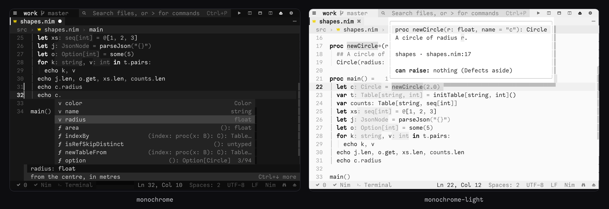

## What's new in 5.1

- **Every theme is equally readable.** One pass over all 22 themes gives every interface colour a minimum
  contrast: text, dim text, line numbers, comments, inlay hints, the completion list, menus, the title and
  status bars, and the current line. Only lightness changes, so each theme keeps its colours. Before, 11
  themes had something hard to read: slate's completion list, the light Solarized and Catppuccin chrome,
  the selected row in One Dark's menus.
- **The same selection look everywhere.** A list that loses the focus (Files, Search, Git, Problems) keeps
  its selected row visible in a softer shade of the selection colour.
- **Drag to resize:**
  - the divider between split panes (side by side or one above the other);
  - the edges of the left and right docks, and the bottom panel by its header.

  Dock and panel sizes are remembered. *View: reset split and dock sizes* puts them back.
- **The scrollbar works:** click it to jump, or drag it.
- **Keyboard:** Ctrl+Alt+←/→ resizes the split or the dock that has the focus, and Ctrl+Alt+↑/↓ the bottom
  panel (or panes one above the other). The same commands are in the palette under *View*.
- **Wheel:** Shift+wheel and a tilt wheel scroll sideways (Shift+wheel used to scroll up and down). The
  wheel over the tabs switches tabs.
- **Touch:**
  - press and hold (about half a second, without moving) opens the context menu, since a phone has no
    right click (`ui.longPressMenu` turns it off);
  - on a phone a tab's close mark takes the space around it, so it is easier to hit.
- **Less memory:**
  - nimsuggest stops after 15 minutes without a question and starts again when needed
    (`nim.nimsuggestIdleMinutes`). It is the one big process (about 280 MB on ned's own source; ned itself
    uses about 13 MB).
  - In Termux its memory ceiling is 800 MB unless you set `nim.nimsuggestMaxMB`.
- **Fixes:**
  - a drag whose button release happened outside the window no longer carries on into the next click;
  - the search for a bracket's partner on another line is bounded, so frames stay under 1 ms;
  - clean-up of unused code in the formatter.

## What's new in 5.0.1

- **Panes one above the other are divided by a solid bar**, the same as side-by-side panes. Each pane
  keeps its own header.
- **Inlay hints stay on their code.**
  - Hints now move with the text when lines are added or removed, including when formatting or an AI
    insert changes many lines at once. Before, they stayed on their old line numbers, so after a format
    `: lent int` could show up on an `if` or inside a comment.
  - A hint on a line you changed is hidden until nimsuggest (or the language server) sends a fresh one.
  - A type hint is only drawn right after a name, never in a comment, a string or past the end of a line.
- **Rainbow brackets never take the colour of the text next to them.** Each bracket pair checks the colours
  right before and after its opening and closing bracket. If the pair's rainbow colour matches one of them,
  it takes the next rainbow colour that doesn't. In `Person(` and `array[Idx, T]` the brackets used to be
  the same colour as the type names. Both brackets of a pair always share one colour, even when they are on
  different lines.

## What's new in 5.0

- **A Nim engine of ned's own.** You no longer need nimlangserver. ned reads your code and the standard
  library itself and answers at once, without a compiler and without a background server. It handles:
  - completion: after a `.` it offers the receiver's fields and every proc that takes it, generics filled in
    (`t.getOrDefault(key: string): int` for a `Table[string, int]`);
  - hover, go to definition (into the standard library and nimble packages), signature help;
  - references and rename across the whole project, aware of overloads and of locals;
  - the outline, *Go to symbol* (Ctrl+T) and project symbols (Ctrl+P `#`);
  - module names after `import`.

  It follows imports the way the compiler does (next to the file, `std/`, `--path` from your `config.nims`
  and `nim.cfg`, a package's `srcDir`, nimble packages). It infers the types of `let`/`var`, loop variables,
  tuple unpacking and call chains, and understands `when` branches, `export` and `include`.

  A query takes about 1–5 ms. On ned's own 24 000-line source it agreed with nimsuggest on every sampled
  go-to-definition (nimsuggest needs about 10 s per query on that file). The full comparison is in
  [Nim IDE: the built-in engine](#nim-ide-the-built-in-engine).
- **nimsuggest only where the compiler is needed:**
  - completion when the index cannot tell a receiver's type;
  - errors while you type;
  - inlay hints for the types of `let`/`var` (Nim 2.2's protocol 4);
  - macro expansion.

  `nim check` reports errors on save. A nimsuggest that grows past `nim.nimsuggestMaxMB` is restarted.
  `"nim.nimsuggest": false` turns it off completely, for phones with little memory.
- **Documentation beside the completion list**, like VS Code and Zed. It shows the full signature
  (highlighted), the whole doc comment rendered as Markdown with highlighted code, and where the symbol is
  defined. On narrow screens it moves above or below the list. Ctrl+Space toggles it while the list is
  open, Ctrl+↑/↓ scrolls it, and `editor.completionDocs` sets the default. Signature help shows the
  documentation as well, and hover renders Markdown. Language servers' documentation shows there too
  (with `completionItem/resolve`).
- **A Nim formatter of ned's own, in nph's style.** Alt+F and `editor.formatOnSave` format Nim inside ned:
  nothing to install and no program to start.
  - 95.7% of its lines are identical to nph's on Nim's compiler and standard library (190 000 lines).
  - Nim's own parser reads the same code before and after, on all 392 files tested (the compiler, the
    standard library, nph and ned).
  - It checks every result and leaves the file alone if the code would change.
  - It is faster than running nph: 3.5–12 ms for files of 1 400–3 700 lines (nph: 6–22 ms), and 2 ms
    for a file that is already formatted (nph: 6 ms).

  `nim.formatter` picks `builtin` (default), `nph` or `nimpretty`. Details are in
  [Formatting Nim](#formatting-nim).
- **Formatting keeps your place.** The cursor stays on the same character of the same code, even when the
  formatter splits or joins lines, and that code stays on the same screen row. Before, a language server's
  formatting could leave you on the last line.
- **Clearer layout:**
  - The breadcrumb bar under the tabs (file › proc) has its own shade, tinted with the theme's accent. The
    active tab shares it, so the file's header never looks like a line of code.
  - Side-by-side panes are divided by a solid bar.
  - Each pane has a header bar, so panes one above the other are clearly separated. The active pane's header
    is tinted.
- **`slate` is the default theme.** A settings file that already names a theme keeps it.
- **Reset settings:** *Settings: reset to defaults* asks first, then writes the default settings file. It
  keeps your old file as `config.json.bak-<date>`. It is in the palette and near the top of the
  Settings UI.
- **AI chat › Insert puts code where it belongs:**
  - over the selection, if there is one;
  - otherwise on its own lines after the cursor's line, re-indented to fit;
  - a whole proc, type or import goes after the block the cursor is in;
  - one blank line separates it from the code around it (never two);
  - it flashes so you see where it went, and Ctrl+Z removes it in one step.
- **Zen mode in vim mode:** Esc no longer leaves zen (Esc is how you get back to NORMAL, often twice).
  Leave with Alt+Z, `:zen` or a click on the corner info. The corner now shows the vim mode.
- `nim.ide` is now `builtin` (default), `nimlangserver` or `off`. The old `auto` and `nimsuggest` mean
  `builtin`.

## What's new in 4.1

- **nimlangserver works in nimble projects.** Two causes are fixed:
  - Inside a package, nimlangserver used to run `nimble dump` and start the `nimsuggest` from the Nim folder
    that nimble reported. That can be a different Nim, or one without nimsuggest (nimble installs its own
    compilers for packages that ask for a specific Nim version). ned now always tells it to use the
    `nimsuggest` on your `PATH`, the same one that works for single files.
  - When the folder you opened holds several packages and loose scripts (your Termux home, say), every
    `.nim` file was mapped to the first file you opened, so package files were checked as if they were
    scripts. Now each nimble package gets its own nimsuggest, and loose files share one.
- **A language server that crashes is restarted.** It is not just reported as "exited". Its error output is
  kept: the warning names the reason, and *Nim: language server status* shows it. If nimlangserver keeps
  failing, ned switches to its built-in nimsuggest client so you keep completion, hover and go-to.
- **OpenAI's newer models work** (GPT-5, GPT-6, o-series, `-pro` and codex models):
  - ned sends `max_completion_tokens`, uses the `developer` role and omits the temperature for reasoning
    models. It also gives those models room to think: at least 25 000 output tokens.
  - Models that only exist on the **Responses API** switch to it on their own (or set `ai.openaiApi`).
  - If your organisation is not verified for streaming, ned falls back to complete, non-streamed replies.
  - Whatever an endpoint refuses is learned once per model and remembered between sessions.
  - *AI: choose model…* lists only chat models and lets you type any model id. An empty reply now says why
    (for example, the token limit was used up by reasoning).
- **No italics** unless you turn them on (`"ui.italics": true`). Termux and many fonts have no italic face.
- **Two new themes: `slate` and `slate-night`.** Both use muted colours on blue-grey slate, with a solid
  teal completion bar. That makes 22 themes.
- **Hardened.** More than an hour and a half of random-input testing (keys, mouse, pastes, resizes, every palette
  command, vim mode) found input-handling, scrolling and vim edge cases that are now fixed. One of them
  crashed vim mode (`.` repeating itself). ned also never trusts the shape of JSON from servers or its own
  state files.
- **More robust in general.** If the terminal disappears, ned saves recovery files and exits instead of
  spinning. A long burst of keys never freezes the screen. Typing no longer sends the whole file to the
  language server on every key. If an internal error does happen, ned keeps running, says so once, and
  writes the details to `~/.local/state/ned/errors.log`.

## What's new in 4.0

- **One nimsuggest per project.** ned now tells nimlangserver which module is your project's main module
  (from the `.nimble` file, `<folder>.nim`, `main.nim` …) and maps every source file to it, so opening ten
  files no longer starts ten nimsuggest processes — on any nimlangserver version. The Nim dock shows how many
  are running; *Nim: language server status* explains exactly what is happening. Language servers (and their
  nimsuggest children) are always shut down with ned, and restarted when you open another folder.
- **Split editor** (side by side or stacked), each pane with its own file, cursor and scroll.
- **Regular expressions** in find, replace and project search, with `$1` groups in replacements.
- **Project-wide find & replace** with an inline preview (old → new), per-line / per-file / all, a files
  filter (`*.nim, src/, !tests/`) and a one-step undo.
- **AI**: saved chats, edits shown as real diffs before you approve them, slash commands (`/fix`, `/review`,
  `/commit` …), `@mentions` for context, prompt caching, token usage, regenerate, `AGENTS.md`/`CLAUDE.md`
  project instructions, *Apply* for code blocks, AI commit messages, opt-in inline suggestions (Tab accepts).
- **Quick fixes** (Alt+Enter): `import std/…` for an undeclared name, remove an unused import, fix or
  explain a problem with AI — plus everything the language server offers.
- **Safety**: atomic, fsync'd saves; recovery files that survive crashes, killed Termux sessions and dead
  batteries; local history of every save; protection against overwriting files changed on disk or edited in
  another ned; binary files open as a read-only hex dump.
- **Git**: live change markers while you type, next/previous change (F7), revert a change, inline blame.
- **Bookmarks**, **recent projects**, **per-project settings** (with a trust check for anything that runs
  programs), **user snippets**, Nim REPL, toggle export marker, docs for the symbol, `nimble add`.
- Fold markers now survive undo/redo.
