# ned

**A fast, safe code editor and Nim IDE for Termux and Linux.**
It runs in any terminal but looks and behaves like a desktop editor: menus, docks, tabs, split panes,
mouse and touch support, dialogs, toasts and tooltips. It is written in Nim, uses only the standard
library, and builds to one binary of about 9 MB.

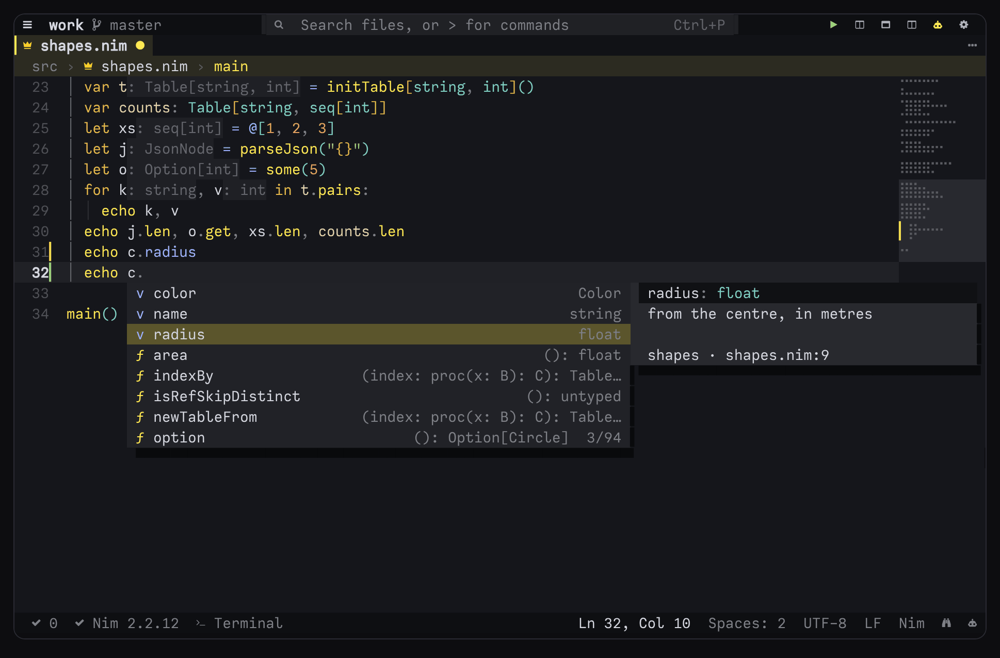

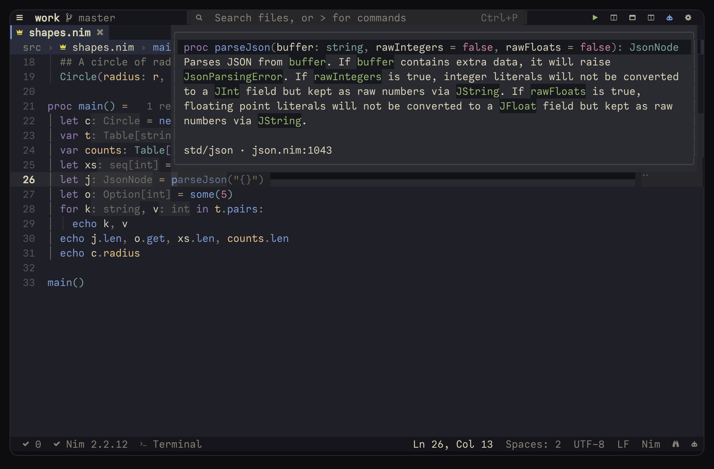

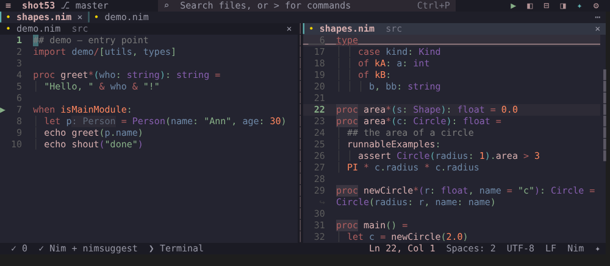

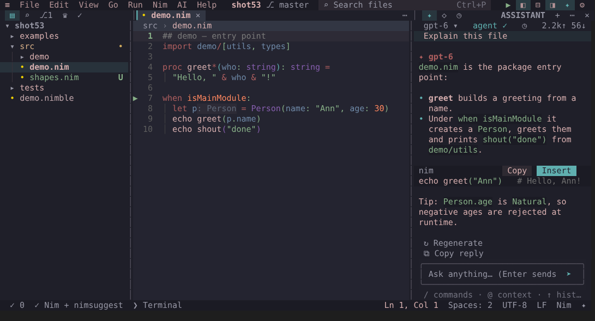

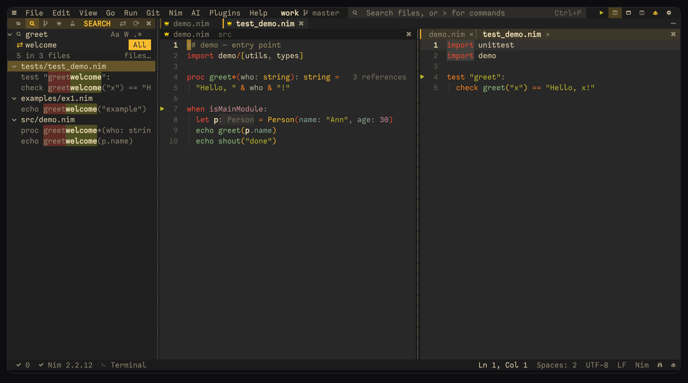

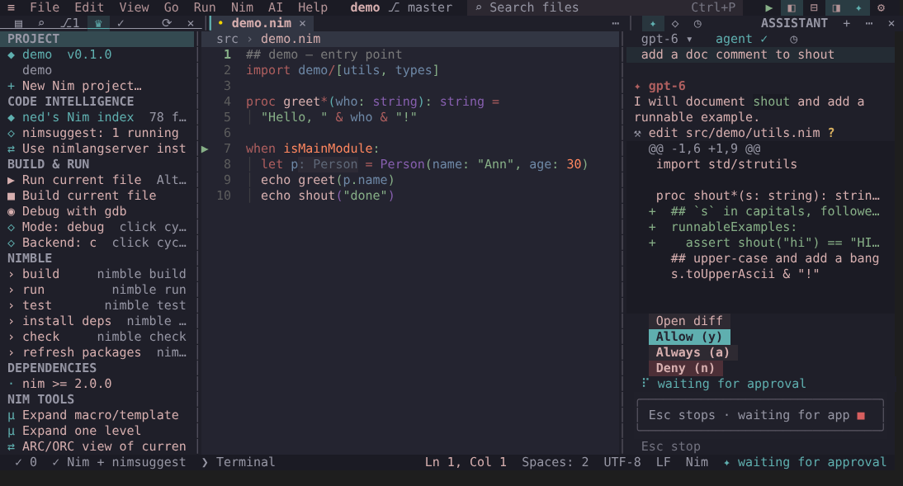

---

## Contents

- [What's new in 6.8](#whats-new-in-68) · [6.7](CHANGELOG.md#whats-new-in-67) · [older releases](CHANGELOG.md)
- [Features](#features)
- [Installing](#installing)
- [First steps](#first-steps)
- [Key bindings](#key-bindings)
- [Nim IDE: the built-in engine](#nim-ide-the-built-in-engine)
- [C: ned's own engine](#c-neds-own-engine)
- [AI assistant](#ai-assistant)
- [Search and replace](#search-and-replace)
- [Safety: how ned protects your work](#safety-how-ned-protects-your-work)
- [Settings](#settings)
- [Vim mode and zen mode](#vim-mode-and-zen-mode)
- [Files ned uses](#files-ned-uses)
- [Building, tasks and performance](#building-tasks-and-performance)
- [Troubleshooting](#troubleshooting)
- [Contributing](#contributing)

---

## What's new in 6.8

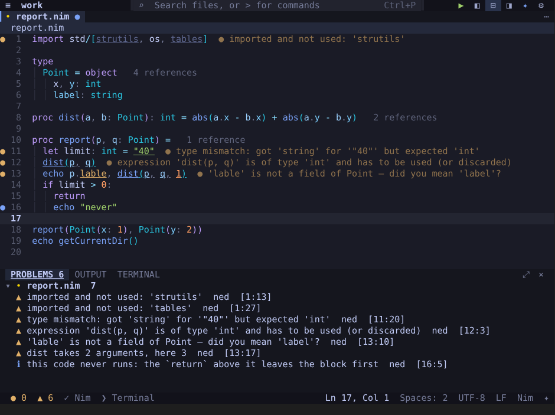

- **nedls: ned's Nim engine as a language server**, for VS Code, Neovim, Helix, Zed, Emacs, Kate and Sublime —
  instead of nimlangserver or nimsuggest. Completion, hover, signature help, definitions, references, rename,
  symbols, semantic colours, inlay hints, formatting, quick fixes and problems, from the same code the editor
  runs; it starts at about 6 MB and answers a hover in a few milliseconds. See
  [nedls](#nedls-neds-engine-in-other-editors).
- **nedfmt: the formatter on its own**, with nph's command line — `--check`, `--diff`, `--out`, `--outDir`,
  `--stdin-name`, `--line-length`, `--include`, `--exclude`, `--extend-exclude`, `.nph.toml` — and a git pre-commit
  hook in one step (`nedfmt --install-hook`). `ned --format` is the same program. The release binaries come with
  `nedfmt` and `nedls` beside `ned`.
- **The formatter checked by Nim's own parser** (`nim.format.verify`, `nedfmt --verify`): a small checker built once
  from the compiler's sources compares the syntax tree before and after; a file it reads differently is left as it
  was. On Nim's compiler and standard library (463 files): no difference (`nimble parsecheck`).
- **The formatter closer to nph**: 99.0% of the lines of Nim's compiler and standard library come out as nph writes
  them (98.0% in 6.7) — lambdas, `if` and `try` values among the arguments as blocks, a command's comma on a line
  of its own, `f():` blocks without the parentheses, prefix operators on their bracket (`%*{…}`).
- **The engine's own checks, at once**: an unused import, a value neither used nor discarded, a literal of the
  wrong type, a field typo (*did you mean 'label'?*), the wrong number of arguments, code after a `return`, an
  unused local — before the compiler's check, in the compiler's words (so its quick fixes apply), and only what
  the engine is sure of.
- **Names a macro makes**: the compiler expands a module's top-level macro calls once, in the background, and
  completion, hover and *Go to definition* know `getConfig` from `makeGetters(Config)`.
- **The compiler's answer, once**: where the engine has none (nimsuggest off), one nimsuggest run answers that hover
  or *Go to definition* and quits.
- **The index on disk**: the standard library and nimble packages are read once, not again in every session — ned's
  and nedls' first answer comes sooner.
- **A sharper engine** — the same answers as nimsuggest for 98.6% of type hints (94% in 6.7), 98.9% of
  definitions (95.5%), 98% of variable types (91%) and 98.6% of member completions (90.5%; nimsuggest's own:
  74%; a name nimsuggest makes up itself, gensym'd, now counts as no answer). It now reads `when` branches left
  out on this platform with their own imports and types, unions and type classes, names a template call declares
  and a template's parameters at its call, `quote do` interpolations, forward declarations, `since` blocks,
  overloads of `[]` by their number of indices, and more.
- **Release binaries built with link-time optimisation** (`-d:lto`): 5–10% less time in the engine and the
  formatter, a 7% smaller binary.

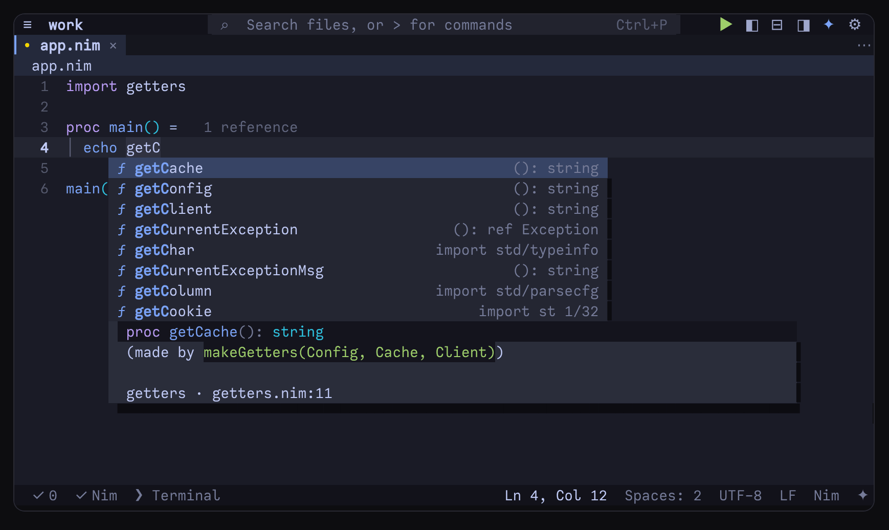

Older releases are in [CHANGELOG.md](CHANGELOG.md): [6.7](CHANGELOG.md#whats-new-in-67) signed in to GitHub without
a password and brought AI that knows your code, [6.6](CHANGELOG.md#whats-new-in-66) showed where ARC/ORC copies,
ran tests on save and added postfix completion, [6.5.1](CHANGELOG.md#whats-new-in-651) fixed C wrappers written one
parameter a line, [6.5](CHANGELOG.md#whats-new-in-65) brought ned's own C engine and ligatures,
[6.4](CHANGELOG.md#whats-new-in-64) took the Nim engine further (parameter names, a generic's instance, organize
imports), [6.3](CHANGELOG.md#whats-new-in-63) explained C from Nim and gave the formatter your settings,
[6.2](CHANGELOG.md#whats-new-in-62) a calmer, desktop-like look, [6.1](CHANGELOG.md#whats-new-in-61) smarter colours,
[6.0](CHANGELOG.md#whats-new-in-60) split ned into a project with its tests.

---

## Features

**Desktop-style UI in the terminal** — title bar with menus (F10), command palette (Ctrl+E, over 200 commands,
most-used first), left dock (files, search & replace, git, Nim, tests), right dock (AI assistant, outline,
timeline), bottom panel (problems, output, terminal), tabs, breadcrumbs, minimap, sticky scroll, indent
guides, rainbow brackets, tooltips, toasts, modal dialogs, context menus (right click), drop shadows,
hover effects, 50 themes (VS Code dark/light, One Dark, Tokyo Night, Catppuccin, Gruvbox, Dracula, Nord,
Solarized, GitHub, Rosé Pine, Kanagawa, Ayu, Monokai, Modus, Slate, Monochrome, Everforest, Night Owl, from
vim Molokai, Jellybeans, Iceberg, Sonokai and PaperColor, and ned's own: Nim Crown, Frankincense, Desert Dusk,
Lagoon, Sea Glass, Paper Ink, Rose Quartz, Amber CRT and Green Phosphor …)
— or `auto`, following the terminal's background or the time of day, your own colours (a theme editor that
checks contrast), VS Code or base16 themes imported, and Termux's own colours set to match —
three icon sets (unicode, Nerd Font, ASCII), phone layout below 70 columns, an accessibility mode (ASCII, letters
beside colours, high contrast), multi-root workspaces (git for each folder), remote folders over SSH (git, Run
and the assistant's commands on the server; its changes come back by themselves), settings sync.

**Editing** — multi-cursor (Ctrl+D, Alt+A, Alt+J/K), expand/shrink selection, move/duplicate lines, toggle
comment, folding, snippets for Nim, Python, C, C++, JS/TS, Rust, Go, HTML and shell (plus your own),
completion, auto-pairs, smart indentation, soft wrap, split editor, bookmarks, regex find/replace, sort/join/
case transforms, line-ending and indentation conversion, format on save (built in for Nim, JSON, Markdown, CSS,
YAML and TOML; a whole project at once; or only the lines you changed, and a preview first),
rulers at the columns you choose or where the formatter wraps (`"editor.rulers": ["lineLength"]`; long lines tinted), colour swatches, `.editorconfig` support, spell check,
CSV and TSV files as tables (columns lined up, sort by a column, a column's sum and mean), large-file mode, a 3-pane merge editor, keyboard macros, vim, Emacs and Helix key bindings, operator ligatures
(`editor.fontLigatures`: drawn by ned in any terminal — `─→ ═⇒ ≠ ≤ ≥` — or kept whole for a ligature font).

**Languages** — syntax highlighting for Nim, C, C++, JS/TS, Rust, Go, Python, Kotlin, C#, PHP, SQL, Java, Lua,
Ruby, shell, Markdown, JSON, YAML, TOML, HTML, CSS, Makefiles, diffs, Nim templates (`.nimf`) and more — and your
own (`languages`); code inside strings and Markdown code blocks in its own colours (C in `{.emit}`, SQL, HTML,
regular expressions); any language server (configure in `lsp`) with type definition, implementation and type
hierarchy, document links, pull diagnostics and formatting as you type — and a second one beside it (a linter such
as ruff), their problems and fixes merged; formatters per language; debugging through the Debug Adapter Protocol (Python, C, C++, Rust, Go, JS/TS …) with logpoints and
stops when a value changes; tests for pytest, go
test, cargo test, PHPUnit, dotnet test and Gradle/Maven; coverage for Python, Go, Rust, JS/TS and any lcov file;
Send to REPL with `# %%` cells; Emmet for HTML and CSS.

**Nim IDE** — a built-in Nim engine (completion with documentation beside the list, hover, go to definition,
signature help, references with counts beside each declaration (operators too), rename, type hierarchy, go to
implementation, change signature, inline, move to another module, fill in a constructor's fields, outline, project symbols, the types of `let`s, `var`s and loop variables shown beside them,
`include`d files and what templates and macros declare understood) that needs no language server — and serves
other editors as one (`nedls`) — a formatter in nph's style (also on its own: `nedfmt`, with a pre-commit hook),
errors while you type from the compiler itself and the engine's own checks at once (unused imports, field typos,
argument counts, values not used), `nim check` on save; nimlangserver if you prefer it;
macro/template expansion (Alt+M), ARC/ORC view, generated C, test explorer for `std/unittest`
with ▶ run buttons in the gutter, project symbols, nimble tasks and the dependency tree, Atlas, Nimony, gdb
debugging in the terminal (logpoints, stops when a value changes), a profiler that shows each proc's and line's
share of the time beside it, quick fixes from the compiler's messages, AI fixes checked by `nim check`, REPL (Shift+Enter sends code to inim), docs lookup, run configurations, what a
proc can raise, benchmarks, nimble releases and newer dependency versions, testament, runnableExamples with a ▶,
type mismatches explained argument by argument.

**C** — ned's own C engine, no clangd needed: completion (struct members after `.` and `->` too), hover with the
comment that documents a declaration, go to definition through `#include`s, references, rename, signature help, the
outline, the C compiler's errors while you type and a missing `#include` added; clangd when you prefer it.

**Integrated terminal** — a real pty with an xterm-compatible emulator: vim, htop, less, git, ssh all work;
several terminals (two side by side), scrollback, mouse, selection and copy; with bash, zsh and fish every command
is marked — Ctrl+↑/↓ go through them, failed ones show red, a command's output can be copied or it can be run again.

**Git** — source-control dock (stage, unstage, discard, diff, commit, push, pull, log), gutter marks that
follow your typing, change navigation and revert, inline blame, file timeline, AI-written commit messages,
interactive rebase, cherry-pick, branch compare and graph, the history of some lines, bisect (by hand or with a
command), worktrees, submodules, GitHub pull requests, issues and CI status (`gh`), review comments on their
lines; signing in to GitHub (the GitHub CLI or an SSH key — no passwords), undo of the last commit, pull or
merge, and checks before a commit (formatted, tests passing).

**AI** — chat and agent (read, search, edit files, run commands — you approve edits and commands; its edits are
checked with `nim check` and the like, and it is told what is wrong), a plan first and then each step with a
restore point, tests it writes kept only when they pass, a failing test made to pass (kept only when it does),
answers grounded in the declarations your code uses, inline edit of a selection (Alt+Shift+C), undo of the agent's
changes, token and cost counter, AI review of staged changes, a local model on the device (Ollama or llama.cpp,
set up for you: offline on a phone too), MCP servers for more tools, their prompts (/server:prompt) and resources (@server:uri); Anthropic, OpenAI, OpenRouter, Ollama, Groq, DeepSeek, Gemini, Mistral or any
OpenAI-compatible endpoint.

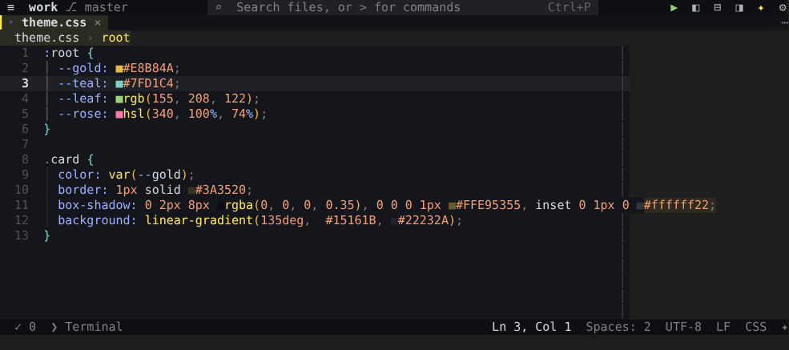

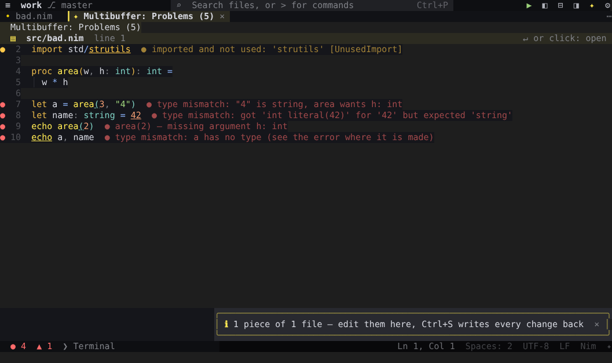

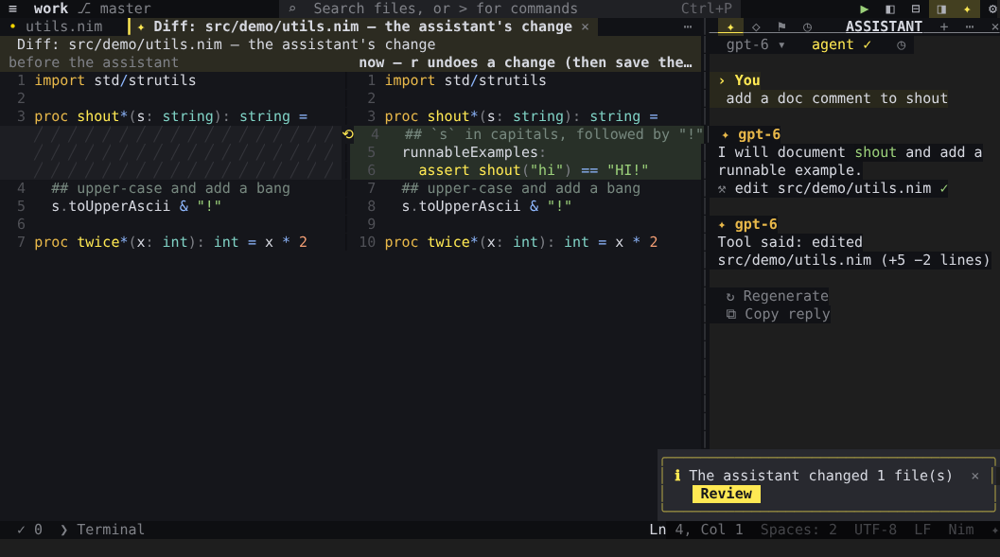

## Installing

ned needs **Nim 2.2 or newer** and nothing else to build. Everything else is optional and is picked up
automatically when it is on your `PATH`.

### Termux (Android)

```sh
pkg install nim git ripgrep curl            # nim to build; the rest is optional but recommended
nim c -d:release --opt:speed -d:strip -o:$PREFIX/bin/ned src/ned.nim
ned --check                                 # what ned found, and how to add the rest
ned
```

or, from the project folder: `nimble termux` (ned, with `nedfmt` and `nedls` beside it).

The Nim IDE features need nothing more: the engine is built in, and `nim check` does the rest.
Recommended extras:

```sh
nimble install inim                         # Nim REPL (formatting is built in; nph is optional)
pkg install gdb termux-api                  # debugger; clipboard (also install the Termux:API app)
```

Nothing stays running in the background — nimsuggest is off by default, and the checks while you type are short
`nim check` runs — which suits a phone's memory. A save also runs the tests that cover the file and asks the
compiler where ARC/ORC copies, short runs as well; `"nim.testOnSave": "off"` and `"nim.showCopies": false` leave
them out to spare the battery.

Use a Nerd Font in `~/.termux/font.ttf` and set `"ui.icons": "nerd"` for nicer icons. The extra-keys row of
Termux (Esc, Ctrl, Alt, arrows, F-keys) makes every shortcut reachable; every command is also in the menus
and the palette, and everything can be tapped.

### Linux

```sh
nim c -d:release --opt:speed -d:strip -o:ned src/ned.nim && sudo mv ned /usr/local/bin/
# or
nimble install            # builds and installs ~/.nimble/bin/ned (and nedfmt, nedls)
nimble local              # builds into ~/.local/bin (ned, nedfmt, nedls)
```

A terminal with true colour and mouse reporting (kitty, WezTerm, foot, Alacritty, GNOME Terminal,
Konsole, Windows Terminal, iTerm2, tmux with `set -g mouse on`) gives the best result.

### macOS

```sh
brew install nim git ripgrep               # Homebrew (brew.sh); choosenim works too
nim c -d:release --opt:speed -d:strip -o:ned src/ned.nim && sudo mv ned /usr/local/bin/
ned --check
```

The clipboard uses `pbcopy` / `pbpaste`. iTerm2, WezTerm, kitty and Ghostty show true colour and pass the mouse;
in Terminal.app set *Use Option as Meta key* (Settings › Profiles › Keyboard) so the Alt shortcuts work. The
debugger panel uses `gdb`, which macOS only lets run once it is code-signed (`brew install gdb`, then its signing
steps); without it, *Nim: debug with gdb* in the palette falls back to `lldb` in the terminal.

### Windows (WSL)

ned is a Unix terminal program, so on Windows it runs inside **WSL** (Windows Subsystem for Linux) — the Linux
build, in Windows Terminal:

```powershell
wsl --install                               # once, in PowerShell as administrator; then restart and open Ubuntu
```

```sh
# inside Ubuntu (apt's Nim is too old — take the official build)
sudo apt install build-essential git ripgrep curl xz-utils
curl -sSfL https://nim-lang.org/download/nim-2.2.4-linux_x64.tar.xz | tar -xJ -C ~
echo 'export PATH=$HOME/nim-2.2.4/bin:$PATH' >> ~/.bashrc && . ~/.bashrc
nim c -d:release --opt:speed -d:strip -o:ned src/ned.nim && sudo mv ned /usr/local/bin/
ned --check
```

Copying goes to the Windows clipboard (OSC 52 in Windows Terminal, and PowerShell), pasting reads it through
PowerShell, and links open in your Windows browser with `wslview` (`sudo apt install wslu`). Keep your projects
inside the Linux file system (`~/code`, not `/mnt/c/…`): it is much faster there.

### Ready-made binaries

The project's GitHub Actions workflow (`.github/workflows/build.yml`) builds ned on every push for Linux (x86_64
and arm64), macOS (Apple silicon and Intel), Termux (aarch64) and Windows through WSL, runs it in a real
pseudo-terminal, and attaches the binaries to the release when you push a tag such as `v5.6.1` — `nedfmt` (the
formatter) and `nedls` (the language server) beside each `ned`.

### Optional tools ned uses when present

| tool | what for |
|---|---|
| `nimsuggest` | ships with Nim; off by default — a second opinion where the built-in engine cannot infer a type (`"nim.nimsuggest": true`) |
| `nimlangserver` | only if you choose it (`"nim.ide": "nimlangserver"`) instead of the built-in engine |
| `nph`, `nimpretty` | only if you choose one (`"nim.formatter"`) instead of the built-in formatter |
| `inim` | Nim REPL (palette › Nim: REPL) — falls back to `nim secret` |
| `clangd` | C and C++ language server — for C, ned's own engine answers when it is not installed (`c.engine`) |
| `cc` (gcc or clang) | C errors while you type, the C in `{.emit}` checked, what the system's headers declare |
| `rg` (ripgrep) | fast project search (falls back to grep, then to a built-in search) |
| `git` | git dock, gutter marks, blame, timeline |
| `curl` | the AI assistant |
| `gdb` / `lldb` | Nim: debug with gdb |
| `termux-clipboard-*`, `pbcopy`, `wl-copy`, `xclip`, PowerShell (WSL) | system clipboard (OSC 52 is used too) |
| `gh` | Git › Pull request, and *Create a GitHub issue* from a TODO comment |

## First steps

```sh
ned                      # the folder you are in (reopens the files you had open)
ned src/app.nim:42:7     # a file at line 42, column 7      (also: ned +42 src/app.nim)
ned ~/code/project       # a folder (inside ned: File › Open folder…, or d on the Welcome page)
git log | ned            # what a command printed
ned --check              # what ned found on this system, and how to install what is missing
```

Starting ned on a file outside the current folder (say `ned ~/code/app/src/x.nim` from `$HOME`) opens that
file's project (the nearest folder with `.git`, a `.nimble`, `Cargo.toml` …) instead of indexing your home.

- **F10** opens the menus, **Ctrl+E** the command palette, **F1** the key bindings.
- **Ctrl+P** finds a file — type `:42` for a line, `@name` for a symbol, `#name` for a project symbol,
  `>` for commands.
- Click or tap anything: tabs, gutter markers (▶ run, ▾ fold), breadcrumbs, dock items, buttons.

## Key bindings

In Termux, Alt comes from the extra-keys row (or a hardware keyboard). Every binding is listed in **F1** and in the palette, and you
can add your own (see [Settings](#settings)).

### Window and layout

| keys | action |
|---|---|
| F10 | menu bar (while debugging: step over — Shift+F10 opens the menus) |
| Ctrl+E / Alt+X | command palette |
| Ctrl+B | left dock (Files · Search · Git · Nim · Tests; Tab cycles) |
| Alt+C | AI assistant (right dock) · Alt+I outline |
| Ctrl+\\ / Alt+` | integrated terminal · Alt+O bottom panel |
| Ctrl+↑ / Ctrl+↓ (in the terminal) | the commands you ran · Alt+Enter: its output, run it again … · Ctrl+PgUp/PgDn the other terminal |
| Alt+\\ | split the editor / switch panes · Alt+\| close the split |
| Ctrl+Alt+←/→ · ↑/↓ | resize the split or the focused dock · the bottom panel (↑ taller) · ⤢ or *Toggle maximized panel* fills the window with it |
| F6 / Shift+F6 | move focus editor → docks → panel |
| Alt+Z | zen mode (Esc Esc leaves) |
| Alt+T | themes (live preview) · Alt+W soft wrap · Alt+L line numbers · Alt+U mouse on/off |
| right click | context menus (editor, files, tabs, git, search results, terminal) — on touch: press and hold |
| drag | split divider, dock edges, the bottom panel's header, the scrollbar, the minimap, a tab (reorder) |
| wheel | scroll · Shift+wheel or tilt wheel: sideways · over the tabs: switch tabs |

### Files and navigation

| keys | action |
|---|---|
| Ctrl+P / Ctrl+O | find file (`:` line · `@` symbol · `#` project symbol · `>` command) |
| Ctrl+N · Ctrl+W | new file · close tab |
| Ctrl+S · Ctrl+Q | save · quit (asks about unsaved files) |
| Alt+← Alt+→ · Ctrl+PgUp/PgDn · Alt+1..9 | switch tabs |
| Ctrl+G | go to line[:col] · Ctrl+T symbol in file |
| Alt+. / F12 / Ctrl+click | go to definition · Alt+, jump back · Alt+< go forward |
| Alt+F12 · Alt+Shift+F12 | peek definition · peek references |
| Alt+Shift+T | reopen the last closed tab |
| Alt+Q / Shift+F12 | find all references |
| Alt+H | hover info (also automatic) |
| Alt+N / Alt+P / F8 | next / previous problem |
| Alt+' | toggle bookmark · Alt+; next · Alt+: previous |
| Alt+V / Alt+Shift+V | next / previous TODO · FIXME · BUG · HACK · NOTE comment (View › TODOs lists and counts them) |
| F7 / Shift+F7 | next / previous git change · click the branch in the title bar: branches · ⟳ sync |

### Editing

| keys | action |
|---|---|
| Ctrl+Z / Ctrl+Y | undo / redo |
| Ctrl+C / X / V | copy / cut / paste (whole line when nothing is selected) |
| Ctrl+A · Ctrl+L | select all · select line |
| Ctrl+D · Alt+A | next occurrence · all occurrences (multi-cursor) |
| Alt+J / Alt+K · Alt+Shift+↑↓ | add cursor below / above · Esc back to one cursor |
| Alt+click · Alt+drag | add a cursor · box (column) selection |
| Alt+Shift+→ / ← | expand / shrink selection |
| Alt+↑ / Alt+↓ · Alt+D | move line(s) · duplicate |
| Alt+Shift+R · Alt+Shift+M | record a keyboard macro (again: stop) · play it — *Edit › Macros* for N times, each line, saved ones |
| Ctrl+K · Ctrl+/ | delete line(s) · toggle comment |
| Alt+- / Alt+= | fold / unfold (or click ▾ ▸) |
| Tab after a keyword | snippet (Tab / Shift+Tab walk the fields) |
| Ctrl+Space | completion |
| Alt+F | format document (with lines selected: just those) · F2 rename symbol |
| Alt+Enter | quick fixes (Nim: fixes for the compiler's errors and warnings, missing case branches, generate $/==/hash, doc comment, run selection, debug this test) |
| F2 | rename — a preview lists every change first (Space unticks, Enter applies) |

### Search

| keys | action |
|---|---|
| Ctrl+F | find (Enter next · Shift+Enter previous · Alt+C case · Alt+W whole word · Alt+R regex) |
| Ctrl+R | replace — then Yes / No / All / Done (y n a q) |
| F3 / Shift+F3 | next / previous match |
| Alt+S | search the project (Search dock) |
| Alt+H (in the Search dock) | show the replace box · Alt+Enter replace all · Tab moves between boxes |

### Run, test, debug

| keys | action |
|---|---|
| Alt+R / F5 | run the current file · Alt+B / Shift+F5 build or check |
| F9 · click the gutter's left edge | toggle a breakpoint (then F5 starts the debugger) · palette: conditional breakpoint, logpoint, stop when this changes |
| F5 · F10 · F11 · Shift+F11 · Shift+F5 | while debugging: continue · step over · step in · step out · stop |
| in the Debug panel | Enter on ▸ expands a variable · *+ add a watch expression* · Enter on a watch (or a *stop when it changes*) removes it |
| Ctrl+F10 | debugger: run to cursor (starts debugging if needed) |
| ▶ in the gutter | run a test, a suite, `when isMainModule`, a nimble task |
| Alt+Y | nimble tasks · Alt+E Nim dock |
| palette | Debug: … · Nim: debug with gdb (in the terminal) · Run tests in file · Run all tests · Stop |

### AI

| keys | action |
|---|---|
| Alt+C | chat (Enter sends, Alt+Enter new line, ↑ history, Ctrl+L new chat, Esc stops) |
| Alt+Shift+C | edit the selection — or the enclosing block — with an instruction |
| y · a · n | allow · always allow · deny an agent action |
| Tab (in the chat box) | complete a `/command` or `@mention` |
| Tab (in the editor) | accept an inline suggestion (when enabled) · Esc dismisses it |

## Nim IDE: the built-in engine

ned 5 understands Nim itself. Its index reads your files, the standard library and your nimble packages
as you work. It answers completion, hover, go to definition, signature help, references, rename, the
outline and symbol search immediately, with no compiler run and no server process.

**How it finds things.** Imports are resolved like the compiler resolves them:
1. next to the importing file;
2. `std/…`, and the search paths that `nim dump` reports for your project (so `--path` lines in
   `config.nims` and `nim.cfg` count);
3. the package's `srcDir`, so tests and examples can `import mypkg`;
4. the newest installed version of each nimble package, including `nimbledeps/` and atlas `deps/`.

`export`, `include`, `from … import`, `except` and `import … as` are followed. A file that another one
`include`s sees what its includer sees: the includer's imports, its declarations and its other include files
(the includer is looked for in the file's folder and the one above). `when` branches are evaluated for your
platform and for what your project's config defines (`nim dump` lists it, so a symbol it leaves out is false). Names are compared style-insensitively, as Nim does. Your
open, unsaved buffers count over the files on disk.

**How it knows types.** From declarations, literals and call results, through chains like
`t.getOrDefault(k).len`. Generics are filled in from arguments (`some(5)` is an `Option[int]`,
`initTable[string, int]()` a `Table[string, int]`, `convert(Seconds, Nanoseconds, x)` x's type) and through
aliases (`Vec2 = GVec2[float32]`, so `v.x` is a `float32`). It also handles:
- loop variables (`for k, v in t.pairs`, a type's own `items` and `pairs` iterators) and tuple unpacking
  (`let (a, b) = …`);
- object fields including inherited ones, `ref`/`ptr` dereferences (`t[]`), and `x{…}` / `x[…]`
  accessors;
- values over several lines (`let x = if c:` / `case k` / `try:` / `block:`, or on the line after `=`),
  aliases (`BiggestInt` is `int64`) and conversions in every spelling (`x.float`, `fd.AsyncFD`, `BiggestUInt 1`);
- operators as Nim types them: `/` of integers is a `float`, `a .. b` an `HSlice`, `and`/`or` of integers an
  integer, `5 * x` x's type, `n - 1` of a `Natural` an `int`, `Time - Duration` a `Time`;
- overloads by their number of arguments and by all of their types (`sock.recv(10)` is a `string`,
  `recv(sock, buf, 10)` an `int`), and generic parameters by their constraints (`[T: SomeInteger]`);
- routines inside routines, an async proc's `result` (what its Future holds), a macro's `untyped` arguments
  (`NimNode`s);
- what a template of the file declares (`genVecConstructor(vec, Vec, float32)` makes `vec2`, `vec3` …);
- block scoping: a `let` in one `of` branch is not seen in the next;
- generic objects built with or without their arguments (`Box[int]()`, `Box(val: "x")` is a `Box[string]`), a
  generic routine's instance on hover (`T = int`), what a concept asks of a value of its type, statements after `;`.

**Type hints.** A `let`, `var` or `const` written without a type shows it after its name, in grey:
`let n: int = parseInt(s)`. The engine works them out for the lines on screen as you scroll and edit. Calls show
their parameters' names before literal arguments — `draw(width: 10, height: 20, filled: true)` (`nim.parameterHints`:
`literals`, `all` or `off`).
`"nim.typeHints": "nimsuggest"` asks nimsuggest instead (when it is turned on); `"editor.inlayHints": false` turns them off.

**What completion offers:**
- After a `.`: the receiver's fields first, then the procs that take it exactly, then related ones
  (subtypes, `openArray`, wider numbers), then generic ones.
- A bare name: locals, then this module, then imports, then `system`, then keywords.
- `Foo(` lists `Foo`'s fields as `name: `, and after `import` it offers module names.
- Overloads are folded into one entry; the documentation lists every signature.

**How good it is.** The same questions to ned's engine and to nimsuggest, on 23 files of the standard library,
nimble packages and the compiler (see [What's new in 5.25](CHANGELOG.md#whats-new-in-525) for the list):

| | ned's engine | nimsuggest |
|---|---|---|
| type hints: the same as nimsuggest's | 98.6% | — |
| go to definition: the same place | 98.9% | — |
| a variable's type: the same | 98% | — |
| member completion: the member written there is offered | 98.6% | 74% |
| time for one question | 0.6 ms | 250 ms |

Where nimsuggest answers with a name it made up itself (a gensym'd symbol, an `:anonymous` proc) it counts as no
answer. What still differs is mostly where both answers are defensible (a name a template call declares: ned goes
to the call, nimsuggest into the template), chronos' `raises` futures, which its async macro builds, and number
types that generics infer from literals. The comparison is in [tests/engine](tests/engine):
`tests/engine/build.sh && tests/engine/compare.py file.nim` runs it on your own code.

**Errors.** While you type, the compiler checks the unsaved text after a pause (`nim check`, reading it from
stdin in the file's folder: same imports, same config); a misspelled name is marked at once by the engine. On
save, `nim check` runs on the file. See [What's new in 5.26](CHANGELOG.md#whats-new-in-526).

**The engine's own checks, at once** (`nim.engineChecks`, on by default), half a second after you stop typing and
before the compiler's check: a field name that is a typo of one the object has (`p.lable` — *did you mean
'label'?*), a call with the wrong number of arguments for every routine of that name in scope, a call whose value is
neither used nor discarded, a literal that can never be the declared type (`let n: int = "3"`), an import nothing in
the file uses, code after a `return`, `raise`, `break` or `continue` in the same block, and a local `let`/`var`
nothing uses. The messages are the compiler's own, so the same quick fixes apply (Alt+Enter: discard the value,
remove the import). Only what the engine can be sure of: not inside templates and macros or what they are given,
not where an overload the engine cannot see could be the one called, not an import whose `$` or `==` code here might
call without naming it, not in `when` branches left out. On Nim's own compiler and standard library (463 files) and
563 files of 19 nimble packages they report nothing the compiler would not — apart from a few mistakes in generic
code nothing instantiates, which the compiler never looks at; the compiler's word wins on any line where both say
something.

**The compiler's answer, once** (`nim.compilerAnswers`, on by default). With nimsuggest off (the default), a
hover or *Go to definition* the engine has no answer for — a name a macro makes, say — asks the compiler once: one
nimsuggest run for that question, which then quits, so its memory goes with it. The answer is kept until the file
changes; your unsaved text goes to it as a private copy, deleted after.

**Names a macro makes** (`nim.macroNames`, on by default). `makeProcs(Foo, Bar)` at the top of a module declares
`getFoo` and `getBar`, which no reader of the text can see: the compiler expands the file's top-level macro calls
once, in the background (`nim check --expandMacro`, your unsaved text as a private copy, deleted after), and the
project files it imports are expanded the same way. What the expansions declare — routines, types and their fields,
constants — is then known to completion, hover (which says which call made it), signature help and *Go to
definition* (which goes to the call). It runs again only when those calls change.

**The index on disk** (`nim.indexCache`, on by default). The engine's reading of the standard library and the
nimble packages is kept in `~/.cache/ned/index`, so a new session — ned's or nedls' — answers its first question
without parsing them again (the whole standard library comes back from the cache in a fifth of the time parsing
it takes). An entry is used only for the very text it was made from, by the same parser, with the same
defines; anything else is read afresh.

**Expansion.** Alt+M on a template call writes it out with the arguments in place (the engine, at once); on a
macro call, the compiler expands it (`nim check --expandMacro`). Hover on a template call shows the same.

**ned's engine and nimsuggest.** Since 5.28 nimsuggest is off by default; this is what each gives:

| | ned's engine (the default) | nimsuggest |
|---|---|---|
| completion, hover, signature help, outline | ✓ | ✓ |
| go to definition, references, rename | ✓ | ✓ |
| … of operators (`a + b`), of fields in constructors (`Vec(x: 1)`), of one overload | ✓ | ✓ |
| type definition, go to implementation, type hierarchy | ✓ | — |
| reference counts beside declarations | ✓ | — |
| type hints beside `let`, `var` and loop variables | ✓ | ✓ |
| errors while you type | `nim check` on the unsaved text | ✓ |
| template expansion · macro expansion | at once · `nim check --expandMacro` | ✓ · ✓ |
| quick fixes and code actions (fill in fields, write a forward declaration's body, generate `$`/`==`/hash) | ✓ | — |
| first answer in a 52 000-line file (ned 5.28's source) | at once | 12 s (it compiles the project first) |
| memory with that file open | 30 MB, the whole editor | 600 MB, nimsuggest alone |
| crashes during the comparison above (23 files) | 0 | 52 (started again each time) |

Turn nimsuggest on (`"nim.nimsuggest": true`, when it is installed — it comes with Nim) for a second opinion:
completion where the index cannot tell a receiver's type (inside macros, `auto` results), and errors while you
type in a big project whose `nim check` takes over 10 s. It is restarted past `nim.nimsuggestMaxMB` (1500 by
default).

**Settings.**
- `nim.ide`: `builtin` (the default), `nimlangserver`, or `off`.
- `nim.nimsuggest`: run nimsuggest for the extras above (off by default); `nim.nimsuggestMaxMB` caps its memory.
- `nim.typeHints`: where the type hints come from, `builtin` (the default) or `nimsuggest`.
- `nim.liveDiagnostics`: errors while you type (on by default); `nim.liveDiagnosticsFrom`: `auto`, `compiler`
  or `nimsuggest`.
- `editor.completionDocs`: documentation beside the list. Ctrl+Space toggles it while the list is open,
  Ctrl+↑/↓ scrolls it.
- *Nim: language server status* shows what the engine has indexed and which search paths and packages it
  uses.

### nedls: ned's engine in other editors

**`nedls`** is ned's Nim engine as a language server (LSP over stdin/stdout), for VS Code, Neovim, Helix, Zed,
Emacs, Kate, Sublime — instead of nimlangserver or nimsuggest. Its answers are ned's own: the same code the editor
runs, without its screen. `nimble install` builds it next to ned (or `nimble nedls`, or `nim c -d:release -o:nedls
src/nedls.nim`).

What it does: completion (with documentation, ned's snippets and postfix templates, the import it adds), hover,
signature help with every overload, definition, declaration, type definition, references, highlights, rename,
document and workspace symbols, semantic colours, inlay hints (types and parameter names), folding, formatting
(ned's formatter; a file it is not sure of gets no edits and a message), the quick fixes for the compiler's
problems (a missing std import, an unused one), and problems: ned's own checks at once, the compiler on the
unsaved text after a pause, `nim check` on save. Positions are UTF-8 when the editor offers it, else UTF-16.
It starts at about 6 MB, holds a big file with its imports in about 16 MB, and answers a hover in a few
milliseconds and a completion in about 20.

Settings (in the editor's `initializationOptions`, or under `nedls` in its settings): `inlayHints` (true),
`parameterHints` (`literals`, `all`, `off`), `checkOnSave` (true), `liveDiagnostics` (true),
`formatLineLength` (88), `nedSettings` (true: your ned settings apply too).

```lua
-- Neovim 0.11+
vim.lsp.config('nedls', { cmd = { 'nedls' }, filetypes = { 'nim', 'nims', 'nimble' },
  root_markers = { 'nim.cfg', 'config.nims', '.git' } })
vim.lsp.enable('nedls')
```

```toml
# Helix: languages.toml
[language-server.nedls]
command = "nedls"
[[language]]
name = "nim"
language-servers = ["nedls"]
```

- **Emacs (eglot):** `(add-to-list 'eglot-server-programs '(nim-mode . ("nedls")))`
- **Kate** (LSP Client › User Server Settings): `{"servers": {"nim": {"command": ["nedls"], "highlightingModeRegex": "^Nim$"}}}`
- **Sublime** (LSP settings): `"clients": {"nedls": {"enabled": true, "command": ["nedls"], "selector": "source.nim"}}`
- **Zed** (with the Nim extension): `"lsp": {"nimlangserver": {"binary": {"path": "/path/to/nedls"}}}`
- **VS Code:** a generic LSP client extension pointed at `nedls` for the `nim` language (turn off the Nim
  extension's own server).
- **ned itself:** `{"nim.ide": "nimlangserver", "lsp": {"nim": ["nedls"]}}` — mostly for testing nedls; the
  editor has the engine built in anyway.

nedls trusts the folder it is given (it runs `nim dump` and `nim check`, which run the project's `config.nims`):
editors ask about trusting a workspace themselves. `nimble lsptest` drives it with a test client (every feature,
and 2000 random edits that must not put it out of step).

### Using nimlangserver instead

Set `"nim.ide": "nimlangserver"` (or click *Use nimlangserver instead* in the Nim dock). All nimlangserver
settings are in the settings file under `nim.*`; completion documentation, signature docs and Markdown
hovers work with it too. The rest of this section is about that mode.

### One nimsuggest per project

nimlangserver decides per file which project (nimsuggest process) serves it. Without a mapping, older
versions start a nimsuggest for every file you open. Newer ones pin whichever file you opened first and
restart it after an idle timeout. ned avoids both:

1. Before the server starts, ned picks the **main module**. It uses `nim.projectFile` if you set it.
   Otherwise it takes the `.nimble` package's `srcDir/<name>.nim` (the same module nimlangserver's own
   nimble entry point uses), then a `bin`, `<folder>.nim`, `src/<folder>.nim`, a module with its own
   `.nims`/`.nim.cfg`, `main.nim`, or the only `.nim` file.
2. It sends a `projectMapping` that maps the project's sources to that module. They all share one
   nimsuggest, which is never stopped for being idle.
3. **A folder with several packages** (your home folder, a monorepo) gets one rule per nimble package, added
   as you open its files. Loose scripts share one nimsuggest, started for the first script you open. A
   package file is therefore always checked inside its own package, with its imports and nimble paths.
4. Tests and examples are separate programs. With `nim.maxNimsuggestProcesses` = 1 (the default) they are
   served by the same process. Set it to 2 to give them their own, for complete answers there.
5. ned always names the `nimsuggest` to use: `nim.nimsuggestPath`, or the one on your `PATH`. Without
   that, nimlangserver would use the Nim folder that `nimble dump` reports inside a package, which is
   often not the Nim you use.
6. The server and its nimsuggest children are shut down when ned exits and restarted when you open
   another folder, so processes never pile up. A server that crashes is restarted. If it keeps crashing,
   the built-in nimsuggest client takes over.

Check it in the **Nim dock** (Alt+E › Code intelligence) or with *Nim: language server status*. Change the
main module with *Nim: use current file as main module* (stored in the project's `.ned/settings.json`).
Your own `nim.projectMapping` always wins.

### Formatting Nim

Alt+F (*Format document*) and `"editor.formatOnSave": true` use ned's own formatter. It formats the way nph does:
- 2-space indentation, and spaces around operators and after commas;
- one statement per line, with a blank line after multi-line routines and types;
- `proc f()` with an empty parameter list, and long import lists packed (one module a line when they are paths
  such as `std/os`);
- `if` and `case` written out on several lines unless every branch is a plain value;
- calls, parameter lists and collections wrapped at 88 columns, with a trailing comma when they take
  several lines;
- comments kept, and a trailing comment that does not fit moved under its line (a lone `## doc` line under
  a statement joins it when it fits);
- a long `from x import …` with the names on the next line.

With several lines selected, Alt+F (or *Format selection*) formats only those lines, at their indentation.

Its layout is yours to choose (settings, Nim section):

| setting | default | |
|---|---|---|
| `nim.format.lineLength` | 88 | where lines wrap (80 and 100 are common too) |
| `nim.format.params` | `fit` | a routine's parameters: `fit` — on one line, else all on the next line or one per line (nph) · `onePerLine` — one per line when too long · `always` — one per line when there are two or more · `keep` — your line breaks |
| `nim.format.arguments` | `fit` | a call's arguments: the same four (`fit` packs them on the next lines) |
| `nim.format.collections` | `fit` | array, seq, table, set and tuple literals: the same four |
| `nim.format.imports` | `keep` | `sort` — std/, pkg/, others, ./relative · `merge` — sorted, and `std/a` + `std/b` → `std/[a, b]` (module initialisation follows import order: keep it if that matters) |
| `nim.format.align` | off | line up object field types and the `=` of const / let / var members |
| `nim.format.reflowDocComments` | off | re-wrap a `##` paragraph with a line longer than the line length (lists and code stay) |
| `nim.format.maxBlankLines` | 1 | empty lines kept in a row (up to 3) |
| `nim.formatEmitC` | on | the C in `{.emit: """…""".}` formatted too: clang-format (your `.clang-format`), else ned's own C formatter |
| `editor.formatOnPaste` | `indent` | pasted lines take the indentation of where they go · `format` — and pasted Nim is formatted · `off` |

ned's own **C formatter** (used for the emits, and for `.c` files when clang-format is not installed) indents by
braces in LLVM's layout and evens out spaces — after commas and keywords, around assignments and comparisons,
none inside brackets — and keeps your line breaks; like the Nim one, it checks that the code is the same token for
token, or changes nothing.

From the shell: **`nedfmt`** — the same formatters as a small program of their own (`nimble install` builds it
next to ned; `ned --format` is the same command) — with nph's options:

```sh
nedfmt src/ tests/                 # format in place (in a git repository: the files git knows, not ignored ones)
nedfmt --check .                   # CI: exit 1 when a file would change, nothing written
nedfmt --diff x.nim                # a unified diff of what would change
cat x.nim | nedfmt -               # stdin to stdout (--stdin-name=path/x.nim: its kind and its project's settings)
nedfmt --outDir:out src/           # write beside, the originals untouched (--out:FILE for one file)
nedfmt --install-hook              # a git pre-commit hook: the staged Nim files must be formatted
nedfmt --verify src/               # check every Nim result with Nim's own parser too (below)
```

`--exclude`, `--extend-exclude` and `--include` take regular expressions, and nph's `.nph.toml` (exclude,
extend-exclude, include) is read too, so a project set up for nph needs nothing new; files named on the command
line are always taken. The layout settings (`nim.format.*`) come from your settings and the project's
`.ned/settings.json`. Exit status: 0 done, 1 `--check` found files to change, 2 a file was left alone (the
formatter was not sure of it) or could not be read, 3 wrong arguments. The hook checks what is staged, not your
working copy; a file the formatter is not sure of does not stop the commit, and `git commit --no-verify` skips it.
*Format: every file in the project…* does it from the editor, with a review first (see the 5.24 notes).

**Nim's own parser as a second check** (`nim.format.verify`, `nedfmt --verify`). Where the compiler's sources are
installed — choosenim and source builds have them, or `nimble install compiler` — ned builds a small checker from
them once (in the background, about half a minute) and asks it whether each formatted file parses to the same
syntax tree as before, comments and layout aside. A file it reads differently is left alone. The formatter's own
token and block check runs anyway; this one is for when you want the compiler's word on it. `nimble parsecheck`
runs it over 463 files of Nim's compiler and standard library.

JSON, Markdown (tables) and CSS have built-in formatters too, used when prettier is not installed.

It works on tokens and checks every result: the same tokens in the same order (doc comments included), and the
same block structure. If anything would differ, it changes nothing and says so. Long string literals and
code with statements inside brackets (a lambda's body, `do` blocks) keep their layout.

How it compares with nph, on Nim's compiler and standard library:

| | built-in | nph |
|---|---|---|
| lines identical to nph's output | 99.0% of 198 000 | — |
| same code for Nim's parser (463 files) | all | all |
| semexprs.nim, 3 598 lines | 23 ms | 33 ms |
| strutils.nim, 3 069 lines | 12.5 ms | 16 ms |
| json.nim, 1 398 lines | 6 ms | 9.5 ms |
| json.nim, already formatted | 4 ms | 9.5 ms |

Both measured on the same (slow) machine; nph's times include starting the program, which ned also has to do when
it runs nph. Where the two still differ — one line in a hundred — it is mostly a comment nph joins to the line
above, a long condition broken at another operator, or arguments packed differently.

To use nph or nimpretty instead, set `"nim.formatter": "nph"` (or `"nimpretty"`), or pick *Nim: format with nph*
in the palette. Your own `formatters` entry for `nim` always wins.

### Other Nim features

- Alt+M expands the macro/template call under the cursor; *expand one level*; ARC/ORC view
  (`expandArc`); show generated C; check the project; generate docs.
- Quick fixes (Alt+Enter): *Import std/tables* for `undeclared identifier: 'initTable'` (from an index of
  the standard library's exports, built once and cached), *Remove unused import os*, and fixes worked out from
  the compiler's messages (let → var, discard, conversions, did you mean, export, create the proc, missing case
  branches, raises, ambiguous names, deprecated names), with *Fix all like this in the file*; AI fix (checked
  with `nim check` before it is applied) / explain.
- *Nim: toggle export marker (\*)*, *Nim: open documentation for symbol*, *Nim: REPL*.
- C interop: F12 on an `importc` declaration opens the C prototype (the hover shows it, with the comment that
  documents it in the header — in completion too), the C signature is shown dimmed after each wrapper
  (`nim.cSignatureHints`), `header: "…"` and `importc: "…"` are coloured and have a hover and F12, Alt+Enter
  rewrites a wrapper from its C declaration, and `proc ` + a C name completes a whole new wrapper; wrappers are checked
  against their headers (`nim.checkWrappers`), completion in `header: "…"` and `importc: "…"`, *wrap a C header
  (c2nim)*, *compile_commands.json for clangd*.
- Code inside strings in its own colours: `{.emit}` as C (C++, JS), `sql"…"`, `re"…"`, `peg"…"`, `parseJson("…")`,
  the `{expressions}` of `fmt"…"` and `&"…"`, and HTML or SQL in triple-quoted strings. `#[html]#` before a string
  marks it; `nim.embeddedLanguages` names your own procs (`{"render": "html"}`).
- C in `{.emit}` edits as C: indentation, `//` comments, completion from its headers and `nimbase.h`, hover,
  F12 between the Nim declaration and the C, C compiler errors on the emit's lines (on save and from builds);
  with clangd installed, clangd's completion, errors while typing, fixes and parameter hints (`nim.emitClangd`).
- HTML, CSS, SQL and JSON in strings go to their language servers: errors on the Nim line, completion, hover,
  fixes.
- *Nim: extract selection into a proc*, *change signature…*, *inline this proc*, *move to another module…* (see the
  5.19 notes), *Nim: sort imports*, *Nim: toggle proc ⇄ func*.
- Reference counts after each proc and type (`nim.referenceCounts`); *Nim: exports nothing uses…*.
- Completion offers names from standard modules not imported yet, and adds the import (`nim.autoImport`), and
  postfix templates after a `.`: `xs.for`, `c.case` with every value of its enum, `v.if` by its type
  (`nim.postfixCompletion`).
- Where ARC/ORC copies, after each save: ⧉copy beside what is copied, hover for why (`nim.showCopies`).
- Constants worked out on hover — a `when` too, with its branch left out on this platform dimmed
  (`editor.dimInactiveCode`).
- Debugger panel with gdb: F9 breakpoints, F5 start/continue, F10/F11 stepping (see the 5.2 notes); conditional
  breakpoints, logpoints and stops when a value changes (5.24).
- *Nimble: add dependency…* (adds `requires` and offers `nimble install -d`), *dependency tree*, *search packages*, tasks,
  build modes (debug / release / danger), backends (C, C++, JS, ObjC), Nimony.
- Test explorer (Tests dock) for `std/unittest` suites, with ▶ buttons in the gutter; tests run on save, ✓ or ✗
  beside each (`nim.testOnSave`).

## C: ned's own engine

C files get an IDE without installing anything: ned reads the file and the headers it includes, the way a person
skimming them does, and answers from that — about 15 ms the first time a file is opened (with every header it
includes), under a millisecond after.

- **Completion**: locals, parameters, the file's and its headers' functions, types, macros and enum constants, and
  **members after `.` and `->`** — through typedefs, pointers, arrays, casts, calls and macros (`opts->`,
  `list.items[i].`, `get(x)->`, `P_OPERAND(p)->`), and in designated initializers (`{ .x = 1, .`), each with its type
  and comment beside the list. After `goto`, the function's labels; in `#include "` and `<`, the headers there.
- **Hover**: the declaration on one line, where it is, and the comment that documents it (`/** … */`, `///` or `//`
  above it, `/**< … */` after it); a definition without a comment shows its prototype's from the header. A struct
  lists its fields.
- **Go to definition (F12)** through `#include`s: the file's folder, the project's `include/`, `inc/`, `src/` and
  `lib/`, the `-I` folders of `compile_commands.json`, `C_INCLUDE_PATH` and `CPATH`, then the compiler's own. On a
  function or global declared in a header, its definition — in the project's other `.c` files too (a system
  header's declaration stays); on a definition's name, its prototype, and back; on `goto x`, the label.
- **References (Alt+Q) and rename (F2, with a preview)**: a local, parameter or label in its function, anything else
  across the project's C files — never inside strings or comments. A name declared outside the project (in the
  system's headers) is not renamed.
- **Signature help** on `(` and `,` with the parameter being typed marked; the **outline** with each struct's fields;
  symbols in the file (Ctrl+T).
- **Errors while you type**: the C compiler (`cc -fsyntax-only`) checks the unsaved text — a private copy, removed
  after — with `compile_commands.json`'s `-D`s; **Alt+Enter adds a missing `#include`** for a standard function,
  type or macro (`printf` → `<stdio.h>`, `size_t` → `<stddef.h>`).

It does not run the preprocessor: every `#if` branch is read, except where the answer is known without one — `#if 0`,
C++-only code (`#ifdef __cplusplus`, `extern "C++" { … }`) and the compiler's target (`__x86_64__`, `__linux__`,
`_WIN32` … as `cc -dM -E` reports them) —, and of branches that open a brace each (`#ifdef X  if (a) {  #else  if (b)
{`) the first, as ctags does. Macros used as expressions are expanded for the types (`#define atime tv[0]`), as are
export markers (`mod_export int x;`) and prototypes written through a macro (`int f _((int a));`); declarations a
macro makes (`local_list1(foo);`) are not understood, and C++ is left to clangd.

`c.engine` chooses: `auto` (the default: ned's engine when clangd is not installed, clangd when it is), `builtin`,
`clangd`, or `both`. How it compares with clangd is measured in [tests/engine](tests/engine/README.md#c-ned-against-clangd).

## AI assistant

Set a key in your shell (e.g. `~/.bashrc`) and restart ned:

```sh
export ANTHROPIC_API_KEY=…     # or OPENAI_API_KEY, OPENROUTER_API_KEY, GROQ_API_KEY, DEEPSEEK_API_KEY …
```

Choose the provider and model with *AI: choose provider…* / *AI: choose model…*, or in the settings
(`ai.provider`, `ai.model`, `ai.baseUrl` for Ollama or any OpenAI-compatible server — Ollama needs no key).

**No key, no internet**: *AI: on this device, offline…* (also first in *AI: choose provider…*) runs a model on
your phone or computer. It finds Ollama — or installs it (`pkg install ollama` in Termux, `brew install ollama`,
Ollama's script on Linux) — starts it, offers the Qwen 2.5 Coder model that fits the device's memory (0.5B under
3 GB, 1.5B from 3 GB, 3B from 5 GB, 7B from 9 GB, 14B from 18 GB; *Other models…* for the rest), downloads it with
its progress in the status bar, sets `ai.provider` and `ai.model`, and times a first answer. llama.cpp's
`llama-server` on port 8080 is used the same way. `ai.localUrl` says where Ollama listens.
*Type a model id…* in the model list accepts any model your provider offers. Keys are passed to `curl`
through a private temporary file, never on the command line.

**OpenAI**: ned speaks both Chat Completions and the Responses API (`ai.openaiApi`: auto / chat / responses).
For reasoning models (GPT-5 and later, o-series) it sends what they accept: `max_completion_tokens` with room
to think, the `developer` role, no temperature. A model that only runs on the Responses API, or an
organisation that is not verified for streaming, is handled automatically. When an endpoint refuses a
parameter, ned adjusts the request, retries, and remembers the change for that model.

- **Chat** sends the current file (or selection) along. **Agent mode** lets the assistant read, search and
  edit files and run commands. Edits and commands wait for your approval (`ai.autoApprove`: none / reads /
  edits / all); file changes are shown as a **diff** first, with *Open diff* for the whole change. Anything
  outside the project folder always asks, and the agent cannot edit outside it.
- **Plan first** (*AI: plan a change, then do it step by step…*, or `/plan …`): the assistant reads the code —
  editing and commands are refused while it plans — and answers with numbered steps. *Do it* runs them all
  (stopping when a step leaves errors), *One step* asks again after each, *Change the plan…* sends what should be
  different. Every step has a restore point: *AI: the plan…* › *Back to before step N*.
- **A failing test**: Alt+Enter on a failed check (or *AI: make the failing test pass*) sends the test, how it
  failed and the code it tests; the change is kept only when the test then passes.
- **Slash commands**: `/explain` `/fix` `/tests` `/doc` `/review` `/optimize` `/commit` `/plan` `/regen` `/new`
  `/history` `/model` `/provider` `/help`.
- **Mentions** attach context: `@file` `@selection` `@diff` `@staged` `@problems` `@terminal` `@tree`, or
  `@path/to/file`.
- **Saved chats**: every conversation is kept (*AI: chat history…*, or the ◷ button) and can be resumed.
- **Project instructions**: `AGENTS.md`, `CLAUDE.md`, `NED.md`, `.ned/instructions.md` or
  `.github/copilot-instructions.md` are added to the system prompt (`ai.projectInstructions`).
- **Prompt caching** for Anthropic (`ai.promptCaching`) and a token counter for the chat — in dollars with
  `ai.price`. Requests over `ai.warnTokens` ask first. `ai.fastModel` adds a ⚡ fast / smart switch.
- **Undo**: every agent run keeps the files it changed; the toast at the end, or *AI: undo the assistant's
  changes…*, puts them back.
- **Nim context** (`ai.nimContext`): the definitions your Nim code uses go along with it — and with inline
  edits and suggestions, for C too; a suggestion naming something that does not exist is dropped
  (`ai.checkSuggestions`).
- *AI: review staged changes* puts its findings in the Problems panel.
- Code blocks have *Copy*, *Insert*, and *Apply* when the block names a file (shows the diff first).
- Alt+Shift+C rewrites the selection (or the enclosing block) in place — Ctrl+Z undoes it.
- *Git: generate commit message with AI* (also in the git dock and `/commit`).
- **Inline suggestions** (`ai.inlineCompletion`, off by default because it sends code on every pause): grey
  text after the cursor, Tab accepts.

## Search and replace

- **Find** (Ctrl+F): case (Alt+C), whole word (Alt+W), regular expression (Alt+R). **Replace** (Ctrl+R)
  asks match by match or replaces all; with regex, `$1`, `${12}`, `$0`/`$&` and `\n` work in the replacement.
- **Project search** (Alt+S): results grouped by file, matches highlighted, the same three toggles, and a
  **files filter** (*files…*): `*.nim, src/, !tests/`. Uses ripgrep when available.
- **Replace in files**: open the replace box (chevron, ⇄, or Alt+H). Every result shows *old → new* inline.
  Right-click a result to replace that line or that file, or to dismiss it; **All** (Alt+Enter) replaces the
  rest after a confirmation. Open files change in the editor (save them); the others are written to disk
  after a local-history copy, and *Search: undo replace all* restores everything.

Regex syntax: `.` `[abc]` `[^a-z]` `[[:digit:]]` `\d \w \s \b` (and negations) `^ $` `( )` `(?: )` `a|b`
`* + ? {n} {n,} {n,m}` and lazy `*? +? ??`. Matching is per line.

## Safety: how ned protects your work

- **Atomic saves**: ned writes a temporary file next to the original, flushes it to storage (`fsync`) and
  renames it over the original, keeping permissions — a crash or power loss leaves the old or the new file,
  never half of one. Hard-linked files are written in place; symlinks are followed.
- **Recovery files**: unsaved edits are written to a private recovery file about a second after you stop
  typing (files over 20 000 lines at most every 20 s, over 300 000 lines not at all); each ned process has its own, so two sessions never overwrite each other's. If ned crashes, Termux kills the session, the ssh connection drops (SIGHUP/SIGTERM) or the
  battery dies, the next start offers *Restore*. *File › Recover unsaved edits…* lists everything.
- **Local history**: every save keeps the previous version (last 60 per file). *File › Local history…* shows
  each version as a diff against the current text and restores it with one click. Agent edits and
  project-wide replaces are saved the same way, so they can always be undone.
- **No silent overwrites**: if a file changed on disk since you opened it, saving asks whether to overwrite or
  reload; if another running ned has unsaved edits to the same file, you are warned.
- **Binary files** open as a read-only hex dump and are never saved; files over 512 MB are refused.
- **Libraries open read-only**: files of the Nim toolchain (the standard library, the compiler) and of installed
  nimble packages — where go to definition often lands — cannot be changed by a stray key; *Read-only* in the
  status bar (or *File: allow editing this file*) unlocks one. The project you have open is never locked.
  `files.protectLibraries: false` turns it off.
- **Folder trust**: a folder you open is not trusted until you run *Workspace: trust this folder* (or press
  *Trust* on the notice, or *⛉ Not trusted* in the status bar). Until then ned's own Nim and C engines read and
  check its code, but nothing in it runs — not the Nim compiler (its `config.nims` and macros can run commands),
  nimble, nimsuggest, its tests or the program — and its project settings that run programs (`lsp`, `run`,
  `run.configs`, `formatters`, `languages`, `debug.adapters`, `repl.commands`, `terminal.shell`, `keys`,
  `editor.keymap`, `commands`, `ai.*` including MCP servers, `nim.nimsuggestPath`, `sync.repository`) are ignored, so
  opening a cloned repository cannot start programs or redirect your code (or your settings) somewhere else. A
  project ned creates for you, the Nim toolchain's own files and nimble packages are trusted;
  `security.folderTrust: off` trusts every folder.
- **Secrets stay put**: API keys and MCP server tokens are never put on a command line; *Settings sync* leaves
  them out of what it exports; a remote folder's ssh password or passphrase is asked by ssh itself, in the
  terminal; a settings repository URL with a token in it is refused.
- *File › Compare with saved* shows your unsaved changes as a diff.

## Settings

Everything is in one commented JSON file: **`~/.config/ned/config.json`** (palette › *Open settings file*),
or use the settings UI (palette › *Settings*, ⚙ in the title bar), where you can type a setting's name or words
from its description. Saving the file applies it immediately.
`ned --default-settings` prints every option with its default and a description.

A few examples:

```jsonc
{
  "theme": "vscode-dark",
  "ui.icons": "nerd",
  "ui.italics": false,
  "editor.tabSize": 2,
  "editor.rulers": [80],
  "editor.fontLigatures": "symbols",
  "editor.formatOnSave": true,
  "editor.vimMode": false,
  "editor.completionDocs": true,
  "nim.ide": "builtin",
  "nim.nimsuggest": false,
  "nim.formatter": "builtin",
  "ai.provider": "anthropic",
  "ai.autoApprove": "reads",
  "git.inlineBlame": true,
  "keys": {"alt+g": "Go to symbol in project…", "ctrl+shift+f": "Search in project…"},
  "commands": {"Upper case": {"run": "tr a-z A-Z", "output": "replace"}},
  "ui.messages": "popup",
  "snippets": {"nim": {"dbg": "echo \"${1:x} = \", $1"}},
  "lsp": {"python": ["pyright-langserver", "--stdio"]},
  "run": {"python": "python3 $file"},
  "editor.keymap": "default",
  "editor.spellCheck": "markdown",
  "ui.accessible": false,
  "repl.commands": {"python": "ipython --no-autoindent"},
  "sync.repository": "git@github.com:you/ned-settings.git"
}
```

*Settings: reset to defaults* (palette, or near the top of the Settings UI) puts every setting and key binding
back to its default after asking. Your old file stays next to it as `config.json.bak-<date>`.

**Project settings**: `<folder>/.ned/settings.json` overrides your settings inside that folder (palette ›
*Settings: open project settings*). Typical uses: `editor.tabSize`, `nim.projectFile`, `files.exclude`.

Setting groups: Appearance (`theme`, `ui.*`), Editor (`editor.*`), Zen (`zen.*`), Vim (`vim.*`), Files
(`files.*`), Search (`search.*`), Terminal (`terminal.*`), Git (`git.*`), Nim (`nim.*`, including every
nimlangserver option), C (`c.*`), AI (`ai.*`), Languages (`lsp`, `formatters`, `run`, `snippets`) and `keys`.

## Vim mode and zen mode

**Key bindings:** *Key bindings: default · vim · emacs · helix…* (`"editor.keymap"`). **Emacs**: C-f C-b C-n C-p,
C-a C-e, M-f M-b, C-v M-v, M-< M->, C-k (again: adds to the same kill), C-w M-w C-y, C-SPC sets the mark, C-g,
C-s, M-%, C-/, C-l, C-o, C-t, M-u M-l M-c, M-;, M-/, M-x (palette), M-g g, C-x C-s / C-f / C-w / C-c / C-x,
C-x b / k / u / h / o / 1 / 2 / 3. **Helix** (select, then act): `h j k l`, `w b e W B E`, `x` line, `%` all,
`v` extend, `;` collapse, `,` one cursor, `C` cursor below, `d c y p P`, `i a I A o O`, `u U`, `r<c>`, `~`,
`> <`, `J`, `/ ? n N *`, `g` (`g e h l s d r y i n p`), space (`f b s S / k a r c y p d ?`), `:w :q`.

**Vim mode** (`"editor.vimMode": true` or View › Vim mode): normal, insert, visual, visual-line and replace
modes; motions `hjkl w b e 0 ^ $ gg G { } % f t ; ,`; operators `d c y > < gu gU gc` with motions and text
objects (`iw aw i( a( i" a" i{ …`); `x X s S C D Y p P J r R ~ . u Ctrl+R`; `/ ? n N * #`; `:w :q :wq :e
file :s/a/b/g :%s/a/b/g :set wrap :term :zen`; `zz zt zb za zc zo zM zR`; optional `jk` escape
(`vim.escapeSequence`).

**Zen mode** (Alt+Z): no chrome, a centred column (`zen.width`), the block or paragraph you are in stays bright
(`zen.dimOthers`), optional typewriter scrolling and a quiet word count; git's change marks stay out of the gutter
unless you want them (`zen.gitChanges`). Esc Esc leaves. In vim mode Esc
belongs to vim: leave with Alt+Z or `:zen`; the corner shows the vim mode.

## Files ned uses

| path | contents |
|---|---|
| `~/.config/ned/config.json` | your settings (`$XDG_CONFIG_HOME` is respected) |
| `~/.config/ned/themes/*.json` | your own and imported themes |
| `~/.config/ned/words.txt` | your own dictionary words (spell check) |
| `~/.local/share/ned/dictionaries/` | dictionaries downloaded by *Spell check: download a dictionary…* |
| `<folder>/*.ned-workspace` | a multi-root workspace (*Workspace: save as…*) |
| `<project>/.ned/settings.json` | project settings, run configurations |
| `~/.local/state/ned/state.json` | recent files, sessions, layout, bookmarks, trusted folders (`$XDG_STATE_HOME`) |
| `~/.local/state/ned/swap/` | recovery files of unsaved edits |
| `~/.local/state/ned/history/` | local history (previous versions of saved files) |
| `~/.local/state/ned/chats/` | saved AI chats (newest 200) |
| `~/.local/state/ned/nimindex.json` | index of the Nim standard library's exports |
| `~/.cache/ned/index/` | the engine's reading of the standard library and packages, kept between sessions (`nim.indexCache`; `$XDG_CACHE_HOME`; safe to delete) |
| `~/.cache/ned/nedastcheck-*` | the Nim parser check the formatter can use (`nim.format.verify`), built once |
| `~/.local/state/ned/errors.log` | details of internal errors, if any ever happen (please include it in a report) |
| `~/.local/state/ned/remote/` | the local copies of remote (SSH) folders, and `remotes.json` |
| `~/.local/state/ned/settings-sync/` | the clone of your settings repository (*Settings sync: push / pull*) |

## Building, tasks and performance

```sh
nim c -d:release --opt:speed -d:strip -o:ned src/ned.nim      # what you need
```

`src/ned.nims` (picked up automatically) turns on `--opt:speed` for release builds. Add `-d:lto` for link-time
optimisation: 5–10% less time in the engine and the formatter, a 7% smaller binary and 1.5 MB less memory at
start, for a build that takes about twice as long (gcc, or clang with a linker that does LTO); the release binaries
are built with it. `-d:useMalloc` (the C library's allocator) saves about 3 MB with a big file open but makes the
engine and the formatter 20% slower: not used, but yours to add where memory matters most. The nimble file has
tasks:

| task | |
|---|---|
| `nimble release` | optimised `./ned` |
| `nimble termux` | build into `$PREFIX/bin` |
| `nimble local` | build into `~/.local/bin` |
| `nimble debug` | debug build with stack traces |
| `nimble typecheck` | `nim check` only |
| `nimble android` | verify it compiles for Android/arm64 (C generation only) |
| `nimble test` | the unit tests: the Nim and C indexes, the formatters, the regular expressions, ARC/ORC copies |
| `nimble uitest` | the whole editor driven through tmux (needs tmux; see [tests/README.md](tests/README.md)) |
| `nimble bench` | render a 200 000-line file off-screen and print frame timings |
| `nimble perf` | startup time, memory and frame times, checked against the CI budget (needs python3) |
| `nimble smoke` | build and run the non-interactive checks |
| `nimble nedfmt` · `nimble nedls` | build the formatter and the language server on their own |
| `nimble lsptest` | nedls driven by a test client: every feature, then 2000 random edits |
| `nimble parsecheck` | the formatter over 463 files of Nim's own source, each checked by Nim's parser |
| `nimble tools` | install nimlangserver, nph and inim |

Why it is fast: a cell grid with per-cell diffing (only changed cells are sent, inside synchronized-output
frames), incremental per-line highlighting with a background pass, nothing done per frame that depends on file
size, file indexing and project search in the background, language servers and git in separate processes with
non-blocking pipes, and zero CPU while idle. Files over 40 000 lines skip the language server so typing stays
instant; a 1-million-line file scrolls and edits normally.

`ned --startup-time [file …]` shows where the time goes when ned starts, and the memory it uses (see the 5.22
notes); CI checks those numbers on every push.

### The source

ned is one program in about 215 files, standard library only:

```
src/ned.nim            the program: the parts below, in the order they build on each other
src/ned/
  core/                types, global state, themes, the cell grid and terminal output, keys, languages, highlighting
  editor/              the buffer and its undo, editing, cursors, find, clipboard, snippets, folding, spell check …
  ui/                  drawing: layout, menus, dialogs, pickers, docks, the file tree, the panel, the editor view
  nim/                 the Nim IDE: the engine's glue, quick fixes, refactorings, codegen, nimble, examples …
  nim/index/           the Nim index — a module of its own: parsing, scopes, types, completion, hover, typos
  format/              the formatters (Nim, JSON, Markdown, CSS — a module of their own) and Format all
  lsp/                 the language-server client, code actions, inlay hints, servers for code inside strings
  ai/                  the assistant: requests, agent tools, MCP, chats, inline suggestions
  git/  term/  debug/  c/  run/  testing/  project/  config/  keymaps/  app/
tests/                 unit tests, the UI suite, the fuzzer, the engine comparison, cross builds
```

Most files are parts of the program (`include`d in order: each sees the ones before it). The Nim index, the
formatters, the regular expressions and `core/text` are modules: they compile on their own, in parallel, and
other programs can import them (`import ned/nim/index`). The tests are described in
[tests/README.md](tests/README.md); GitHub runs them on every push.

## Troubleshooting

- **Start here:** `ned --check` (or *Help › Check setup*) shows which tools ned found and how to install the
  missing ones. When you report a problem, *Help › Copy info for bug report* gives the details to paste.
- **Several nimsuggest processes** — open *Nim: language server status*: it lists each process and why it
  exists. With the built-in engine there is one per project at most; with nimlangserver it is usually a test
  file with `nim.maxNimsuggestProcesses` ≥ 2, or a `nim.projectMapping` of your own.
- **No completion or hover for Nim** — check that `nim` is on your `PATH`. The engine finds the standard
  library from it. *Nim: language server status* shows the library folder and the search paths in use.
  Completion that comes up but does not know a type falls back to nimsuggest when it is turned on.
- **nimsuggest uses too much memory** — it is off by default since 5.28; if you turned it on, lower
  `nim.nimsuggestMaxMB` or `nim.nimsuggestIdleMinutes`, or set `"nim.nimsuggest": false` again.
- **Nim works in single files but not in a nimble project** — fixed in 4.1. Open *Nim: language server
  status*: it shows the nimsuggest in use, the rule for each project, and the server's errors. If the
  package needs a different Nim, set `nim.nimsuggestPath` to that Nim's `nimsuggest`.
- **"nimlangserver exited"** — the warning shows the server's last error line, and the status page shows
  its output. ned restarts it, and switches to the built-in nimsuggest client if it keeps failing.
- **AI: "Unsupported parameter: 'max_tokens'…" or a model that answers with nothing** — update to 4.1. The
  request is adjusted to each model automatically. An empty reply says why, usually the token limit (raise
  `ai.maxTokens`).
- **Alt keys don't work** — in Termux add ALT to the extra-keys row (`~/.termux/termux.properties`); on macOS
  terminals enable "Option as Meta". Every command is also in the menus (F10) and the palette (Ctrl+E).
- **Can't select text with the mouse in Termux** — Alt+U turns ned's mouse support off for a moment.
- **Colours look wrong** — set `"ui.trueColor": "on"` or `"off"` (256 colours).
- **Comments look odd or garbled** — italics are off by default. Turn them on with `"ui.italics": true`
  only if your terminal font has an italic face.
- **AI says "No API key"** — export the key in the shell that starts ned, or set `ai.apiKey`
  (`ai.apiKeyEnv` names a different variable). Or use a model on the device, which needs none: *AI: on this
  device, offline…*.
- **git push asks for a username and password, and fails** — GitHub stopped taking passwords. Since 6.7 ned
  offers *Sign in* when that happens (also *Git: sign in to GitHub*): the GitHub CLI signs you in in the
  browser, or an SSH key is made and added. In a shell the same is `gh auth login` and `gh auth setup-git`.
- **"the built-in formatter would change the code here, so nothing was changed"** — the formatter met code it
  cannot lay out safely and left the file as it was. Choose nph for that project (`"nim.formatter": "nph"` in
  its `.ned/settings.json`), and please report the file.
- **Something crashed** — start ned again and restore the offered edits; please report the stack trace it
  printed.

## Contributing

Bug reports, ideas, themes and code are welcome — [CONTRIBUTING.md](CONTRIBUTING.md) explains how ned is built,
laid out and tested. Security problems: please report them privately ([SECURITY.md](SECURITY.md)).

## License

MIT — see [LICENSE](LICENSE).
