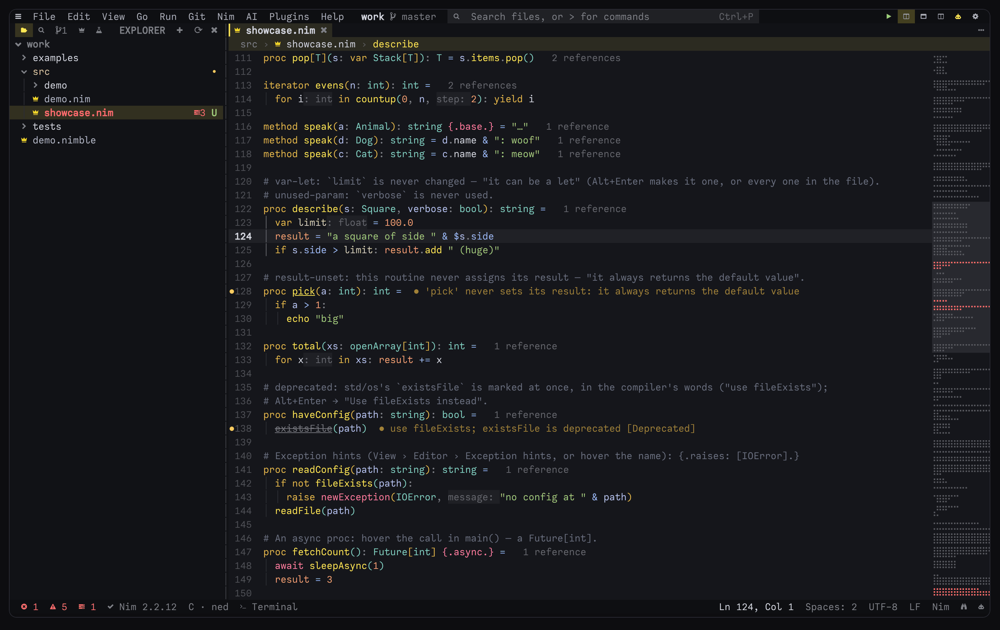
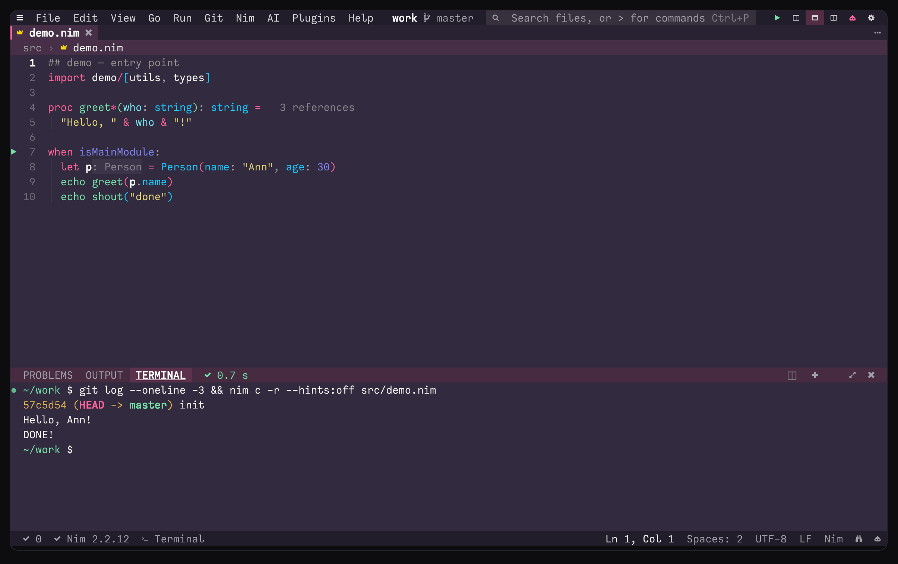
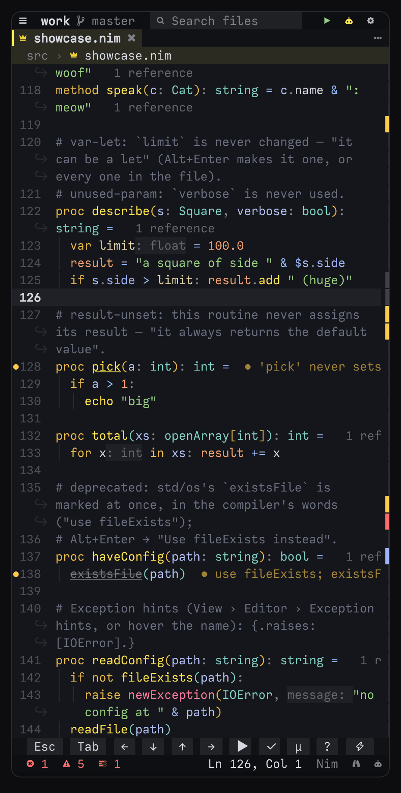
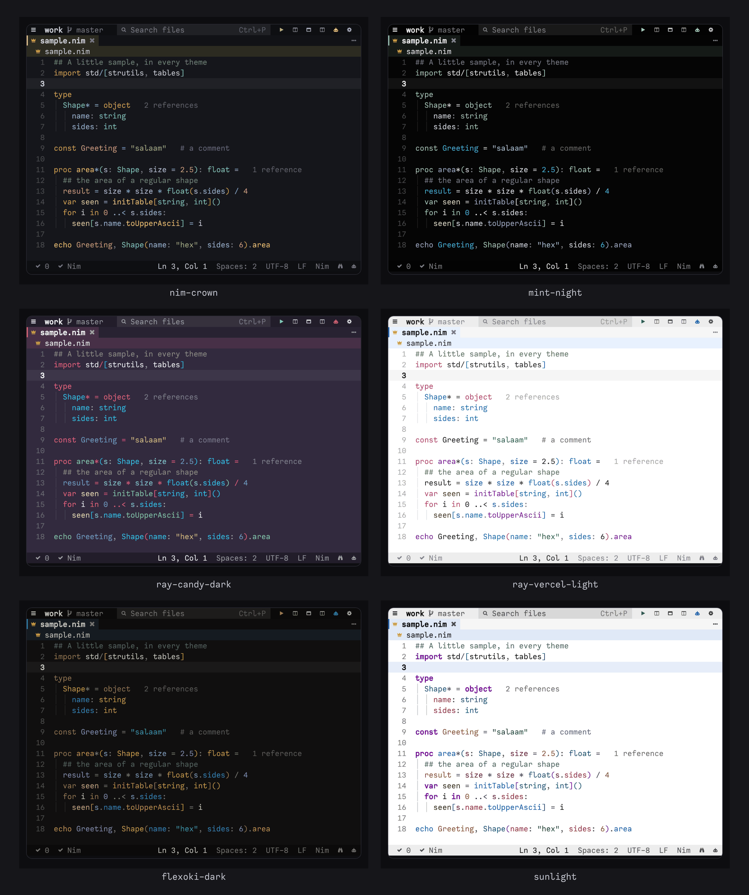

# Announcing ned, a terminal code editor and Nim IDE

*By Foxoman. This post comes with ned 6.41.0.*



ned is a code editor for the terminal and an IDE for Nim. It runs in any terminal but behaves like a desktop editor:
menus, docks, tabs, split panes, and mouse and touch support. It is written in Nim, uses only Nim's standard
library, and builds to a single program, with nothing else to install.

It runs on Linux, macOS, Android (in Termux) and Windows. I use it every day on an Android tablet, in Termux. It is
for people who write Nim and want an IDE with no language server beside it, and for anyone who wants a capable
editor on a phone, a tablet or a small machine.

## Highlights

**A Nim engine that needs no language server.** ned reads your files, the standard library and your nimble packages
as you work. Completion (with the documentation beside the list), hover, Go to definition, signature help,
references, rename and the outline are answered by ned itself, with no compiler run and no server process. Errors
appear as you type, from the compiler and from ned's own checks: unused imports and parameters, field typos, wrong
argument counts, a `var` that can be a `let`, a routine that never sets its result, deprecated names. The grey text
in the picture above is the engine's too: how many references each routine has, the types of `let`s, `var`s and loop
variables, and the names of literal arguments. Nothing stays running in the background, which suits a phone's memory.


**Nim 2.4 and Nim 3.** With Nim 2.4 or newer, ned asks the compiler for its own reading of the file, when you save
and while you type. Names are coloured by what they are, hover gives the type the compiler gave each `let` and
`var`, Go to definition goes to the overload the compiler chose, Find references lists the places of that overload
only, and Alt+M shows what a macro call made at once. When a project has Nimony's files and `nimony` is installed,
ned treats it as Nim 3: `nimony` checks it as you type and runs it (F5). For a Nim 2 file, *Nim 3: what this file
needs* lists the changes porting calls for in the Problems dock. ned can install `nimony` for you: it builds it a
part at a time, so a phone does not run out of memory.

**A formatter.** Alt+F formats in nph's style. Turn on `"editor.formatOnSave": true`, and with
`"editor.formatOnSaveScope": "changed"` only the lines you changed are formatted, so an old file does not become a
big diff. The formatter is built in for Nim, JSON, Markdown, CSS, HTML, SQL, YAML and TOML. C and C++ use
clang-format's styles. `nedfmt` runs the same formatters from the shell, in CI and as a pre-commit hook.

**An AI assistant.** Alt+C opens it. It answers questions about your code, and as an agent it can read and search
files, edit them and run commands. You approve each edit and each command, and its edits are checked with
`nim check` and the like. Use Anthropic, OpenAI, Gemini and other providers, any OpenAI-compatible endpoint, or a
model on the device with Ollama or llama.cpp, offline. Secrets are replaced with placeholders before anything is
sent, and files such as `.env` are not sent at all.

**Terminal, git, debugger and plugins.**

- A real terminal in the bottom panel (`Ctrl+\` or ``Alt+` ``). vim, htop, git and ssh work in it.
- A git dock: stage, commit, push, pull, log and diff, with blame, interactive rebase, bisect and a merge editor.
- A debugger. F9 sets a breakpoint and F5 starts the program under it: gdb for Nim, a Debug Adapter Protocol
  debugger for other languages.
- Plugins written in NimScript. Eighty-five of ned's own come with it, off until you turn one on, and each asks
  before it runs programs, changes files or uses the clipboard. The [tutorial](../plugins/tutorial.md) builds one.



**Vim, Emacs and Helix keys.** `"editor.vimMode": true` (or *View › Vim mode*) gives vim's keys: its modes,
motions with counts, operators and text objects, macros, and vim-surround. The `:` line reaches every ned command by its name, and
every setting with `:set` — by its full key, its last part, or vim's own name (`:set tabstop=2`, `:set nowrap`) —
and Tab completes them. `"editor.keymap"` switches to Emacs's or Helix's keys instead.


**Made for a phone or tablet as much as a desktop.** Below 70 columns ned switches to a phone layout, and everything
can be tapped. Every command is in the menus and the palette, and Termux's extra-keys row reaches every shortcut;
`"ui.touchBar": "auto"` adds a row of big keys above the status bar on a narrow screen. ned watches the memory the
phone has left: it never runs more than two compiler checks at once, and when memory is short it empties its caches
and checks on save only, so Android has no reason to close Termux.



**150 themes.** Dark and light: ned's own (nim-crown, mint-night, frankincense, lagoon …), every theme of
[ray.so](https://ray.so) with `ray-` before its name, and the well-known ones — One Dark, Tokyo Night, Catppuccin,
Gruvbox, Dracula, Nord, Solarized, Rosé Pine, Kanagawa, Everforest and more. `"theme": "auto"` follows the
terminal's background or the time of day. The theme editor checks contrast as you choose colours, and VS Code and
base16 themes can be imported.



## Install

To build ned you need Nim 2.2 or newer and nothing else. Other tools are optional and picked up when they are on your
`PATH`.

**1. The quick way**, on Linux, macOS and Termux:

```sh
curl -fsSL https://raw.githubusercontent.com/foxoman/ned/main/install.sh | sh
```

It builds ned with nimble. On Termux it installs Nim, git and clang from Termux's packages first, or the release's
Termux package when the release has one.

**2. nimble, straight from GitHub.** This builds `ned`, `nedfmt` and `nedls` into `~/.nimble/bin`, and it takes a
few minutes.

```sh
nimble install https://github.com/foxoman/ned
```

Once ned is in Nim's package list, `nimble install ned` will do the same.

**3. The Termux package.** Download `ned_6.41.0_aarch64.deb` from the
[releases](https://github.com/foxoman/ned/releases), then install it. It brings ned, nedls and nedfmt.

```sh
pkg install ./ned_6.41.0_aarch64.deb
```

**4. From source.**

```sh
git clone https://github.com/foxoman/ned
cd ned
nim c -d:release --opt:speed -d:strip -o:ned src/ned.nim
```

This takes a few minutes too. Move `ned` onto your `PATH`, for example `sudo mv ned /usr/local/bin/` on Linux.

ned builds for Windows too. Native Windows is experimental; WSL is the tried way.
[Installing](../../README.md#installing) in the README covers each system.

Once installed, ned looks on GitHub once a day for a newer version and says when there is one, with what is new in
it. `ned --update` builds the new version the way this one was installed.

## First steps

```sh
ned                      # the folder you are in, reopening the files you had open
ned src/app.nim:42:7     # a file at line 42, column 7
ned --check              # what ned found on this system, and how to install what is missing
```

- **F10** opens the menus, **Ctrl+E** the command palette, and **F1** the key bindings.
- **Ctrl+P** finds a file. Type `:42` for a line, `@name` for a symbol, `#name` for a project symbol, and `>` for
  commands.
- Click or tap anything: tabs, gutter markers, dock items and buttons.
- *Help › Nim tour* teaches Nim inside ned, a lesson at a time, each with code to run and exercises.

## Use ned's engine in your editor

The same Nim engine runs without ned's screen as `nedls`, a language server for VS Code, Neovim, Helix, Zed, Emacs,
Kate and Sublime. `nimble install` builds it next to ned. The set-ups for each editor are in
[the Nim IDE guide](../guide/nim.md#nedls-neds-engine-in-other-editors).

For Zed there is an extension, *nedls-language-server*, in a repository of its own:
[github.com/foxoman/nedls-zed](https://github.com/foxoman/nedls-zed). Until it is in Zed's list of extensions,
clone it and install it with *zed: install dev extension*, next to the Nim extension. With
`"semantic_tokens": "combined"` for Nim in Zed's settings, Zed colours each name by what it is, as ned does.

## What's next, and how to get involved

The [changelog](../../CHANGELOG.md) lists what each release changed. Two things are still to do: ned is not in Nim's
package list yet, so `nimble install ned` waits on that, and the Zed extension waits for its place in Zed's list.

Bug reports, ideas, themes, documentation and code are welcome on
[GitHub](https://github.com/foxoman/ned/issues). Run `ned --check` first, and paste *Help › Copy info for bug report*
into the issue. [CONTRIBUTING.md](../../CONTRIBUTING.md) explains how ned is laid out and tested, and
[the source map](../dev/source-map.md) lists every source file with what it is. Please report security problems
privately, as [SECURITY.md](../../SECURITY.md) says.

## Licence

ned is free software under the GNU General Public License, version 3 or (at your option) any later version
(`GPL-3.0-or-later`). The full text is in [LICENSE](../../LICENSE). Plugins may use any licence: the plugin library
they import comes with the [ned Plugin Exception](../../PLUGIN-EXCEPTION.md).

*The screenshots use the Coder Nerd Font Mono, with ned's Nerd Font icons (`"ui.icons": "nerd"`).*
