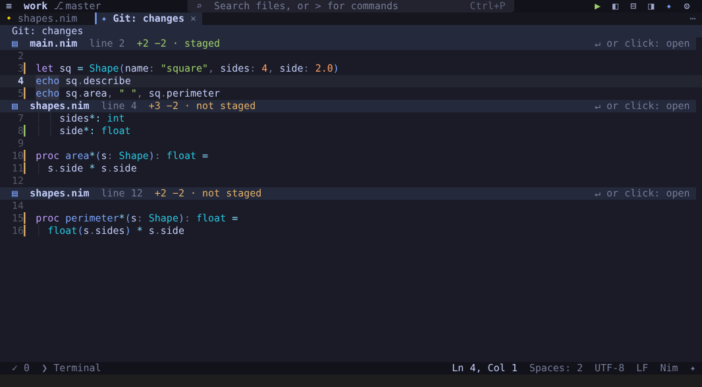
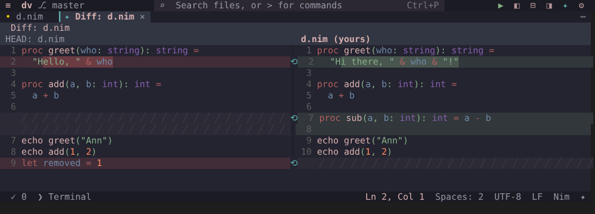
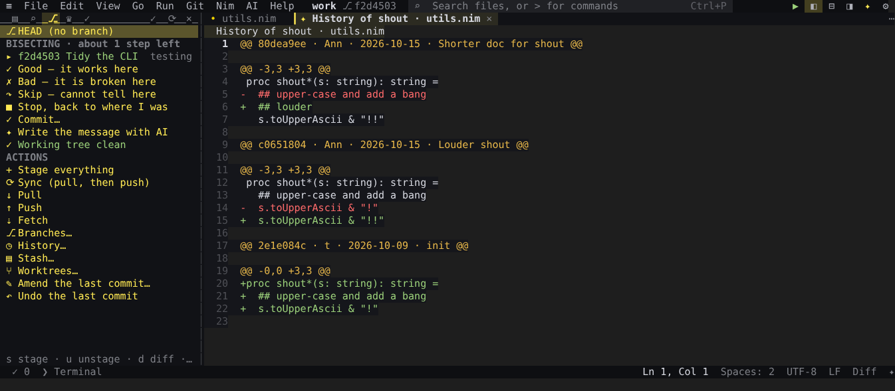
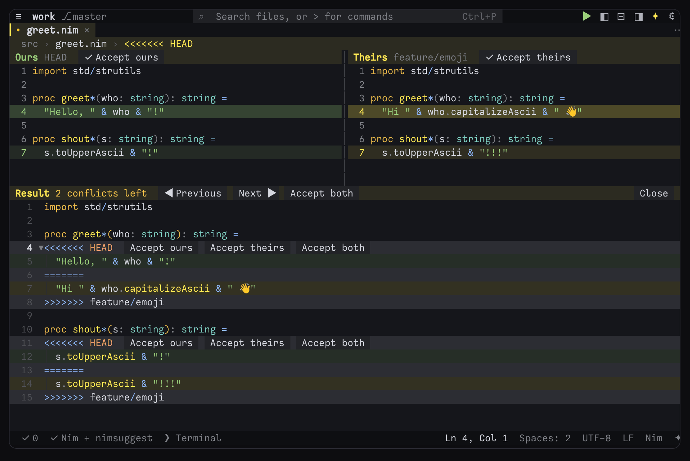
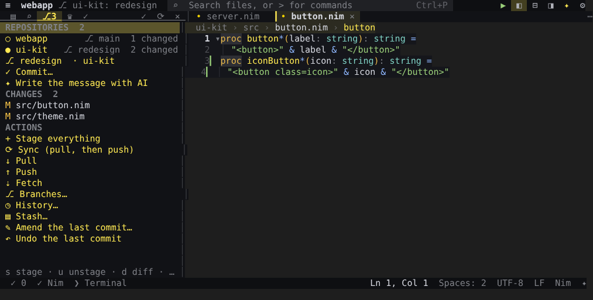

# Git

ned has git built in: a source-control dock, change marks in the gutter that follow your typing, every uncommitted
change in one editable view, blame, history, interactive rebase, bisect, a 3-pane merge editor and GitHub (pull
requests, issues, CI, review comments). It runs the `git` you have installed — `pkg install git` in Termux — and the
GitHub features use the GitHub CLI (`gh`) when it is there. Every command below is in the **Git** menu (F10) and the
palette (Ctrl+E); the palette names are in *italics*. All keys are also in [Key bindings](keys.md).



## The Git dock

**Alt+G** opens the Git dock on the left (Alt+G again closes it); it is also one of the views **Ctrl+B** shows (Tab
moves between them), *Git panel* in the palette and *Source control* in the View menu. Its icon in the dock header
shows how many files have changed.

From the top, the dock shows:

- the **branch**, with its upstream (`main → origin/main`) — click it for the branches;
- a **merge, rebase, cherry-pick or revert in progress**, the files with conflicts (with how many each has left) and
  *Continue* / *Abort*; or **BISECTING** with *Good*, *Bad*, *Skip* and *Stop* (see [Bisect](#find-the-commit-that-broke-it-bisect));
- *Commit…* and, when an AI provider is set up, *Write the message with AI*;
- **STAGED CHANGES**, **CHANGES** and **UNTRACKED**, each file with its letter (M, A, D, U …). A new folder is one
  line with how many files it holds, not every file in it (`git.untrackedFiles`);
- **ACTIONS**: *Stage everything*, *Sync (pull, then push)* with ↑ commits to push and ↓ to pull, *Pull*, *Push*,
  *Fetch*, the GitHub sign-in, *Branches…*, *History…*, *Stash…*, *Worktrees…*, *Submodules…* (when the repository
  has them), *Find the commit that broke it…*, *Amend the last commit…* and *Undo…*.

In the dock (a hint line at the bottom repeats the main ones):

| key | action |
|---|---|
| Enter | open the file and show its diff |
| s · u | stage · unstage the selected file |
| d | its diff as text |
| x | discard its changes (asks first; an untracked file or folder is deleted) |
| a | stage everything |
| c | commit: the message box |
| P · L | push · pull |
| l | the log as a graph (`git log --graph`) in the Output panel |
| r · q | refresh · close the dock |

Right-click a file for *Open file*, *Open diff* (side by side), *Open diff as text*, *Stage*, *Unstage* and *Discard
changes…*. The header has ✓ (commit) and ⟳ (refresh). While the dock (or the Files dock) is shown, ned runs
`git status` every few seconds (`git.autoRefresh`) — less often in a repository where it takes long, never while you
are away, and without taking git's index lock, so a git command of yours never finds the index locked.

## Committing

- **The message box** — *Git: commit (message box)…*, or *Commit…* (**c**) in the dock — opens a tab: write the message (the
  first line is the summary), **Ctrl+S** commits, **Ctrl+W** cancels. Lines starting with `#` are left out, and the
  tab says how many files are staged. Commit messages are spell-checked (`editor.spellCheck`).
- **One line** — *Git: commit…*, or ✓ in the dock's header: type the message, Enter commits.
- **Nothing staged?** ned asks whether to commit every changed file (new files are left out).
- *Git: amend the last commit…* opens the box with the last commit's message; Ctrl+S replaces that commit.
- The first time, git has to know who you are: ned asks for your name and email once and keeps them in your git
  settings (`git config --global`).
- `git commit` typed in ned's terminal opens its message in a tab of this ned — see [ned as git's
  editor](#ned-as-gits-editor).

## AI commit messages

*Git: generate commit message with AI* (also *Write the message with AI* in the dock, and `/commit` in the chat)
sends the staged diff — or the unstaged one when nothing is staged — to your AI provider and puts the one-line
summary it writes into the commit prompt, where you can change it before Enter commits. *AI: review staged changes
(findings in Problems)* has the AI look over the same diff. Setting up a provider: [The AI assistant](ai.md).

## Checks before a commit

`git.checksBeforeCommit` makes a commit — from the message box or with one line — check the files it takes first:

- **format** — each file is formatted the way ned's own formatter would do it, on the text that is staged — only
  when `editor.formatOnSave` is on, for the languages it formats (`editor.formatOnSaveLanguages`);
- **tests** — the Nim tests that cover those files pass (in a trusted folder);
- **both** (the default) or **off**.

When a check fails the commit stops (the message box stays open), and ned says why: *(f)ormat and stage them*, *(c)ommit
anyway* or *(x) cancel* for formatting; *(o)pen the test*, *(c)ommit anyway* or *(x) cancel* for tests. For a
pre-commit hook outside ned, see `nedfmt --install-hook` in [Formatting](formatting.md#from-the-shell-nedfmt) and
`ned --lint --install-hook` in [Nim](nim.md#lint-the-engines-checks-from-the-command-line-and-in-ci).

## Push, pull and sync

*Git: push*, *Git: pull*, *Git: pull (rebase)*, *Git: fetch* and *Git: sync (pull, then push)* — sync pulls with
rebase, then pushes. The title bar shows the branch with ↑ (to push) and ↓ (to pull) and a ⟳ button for sync;
right-click the branch for a short menu (pull, push, sync, fetch, stash, history).

- They never hang on a password prompt. When the server wants a login, the same command runs in the terminal, where
  you can type it — for GitHub, ned offers to [sign you in](#signing-in-to-github) instead.
- A new branch's first push sets its upstream by itself.
- Open files that a pull (or any git command) changes are reloaded when they have no unsaved edits
  (`files.autoReload`); otherwise ned tells you the file changed on disk.

## Branches, stash and tags

Click the branch in the title bar (or *Git: branches…*, or the branch row in the dock):

- *+ New branch…* (from here) and *Fetch*;
- your branches, newest first (✓ the current one, ↔ its upstream): *Switch to it*, *Merge it into* the current one,
  *Rename…*, *Delete…* (only when merged) and *Delete even if not merged…*. Switching saves your files first;
- remote branches you have no local branch for: pick one to get a local branch that follows it.

*Git: stash…* puts changes aside (*Stash my changes…*, or *Stash, new files too…*) and lists the stashes: *Apply*,
*Pop*, *Show* and *Drop…*. *Git: create a tag…* and *Git: push tags* make and push tags. *Git: copy link to this
line* copies a permalink to the line — or the selected lines — at the current commit, on GitHub, GitLab or Codeberg.

**New repositories.** *Git: initialize a repository here* (it asks first when the folder is inside another
repository). *Git: clone a repository…* (or *File: clone from a link…*, and `g` on the Welcome page) takes a link as
you copied it: `https://github.com/u/r`, a `/tree/branch` link from GitHub, GitLab, Codeberg or Bitbucket, `user/repo`
for GitHub, `git@host:u/r.git`, `ssh://…`. Choose *Clone* or *Latest version only*; the clone opens with its README,
and a Nim project offers `nimble install --depsOnly`. A link with a password or token in it is refused — git asks for
the login in the terminal instead, so nothing secret stays in `.git/config`.

## Changes in the editor

The gutter marks every line that differs from what git has, as you type: a green ▎ for added lines, ▎ in the
"changed" colour for modified ones and ▁ where lines were deleted (`+ ~ _` in [accessibility
mode](themes.md#accessibility-mode); `git.gutter` turns them off; in zen mode they show with `zen.gitChanges`).

- **F7 / Shift+F7** go to the next / previous change.
- **Click a mark** to see the change with *Stage this change*, *Revert this change* and *Show the change*. The
  gutter's right-click menu has them too, and on any line *Copy a link to this line (git host)* and *Git: who
  changed this line*.
- *Git: show this change*, *Git: stage this change*, *Git: revert this change* (back to the committed text — Ctrl+Z
  brings it back), *Git: stage selected lines* (only the changed lines inside the selection), *Git: unstage this
  change* and *Git: unstage this file*. They are also in the editor's right-click menu on a changed line.
- *Git: compare with last commit (side by side)* opens the last commit's version beside your file, changed words
  marked. In the diff, F7 / Shift+F7 go between changes, Enter opens that line, and **r** (or ⟲) reverts a change in
  your file. *Git: diff current file* shows the diff as text.



## The changes view (Alt+Shift+G)

**Alt+Shift+G** (*Git: changes (every change, editable)…*) puts every change not committed yet, in every file of
every repository you have open, into one tab. Each change comes with a line around it, under a header that says what
it adds and removes and whether it is staged: *+3 −2 · not staged*, *partly staged*, *staged*, *new file, not
tracked*.

- **Edit there** and Ctrl+S writes each piece back to its file.
- Right-click a change (or use the palette) to **stage**, **unstage** or **revert** it. Revert puts back the last
  commit's text and unstages it. The view is made again afterwards, the cursor where it was.
- **Enter on a header** opens the file at that place.
- Files with unsaved edits are not shown — save them, then open the view again.

## Blame, the timeline and the history of some lines

- **Inline blame** (`git.inlineBlame`, or *Git: toggle inline blame*): who last changed the line you are on, when,
  and the commit's summary, at the end of the line — *You · not committed* for your own new lines.
- *Git: blame this file* opens a tab with the commit, date and author of every line; Enter on a line shows its
  commit.
- **Timeline** (the right dock, or *Timeline* in the palette): the commits that changed the current file, following
  renames. Pick one to see that version side by side with yours.
- *Git: history of these lines*: every commit that changed the selection — or, with nothing selected, the Nim proc
  the cursor is in (else the line) — each with the diff of just those lines (`git log -L`). Enter on one opens it.

## History, branch graph and comparing branches

- *Git: history…* lists the last 400 commits, with their branches and tags. Pick one for its files (each opens as a
  side-by-side diff), *Copy the hash*, *The whole commit as text*, *Create a branch here…*, *Cherry-pick onto* the
  current branch, and *Revert this commit…* (a new commit that undoes it).
- *Git: branch graph*: the history of every branch as a graph; Enter on a commit opens the same menu.
- *Git: compare with a branch…*: the files this branch changed since it left the other one (new, deleted, renamed,
  changed); pick one for its side-by-side diff.
- *Git: cherry-pick from a branch…*: the commits on another branch that this one does not have; pick one to copy it
  here.

## Interactive rebase

*Git: interactive rebase…* asks where to start — *Commits not pushed yet*, or after one of the last 40 commits —
and opens the plan as text, oldest commit first:

```text
pick 3f2a1c0 Parse the config file
reword 9b81d22 Fix a typo in the README
squash 77ac0e1 Parse comments too
fixup 0c4d5e9 oops
drop 5e6f7a8 Debug output
```

Change the first word of a line (`p r s f d e` work too):

| word | what happens to the commit |
|---|---|
| `pick` | kept as it is |
| `reword` | kept, with the message you write on the line after the hash |
| `squash` | joined to the commit above it, both messages kept |
| `fixup` | joined to the commit above it, its own message dropped |
| `drop` | left out — deleting its line does the same |
| `edit` | the rebase stops there so you can change it |

Move lines with Alt+↑ / Alt+↓ to reorder commits, then **Ctrl+S** starts the rebase (after asking — it rewrites
history, so only for commits not shared yet); closing the tab cancels it. Uncommitted changes are put aside while it
runs. On a conflict, fix the files, then *Git: continue (merge / rebase)* or *Git: abort (merge / rebase)*. A range
with merge commits is left to the terminal (`git rebase -i --rebase-merges`).

## Find the commit that broke it (bisect)

*Git: find the commit that broke it (bisect)…* (also in the dock) checks out older commits, so commit or stash your
changes first (new untracked files may stay). Pick a commit where it still worked, then choose how to tell:

- **I'll say at each step** — ned checks out a commit; test it and press *Good*, *Bad* or *Skip* in the Git dock (or
  *Git: bisect — good (works here)*, *— bad (broken here)*, *— skip (cannot tell here)*). The dock shows the commit
  being tested and about how many steps are left.
- **A command tells…** — a command that succeeds (exit 0) when it works, such as `nimble test`; git runs it at each
  step.

When the first bad commit is found, ned shows it and offers to go back to where you were. *Git: bisect — stop, back
to where I was* ends it at any time.



## Undo a commit, a pull or a merge

*Git: undo…* (or *Undo…* in the dock) lists the branch's last steps from git's reflog — a commit, an amend, a pull,
a merge, a whole rebase, a reset, a switch of branch — and takes the branch back to before the one you pick:

- a commit is undone softly: its changes stay, staged;
- anything else keeps your uncommitted work; a switch of branch switches back;
- a commit you have already pushed is reverted with a new commit, unless you choose to undo it anyway (you will
  then have to force-push).

*Git: undo the last step* and *Git: undo the last commit* undo the newest step straight away (after asking).

## Merge conflicts and the merge editor

When a file with conflicts opens, a toast offers the **merge editor**. In the file itself conflict blocks are
tinted, and the `<<<<<<<` line has **Accept ours · Accept theirs · Accept both** buttons — also *Git: accept ours
(conflict at cursor)*, *Git: accept theirs (conflict at cursor)*, *Git: accept both (conflict at cursor)* and *Git:
next merge conflict*.

*Git: merge editor (ours | theirs | result)* shows ours and theirs side by side above the result, which is the file
itself, so you can also edit it. *✓ Accept* on either side, *Accept both*, ◀ *Previous* and *Next* ▶ go through the
conflicts; once none are left, *Save and stage* finishes the file. While a merge or rebase is in progress the Git
dock lists the conflicted files and has *Continue the merge* / *Abort the merge*.



## Worktrees and submodules

- *Git: worktrees…* lists the repository's worktrees (more checkouts of it, each on its own branch). Open one as the
  project or add it to the workspace, make one for a new or an existing branch in a folder of its own (ned suggests
  `<project>-<branch>` beside the project), remove one (its folder goes, the branch stays), or prune the ones whose
  folder is gone.
- *Git: submodules…* lists each submodule with its state — not checked out, at another commit than the one recorded,
  up to date. Update one or all, record its current commit, open it, show it in the Git dock, or add a new one (its
  URL, then a folder). Checked-out submodules appear in the Git dock as repositories of their own.

## GitHub

### Signing in to GitHub

GitHub takes no password from git. When a push, pull or fetch to github.com is refused for a login, ned offers the
ways that work (also any time: *Git: sign in to GitHub*):

- **Sign in with GitHub** — the GitHub CLI (installed first if it is missing) signs you in in the browser with a
  one-time code shown in the terminal, and becomes git's credential helper. The command then runs again.
- **Use an SSH key** — this device's key (made in the terminal if there is none; you choose its passphrase there) is
  added to your account by `gh`, or copied for you with GitHub's *New SSH key* page opened. The remote then switches
  to SSH.
- **Type a login in the terminal** — a personal access token as the password.

A remote that already uses SSH gets *Set up an SSH key* or *Use HTTPS and sign in with GitHub*. The first SSH
connection asks whether to trust GitHub's host key — answer it in the terminal. ned never asks for, sees or stores a
token, and the dock shows who you push as (*GitHub: @you*). Other servers ask for their login in the terminal.

### Pull requests, issues, CI and review comments

These need the GitHub CLI (`gh`, signed in). *Git: GitHub…* gathers them:

- *Git: GitHub pull requests…* — pick one to *Check it out*, see *Its changes*, its *Checks (CI)*, *Read it* with its
  comments, or open it in the browser. *Git: create a pull request (gh)* runs `gh pr create --fill` in the terminal.
- *Git: GitHub issues…* — read one, or open it in the browser.
- *Git: GitHub Actions (CI)…* — the latest runs; pick one to open it. The current branch's result is in the status
  bar — **CI ✓**, **CI ✗** or **CI ⟳** (click it for the runs) — checked again after a push.
- *Git: GitHub review comments…* — the review threads of this branch's pull request, open ones first: *Go to it*,
  *Reply…*, *Resolve* (or *Open it again*), *Open on GitHub*. Once loaded, each open thread shows at the end of the
  line it is about, and its whole conversation on hover. They are fetched again after a push.

## Several repositories, and remote folders

**Multi-root workspaces.** When the folders of a [workspace](terminal.md#multi-root-workspaces) are separate
repositories, the Git dock lists them under **REPOSITORIES**, each with its branch, how many files changed and what is
to push or pull. The dock — and every git command — works on one at a time: the one you click, or the one of the file
you are editing, which the dock follows by itself. The title bar names it (`ui-kit: redesign`), the commit box says
which repository it commits to, and the Files tree marks changed files in all of them.



**Remote folders over SSH.** When a [remote folder](terminal.md#remote-folders-over-ssh) is a git repository, git
runs on the server, on the real repository: the dock shows the server's branch and changes (*git on devbox*), and
staging, commits, branches, stash, merges, rebases, pull and push all happen there. What a git command changes in the
files comes back into the local copy, and the gutter marks, blame and the file's history come from the server too. A
remote folder that is not a repository yet gets *git init on devbox* (the server's name) in the dock.

## ned as git's editor

In ned's own terminal, `git commit`, `git rebase -i` and anything else that starts `$EDITOR` open the file in a tab
of this ned, and git waits until you save and close it (Ctrl+S, Ctrl+W) — unless you set `GIT_EDITOR` or `EDITOR`
yourself (`terminal.editorEnv`). Anywhere else, set `GIT_EDITOR="ned --wait"` and git waits for ned. Details: [The
terminal, remote work and scripting ned](terminal.md#gits-editor-ned---wait).

## Settings

| setting | default | what it does |
|---|---|---|
| `git.gutter` | `true` | added / modified / deleted marks next to the line numbers |
| `git.autoRefresh` | `true` | refresh the Git dock every few seconds while it is open |
| `git.untrackedFiles` | `"folders"` | a new folder as one line with its file count (`folders`), or every file on its own line (`all`) |
| `git.inlineBlame` | `false` | who last changed the current line, and when, at its end |
| `git.checksBeforeCommit` | `"both"` | before a commit: `format`, `tests`, `both` or `off` |
| `zen.gitChanges` | `false` | show the change marks in zen mode too |
| `terminal.editorEnv` | `true` | in ned's terminal, ned is git's editor (`GIT_EDITOR`, and `EDITOR`/`VISUAL` where not set) |
| `editor.formatOnSaveScope` | `"file"` | `changed`: format on save only the lines changed since git last saw the file |

Every setting is in the [settings reference](../reference/settings.md#git).

## Keys

| keys | action |
|---|---|
| Alt+G | the Git dock (again: close it) |
| Alt+Shift+G | every change not committed, in one editable view |
| F7 / Shift+F7 | next / previous change in the file (and in a diff) |
| click the branch in the title bar | branches · ⟳ beside it: sync |
| Ctrl+S · Ctrl+W | commit message box: commit · cancel — rebase plan: start the rebase · close the tab (cancel) |

The rest are commands — [every command](../reference/commands.md) with its key; give any of them a key of your own
with the `keys` setting ([Settings](settings.md)).
