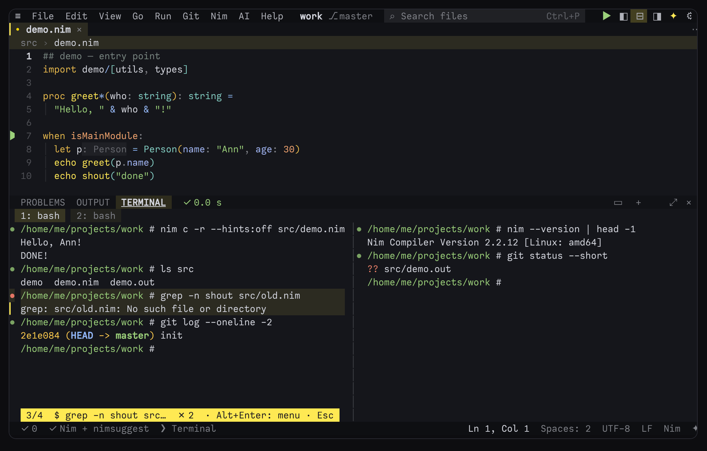
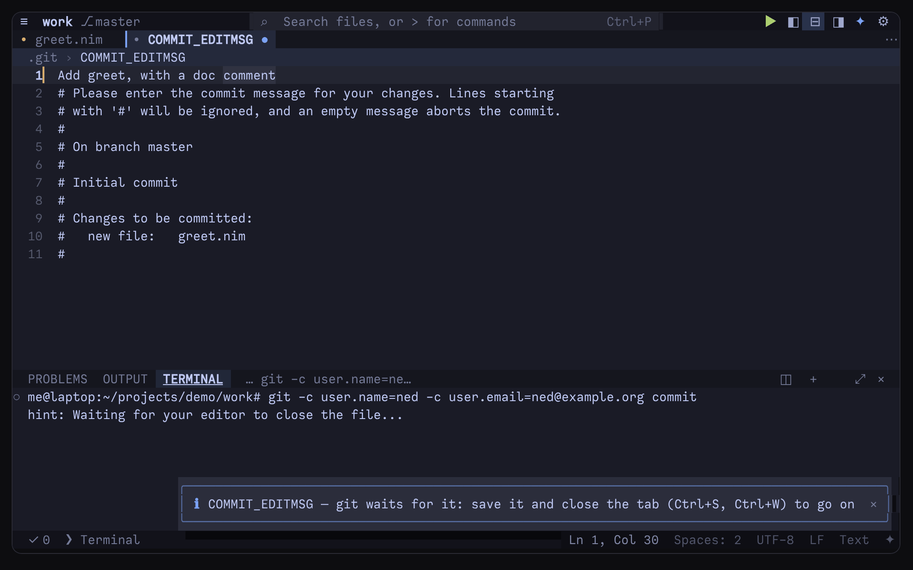

# The terminal, remote work and scripting ned

ned has a real terminal inside it, and the ned that is running can be reached from outside: from its own terminal
(`ned FILE` opens the file in a tab, `git commit` opens its message there), from git as its editor, and from your
scripts (`ned --remote …`). This guide also covers folders on another machine over SSH, workspaces of several
folders, keeping your settings in sync between devices, and what ned asks of the terminal it runs in. The terminal's
keys are also in [Key bindings](keys.md#window-and-layout).

## The integrated terminal

**Ctrl+\\** or **Alt+\`** opens the terminal in the bottom panel (*Toggle terminal*, View › *Terminal*); the same key
hides it again. It is a real pseudo-terminal with an xterm-compatible emulator, so vim, htop, less, git and ssh work
in it, with colours, the mouse and bracketed paste. Programs see `TERM=xterm-256color`, `COLORTERM=truecolor` and
`TERM_PROGRAM=ned`.

- **The shell** is `terminal.shell`, else `$SHELL`, else bash, zsh, fish or sh (on Windows, PowerShell). It starts in
  the project folder, or in the current file's folder with `"terminal.cwd": "file"`.
- **Scrolling back**: Shift+PgUp / Shift+PgDn, Shift+↑ / Shift+↓ or the mouse wheel; the corner shows where you
  are. `terminal.scrollback` lines are kept (3000).
- **The mouse**: drag to select; right-click for *Copy*, *Paste*, *Clear*, *New terminal*, *Split* and *Kill
  terminal* (and the command menu below). Ctrl+Shift+C copies the selection where the terminal sends that key.
  Programs that use the mouse get it. Dragging a file from the Files tree into the terminal types its path.
- **Keys**: everything goes to the program in the terminal except Ctrl+\\ and Alt+\` (hide it), Ctrl+Q (quit ned),
  Alt+O (the panel), Alt+C (the assistant), F6 (the next area), F10 (the menus), Ctrl+PgUp/PgDn (the other terminal)
  and Shift with ↑ ↓ PgUp PgDn (scroll back).
- **Size**: Ctrl+Alt+↑ / ↓ makes the panel taller or shorter; ⤢ or *Toggle maximized panel* fills the window with it.
- When the shell exits, **Enter** starts a new one and Esc goes back to the editor.

*Open shell full screen (leave ned temporarily)* runs your shell on the whole screen instead; ned comes back when it
exits.

## Several terminals

**+** in the panel header (or *Terminal: new*) opens another terminal; tabs above them (*1: bash*, *2: bash*) switch,
and a tab whose last command failed says so with ✗. **◫** (or *Terminal: split*) shows two side by side; a click or
**Ctrl+PgUp / Ctrl+PgDn** moves between them (*Terminal: focus the other split*), and ▭ goes back to one.

The REPLs run in terminal tabs of their own (Shift+Enter sends code to them — see [Nim](nim.md)). *Run in terminal
(interactive)*, *Nim: debug with gdb* and the logins git and ssh ask for are typed into the terminal for you.

## Terminals that outlive ned

When ned quits — or its window closes, or Termux's session ends — its terminals **keep running**: a build, a server
or a long test goes on. The next ned you start in the same folder takes them back, with what they showed, and says
so in the status bar ("2 terminals kept running since last time"). They are the same shells: what ran in them is
still running, and their history is there.

- **Kill terminal** (its right-click menu, or *Terminal: kill*) ends one for good.
- *Terminal: kept terminals…* lists every folder's kept terminals, with when each started, to end one or all of them.
- A terminal that another ned has open stays with that ned; a second ned in the same folder starts its own.
- `"terminal.keepRunning": false` ends the shells with ned, as before 6.29.
- Not on Windows, and not for REPLs, the debugger's terminal or a remote folder's terminal (its ssh connection ends
  with ned).

How: each kept shell belongs to a small process of its own (`ned --term-host`), which holds the terminal and the last
megabyte it printed; ned talks to it through a socket only you can open, in ned's private folder.

## Shell integration: the commands you ran

With bash, zsh and fish, every prompt, command line, output and exit code is marked (OSC 133). ned adds this when it
starts the shell — your `.bashrc`, `.zshrc` or `config.fish` is still read — and `"terminal.shellIntegration": false`
turns it off.

- A **●** beside each command in the terminal's gutter, **red when it failed**. The panel header shows the last
  result — *✓ 1.2 s* or *✗ exit 2* — and clicking it lists the commands.
- **Ctrl+↑ / Ctrl+↓** go from one command to the next, its lines tinted, with *3/4 $ the command* at the bottom;
  Esc goes back to the live terminal.
- **Alt+Enter** on the command shown — or a click on its ● — opens its menu: *Copy its output*, *Copy the command*,
  *Run it again*, *Open its output in a tab* (to search or save it) and *Go to it*.
- In the palette: *Terminal: commands…* (newest first), *Terminal: run the last command again*, *Terminal: copy the
  last command's output*, *Terminal: previous command* and *Terminal: next command*.



## `ned FILE` in ned's terminal

The running ned answers on a socket only you can reach, and its terminal knows where (`$NED_SOCKET`). So in ned's
terminal:

- `ned app.nim:42` opens the file at that line in a tab of this ned — there is no ned inside ned;
- `git log | ned` (or `some-command | ned -`) opens what the command printed in a tab;
- `ned --new FILE` starts another ned when that is what you want.

If the ned around the terminal is gone, `ned FILE` there simply starts a new one.

## git's editor: `ned --wait`

In ned's terminal, ned is git's editor: `GIT_EDITOR` is `ned --wait`, and so are `EDITOR` and `VISUAL` where you have
not set them. `git commit` opens its message in a tab of this ned and git waits; save and close the tab (Ctrl+S,
Ctrl+W) and git goes on, the terminal has the focus again. `git rebase -i` and anything else that runs `$EDITOR` work
the same way. `terminal.editorEnv` turns this on and off; a `GIT_EDITOR` or `EDITOR` you set yourself is left alone.

Anywhere else, `GIT_EDITOR="ned --wait"` starts a ned for the message (git goes on when you quit it), and `ned
--remote --wait FILE` opens a file in a ned that is already running and waits until its tab is closed.



## Remote control: scripting a running ned

| option | what it does |
|---|---|
| `ned --remote FILE[:LINE[:COL]]…` | open the files there (text piped in opens in a tab) |
| `ned --remote --wait FILE…` | … and wait until their tabs are closed |
| `ned --remote-command NAME` | run a command of the palette by its name (`"Format document"`, `"Run tests in file"` …) |
| `ned --remote-message TEXT` | show a message there |
| `ned --remote-problems [NAME]` | a build's or a linter's output on stdin becomes Problems, under NAME |
| `ned --remote-get WHAT` | print `file`, `line`, `col`, `selection`, `word`, `root`, `files` or `text` |
| `ned --remote-list` | the neds running for you: process, project, open files |

```sh
ned --remote src/app.nim:120                 # open it there
ned --remote-command "Format document"       # a command of the palette
ned --remote-message "deploy finished"
make 2>&1 | ned --remote-problems build      # file:line:col: lines become problems
ned --remote-get selection                   # what is selected in the current tab
```

- **Which ned?** The one whose terminal this is (`$NED_SOCKET`); else the one whose project holds the file (or the
  current folder); else the one started last.
- **Problems**: `file:line:col: message` lines, Nim's `file(line, col) Error: …` and the other formats the Output
  panel links are read; without a NAME they go under `script`. Sending again under the same name replaces them.
- A command name that does not exist is answered with the names that come close; errors go to stderr with exit
  code 1, so scripts can tell.
- The socket is `$TMPDIR/ned-UID/remote-PID.sock`, readable only by you, and gone when ned quits (see [Files ned
  uses](files.md)).

## Remote folders over SSH

*Remote: open a folder over SSH…* (File › Open more › *A folder over SSH…*) takes `user@host:/path`, `host:~/project`
or a `Host` from `~/.ssh/config` (alone: its home folder).

- ned copies the folder to a local copy (in `~/.local/state/ned/remote/`), leaving out the folders in
  `remote.exclude` — `.git`, `node_modules`, `.venv`, `target`, `nimcache` and the like. You edit there, with the
  tree and search as usual.
- **Language servers run on the server** when it has them (`remote.languageServers`: `auto`), with the packages
  and the toolchain there — nimlangserver, pyright, clangd … through the same ssh connection. ned tells them the
  server's paths and turns what they answer back into the local copy's; a file of the server's outside the folder
  that one points to — a definition in its library — is fetched when you open it, to read. When the server does
  not have a server's program, the one here is used on the local copy (`server`: only the server's, `here`: only
  these). With no Nim here, ned's own Nim engine reads the server's library — fetched once, only its `.nim` files —
  so completion, hover and F12 into the library work as with a Nim here.
- **Every save goes to the server**, and so do deleting, renaming or moving files in the Files tree, new files and
  folders, the assistant's changes and a project-wide replace.
- **The terminal, Run, tasks, tests and the assistant's commands run on the server**, in the folder, through `sh`
  whatever your login shell there is; compiler messages point back at your files. The terminal opens your login
  shell on the server.
- **Changes made on the server come over by themselves** every `remote.autoSync` seconds (10; 0 = only after Run,
  tasks and the assistant's commands); open tabs without unsaved changes reload. *Remote: pull the latest files from
  the server* fetches them now, and removes files deleted there (never one you saved here since, or one open with
  unsaved changes).
- **git runs on the server**, on the real repository — see [Git](git.md#several-repositories-and-remote-folders).
- **One shared ssh connection** is used (kept for 4 hours after its last use). With a key or an agent ned connects
  without a question; when ssh needs a password, a passphrase or a new host key, it asks in the terminal, once —
  never on a command line — and ned goes on when it is connected.

*Remote: SSH menu…* has the rest: open another folder, pull the latest files, a terminal on the host, and
*Disconnect* (the next save or Run connects again).

## Multi-root workspaces

A workspace is several folders in one window: the file tree, quick open (Ctrl+P), project search and the language
servers cover all of them.

- *Workspace: add a folder…* and *Workspace: remove a folder…* (also in File › Open more).
- *Workspace: save as…* writes a `.ned-workspace` file — `{"folders": [{"path": "../api"}, …]}`, paths relative to
  the file — and `ned app.ned-workspace` opens it again. *Workspace: open a workspace file…* opens those and VS
  Code's `.code-workspace` files; the first folder is the project.
- When the folders are separate git repositories, the Git dock shows them all — see
  [Git](git.md#several-repositories-and-remote-folders).

## Settings sync

Your settings, key bindings, snippets and commands (all in `config.json`), your themes, your dictionary words, your
saved macros and the list of your plugins go together into one file — **never API keys, tokens, passwords or MCP
servers' `env` values**, which stay on each device.

- *Settings sync: export to a file…* and *Settings sync: import from a file…* (`~/ned-settings.json` by default).
  Importing keeps this device's secrets and leaves the old file beside it as `config.json.bak-sync`.
- *Settings sync: push (save to your settings repository)* and *Settings sync: pull (load from your settings
  repository)* keep that file in a private git repository of yours: `sync.repository` (or *Settings sync: set the
  repository…*). Use an ssh URL or one your credential helper knows — a URL with a token in it is refused.
- *Settings sync: sync now (both ways)* merges the two: each setting you changed on one device only is taken from
  that device, one removed there is removed here too, and a setting changed on both keeps this device's value (ned
  says which). Words and plugins are put together; a plugin your other device has and this one does not is offered
  for installing (each asks for its [permissions](../plugins/README.md) as it would anyway). It is offered once: one
  you do not install stays on the list (the other device keeps it) and is not offered at every sync — *Settings
  sync: install the other device's plugins* offers it again.
- `sync.auto` does that on its own: `start` (a few seconds after ned starts), `quit` (as ned quits — a few seconds at
  most) or `both`. `sync.exclude` lists the settings that stay on this device, such as `["terminal.shell"]`.

All of them are in File › Preferences › *Settings sync*. See also [Settings](settings.md).

## MCP servers

The AI assistant's agent can use the tools of MCP servers that ned starts for it (`ai.mcpServers`, *AI: MCP
servers…*) — see [The AI assistant](ai.md). Their tokens go to the server's environment, never onto a command line,
and a project's settings cannot add servers until you trust its folder ([Safety](safety.md)).

## What ned asks of the terminal it runs in

ned does not guess what your terminal can do from its name: it asks when it starts, and uses what the answers allow.
*Check setup* (in the Help menu) shows what the terminal answered.

| what | setting | what it gives |
|---|---|---|
| the kitty keyboard protocol | `ui.kittyKeyboard` | Ctrl+Shift+letters can have keys of their own, Ctrl+I is not Tab, Ctrl+Enter and Shift+Enter work, Alt+key comes without a delay (kitty, WezTerm, Ghostty, foot, Alacritty, iTerm2 …) |
| 24-bit colour | `ui.trueColor` | asked of the terminal, not only read from `COLORTERM`, which SSH, mosh, `sudo` and tmux often lose; Windows Terminal (which sets no `COLORTERM`), the Windows console, kitty, Konsole, GNOME Terminal and the others known to draw it are taken at their word. Where only 256 colours are drawn, each colour is the nearest of them — a dark blue-grey background stays grey. *Check setup* says which, and why |
| curly underlines | `ui.undercurl` | errors and warnings get a squiggle in their colour and the text keeps its own |
| emoji sequences | `ui.graphemes` | 👨‍👩‍👧, 👍🏽 and flags as one character two columns wide, where the terminal joins them (mode 2027) |
| light or dark | `theme` (`auto`) | the terminal's background, and its switches between light and dark (mode 2031) — see [Themes](themes.md#light-or-dark-by-itself-theme-auto) |
| the focus | `ui.pauseWhenAway`, `editor.saveOnFocusLost` | back in the terminal, files changed meanwhile are looked at at once; while you are away, work that only serves the screen waits |
| the window's title | `ui.terminalTitle` | the file and the project, ● while unsaved; the old title comes back when ned quits |
| progress | `ui.progressBar` | long jobs fill the status bar — and the tab, in Windows Terminal and Ghostty |
| the pointer's shape | `ui.pointerShapes` | a hand over what can be clicked, an I-beam over text (OSC 22) |
| the clipboard | — | copying goes through the terminal (OSC 52); pasting from other apps needs a helper (`termux-api`, `wl-clipboard`, `xclip`, `pbpaste`) |
| scrolling | `ui.terminalScroll` | the terminal moves the lines and ned sends only the new ones — turn it off if scrolled text lands in the wrong place |
| the mouse | `ui.mouse` | Alt+U turns it off for a moment so the terminal can select text |

If something looks or behaves oddly, [Troubleshooting](troubleshooting.md) and the [FAQ](../FAQ.md#keys-and-the-terminal)
list the settings that help.

## Settings

| setting | default | what it does |
|---|---|---|
| `terminal.shell` | `""` | the shell (empty: `$SHELL`, then bash, sh) |
| `terminal.scrollback` | `3000` | lines of scrollback |
| `terminal.cwd` | `"project"` | where new terminals start: `project` or the current `file`'s folder |
| `terminal.shellIntegration` | `true` | command marks for bash, zsh and fish (Ctrl+↑/↓, failed commands, copy output) |
| `terminal.editorEnv` | `true` | in ned's terminal, ned is git's editor (`GIT_EDITOR`, and `EDITOR` / `VISUAL` where not set) |
| `terminal.keepRunning` | `true` | terminals keep running when ned quits; the next ned in the folder takes them back |
| `remote.languageServers` | `"auto"` | where a remote folder's language servers run: `auto` (the server's when it has them), `server`, `here` |
| `remote.exclude` | `[".git", "node_modules", …]` | folders left on the server when a remote folder is copied |
| `remote.autoSync` | `10` | seconds between copies of the server's changes (0: only after Run, tasks and the assistant) |
| `sync.repository` | `""` | the git repository for *Settings sync* |
| `sync.auto` | `"off"` | sync both ways on its own: `start`, `quit` or `both` |
| `sync.exclude` | `[]` | settings that stay on this device |

Every setting: [settings reference](../reference/settings.md#terminal).
