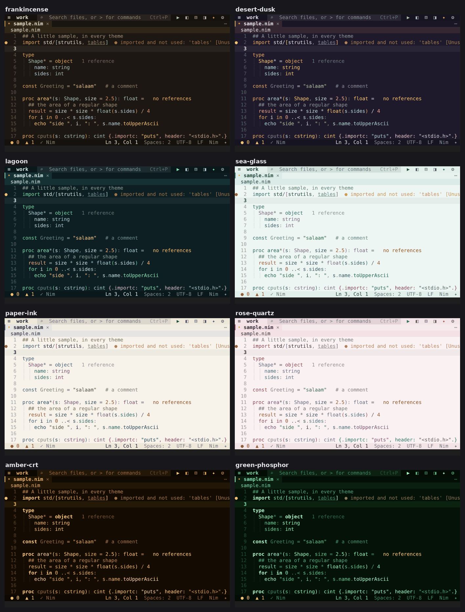
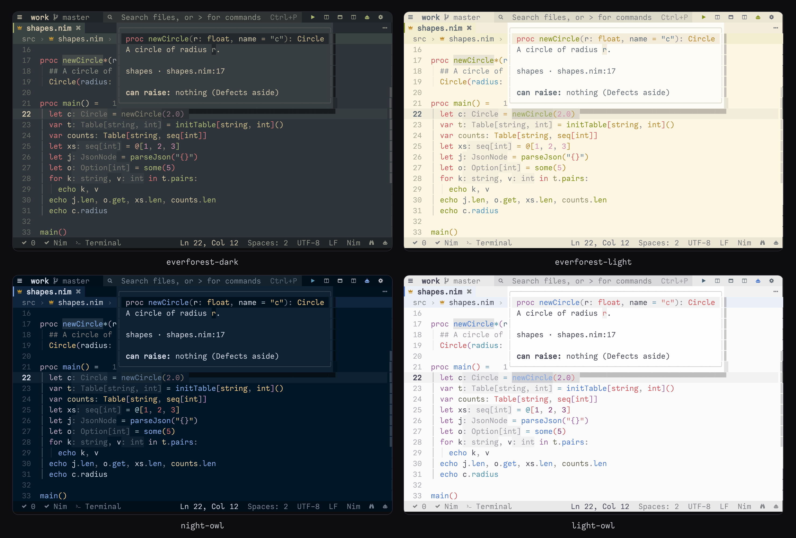
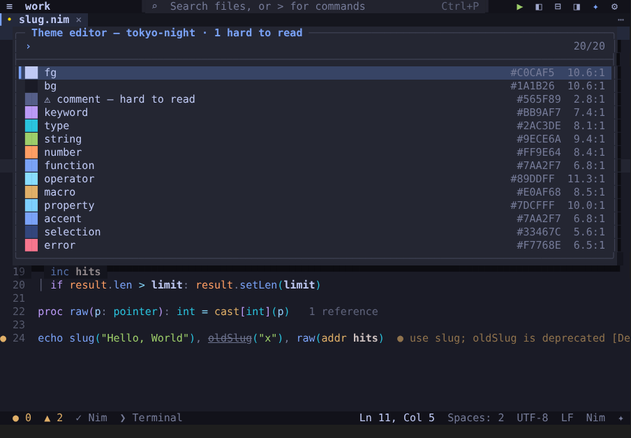
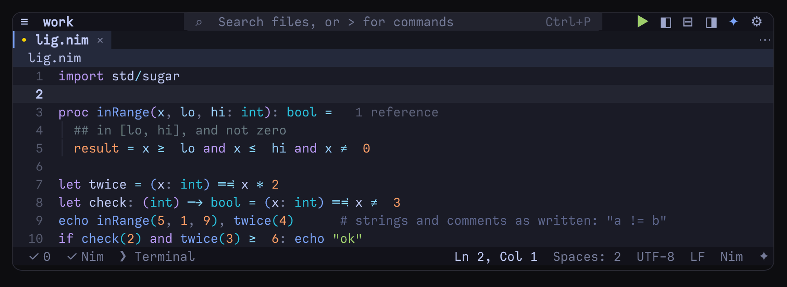
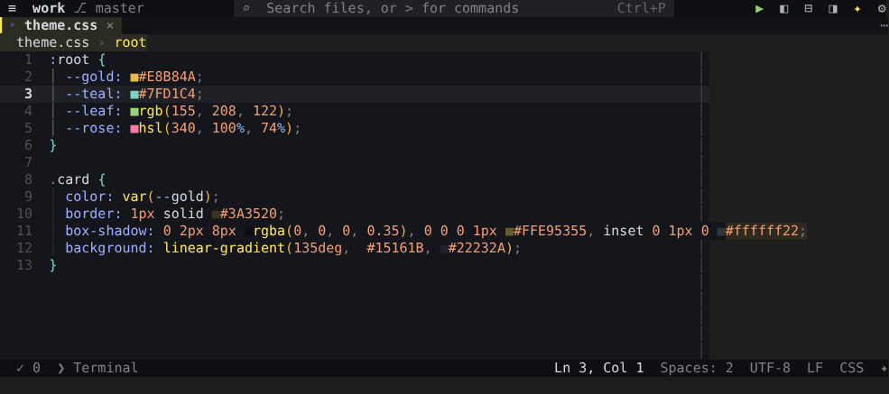

# Themes and appearance

ned draws everything itself, in the terminal's own font, so how it looks is up to you: 56 built-in themes, light or
dark that follows the terminal or the clock, your own colours over any theme, a theme editor that checks contrast,
VS Code and base16 themes imported, Termux's colours set to match, three icon sets, an accessibility mode, a layout
for phones, and settings for every bar, line and mark on the screen. The settings named here go in
`~/.config/ned/config.json` or the Settings window — see [Settings](settings.md) and [every
setting](../reference/settings.md#appearance).



## Choosing a theme

**Alt+T** (*Select theme…*, or File › Preferences › *Color theme…*) lists the themes, each with a swatch of its
background and its keyword, string and function colours. Moving through the list shows each theme at once on the
whole window; **Enter** keeps it (it is written to `"theme"`), **Esc** goes back to the one you had. Type to filter
the list. The default is `nim-crown`.

```jsonc
{ "theme": "tokyo-night" }
```

## The built-in themes

| | dark | light |
|---|---|---|
| **from other editors** | `one-dark` `tokyo-night` `catppuccin-mocha` `gruvbox-dark` `dracula` `nord` `monokai` `solarized-dark` `github-dark` `rose-pine` `kanagawa` `everforest-dark` `night-owl` `nim-crown` `vscode-dark` `modus-vivendi` `ayu-mirage` `shades-of-purple` `shades-of-purple-super-dark` | `one-light` `catppuccin-latte` `gruvbox-light` `solarized-light` `everforest-light` `light-owl` `vscode-light` `github-light` `tokyo-night-day` `rose-pine-dawn` `kanagawa-lotus` `ayu-light` `modus-operandi` |
| **from vim** | `jellybeans` `iceberg` `sonokai` | `papercolor-light` |
| **Foxoman's** | `classic-blue` (the VS Code theme) · `nebula-pulse` `nebula-nova` `nebula-nord` `nebula-serenity` (the Zed themes) | `nebula-glow` `nebula-dawn` |
| **ned's own** | `frankincense` `desert-dusk` `lagoon` | `sea-glass` `paper-ink` `rose-quartz` |
| **easy on the eyes** | `oled-black` `oled-warm` `oled-dim` `lcd-soft` `lcd-warm` | `lcd-paper` |
| **old terminals** | `amber-crt` `green-phosphor` | |
| **slate** | `slate` (Nebula Void) | |
| **grey only** | `monochrome` | `monochrome-light` |

`nim-crown` is ned's default. The *easy on the eyes* themes are for long sessions. On an OLED screen (most phones
and tablets) `oled-black` keeps the background truly black — those pixels are off — with soft grey text instead of
white, which glows less; `oled-warm` has no blue in it, for the evening; `oled-dim` is darker still, for a dark
room. On an LCD screen black is a lit grey anyway: `lcd-soft` (a soft dark grey), `lcd-warm` (a warm dark brown)
and `lcd-paper` (warm paper rather than white) keep the contrast high enough to read and low enough not to glare.
**`theme.trueBlack`** puts any dark theme on true black for an OLED screen: the editor, its bars and docks black,
popups, menus and the current line a little lifted above it, the text and the syntax in the theme's own colours —
`shades-of-purple`, `classic-blue` or `nebula-pulse` with their pixels off where nothing is written.

6.30 left out themes that were another one under another name: `molokai` (it is `monokai`), `catppuccin-frappe` and
`catppuccin-macchiato` (`catppuccin-mocha`, a shade apart), `github-dark-dimmed` (`github-dark`), `slate-night`
(`slate`). A setting that names one of them gets the one it was.

`modus-vivendi` and `modus-operandi` are made for readability (WCAG AAA) and are the
themes [accessibility mode](#accessibility-mode) picks. Every theme gets the same readability pass when it loads:
interface colours — dim text, the status and title bars, menus, the current line, the selection — are given a
minimum contrast, keeping the theme's own hues.



## Light or dark by itself: `"theme": "auto"`

With `"theme": "auto"` ned uses `theme.light` or `theme.dark`, chosen by `theme.autoBy`:

- **`terminal`** (the default) — ned asks the terminal for its background colour when it starts. A terminal that
  reports when the system switches between light and dark (mode 2031: kitty, Ghostty, Contour …) changes ned's theme
  the moment the phone or the desktop goes dark. A terminal that never answers gets `theme.dark`.
- **`clock`** — light from `theme.dayStarts`, dark from `theme.nightStarts`. Useful where the terminal does not say
  its background, like Termux. *Theme: light by day, dark at night* (also in File › Preferences) sets this up in one
  step.

| setting | default | what it does |
|---|---|---|
| `theme` | `"nim-crown"` | the theme, or `auto` |
| `theme.dark` | `"nim-crown"` | with `auto`: the theme on a dark terminal (or at night) |
| `theme.light` | `"github-light"` | with `auto`: the theme on a light terminal (or by day) |
| `theme.autoBy` | `"terminal"` | `terminal` (its background) or `clock` |
| `theme.dayStarts` | `"07:00"` | with `clock`: when the light theme starts (HH:MM) |
| `theme.nightStarts` | `"19:00"` | with `clock`: when the dark theme starts (HH:MM) |

## Changing colours: `theme.colors`

`theme.colors` changes colours of any theme without making a theme of your own — for every theme, for one, or both:

```jsonc
{
  "theme.colors": {
    "comment": "#8a8a8a",                              // every theme
    "nim-crown": { "bg": "#101010", "ruler": "#333333" } // only nim-crown ("[nim-crown]" works too, as in VS Code)
  }
}
```

The colour names, here and in theme files:

| name | what it colours |
|---|---|
| `bg` · `fg` | the editor's background · its text |
| `accent` | highlights: search matches, matching brackets, extra cursors, the selected row of a menu, the focused frame |
| `selection` | selected text |
| `comment` `keyword` `type` `string` `number` `function` `operator` `macro` `property` | those parts of code |
| `error` · `warning` · `ok` | errors, warnings and success — also git's deleted, changed and added lines |
| `titleBar` · `dock` · `statusBar` | the backgrounds of the title bar, the docks and the status bar |
| `ruler` | the [rulers](#rulers) |

A colour is `#RRGGBB`, `RRGGBB`, `#RGB` or `#RRGGBBAA` (the alpha is blended over the background). The colours the
rest of the theme is made from — the current line, menus, popups, the gutter — follow the ones you change.

## The theme editor

*Theme: edit colours (contrast checked)…* (File › Preferences › *Edit the theme's colours…*) lists every colour of the
theme in use with a swatch, its value and its contrast ratio, and marks with ⚠ the ones that are hard to read: text
on the background, on the selection or on a bar below 4.5:1, any other colour below 3:1 on the background (a ruler
below 1.3:1). Pick a colour to:

- *Type a colour…* (`#rrggbb`);
- *Make it readable* — the nearest colour that reaches the contrast (offered when it is too low);
- make it *Lighter* or *Darker*;
- put it back *As in* the original theme.

Changes go into your own copy of the theme — a built-in theme is copied once as `<name>-mine` and put in use (with
`"theme": "auto"`, as `theme.dark` or `theme.light`) — and show at once. *Theme: make my own copy of this theme*
writes that copy and opens it, to edit by hand.



## Your own theme file

Themes of your own are JSON files in **`~/.config/ned/themes/`** (`$XDG_CONFIG_HOME/ned/themes/`), one per theme:

```json
{
  "name": "harbour-night",
  "base": "tokyo-night",
  "dark": true,
  "colors": {
    "bg": "#0f1720",
    "comment": "#6b7a8f",
    "keyword": "#e0af68",
    "titleBar": "#0b1118",
    "ruler": "#2a3442"
  }
}
```

- `name` — what Alt+T and the `theme` setting call it (lower case, spaces become `-`); without one, the file's name.
  A name a built-in theme already has is not taken: choose another.
- `base` — the built-in theme every colour you leave out comes from (without it: `nim-crown` for a dark theme,
  `github-light` for a light one).
- `dark` — whether it is a dark theme; left out, ned tells from `bg`.
- `colors` — any of the [colour names](#changing-colours-themecolors).

Saving a file in that folder applies the change straight away; *Theme: reload theme files* reads the folder again
after you copy files in. Your themes travel with [Settings sync](terminal.md#settings-sync).

## Importing VS Code and base16 themes

*Theme: import a VS Code or base16 theme…* asks for a file:

- a **VS Code** colour theme `.json` (comments and trailing commas are fine): the editor's colours, the title bar,
  side bar and status bar, and the token colours for comments, keywords, types, strings and the rest;
- a **base16** scheme, `.yaml` or `.json` (`base00` … `base0F`).

The theme is written to `~/.config/ned/themes/` (a name a built-in theme has gets `-imported`), put in use, and can
be edited there like any of your own.

## Termux colours

In Termux, *Theme: use these colours in all of Termux* writes `~/.termux/colors.properties` — background,
foreground, cursor and the 16 terminal colours — from ned's theme, so the shell after ned looks the same. Your own
colours are kept beside it (`colors.properties.ned-backup`), and *Theme: put Termux's own colours back* restores them
in one step. With `"theme.termuxColors": true` (the toast's *Keep matching*) Termux follows every theme change.

## Icons

`ui.icons` picks the icon set of the docks, menus and status bar: `unicode` (the default; works with any font),
`nerd` (needs a Nerd Font in the terminal — in Termux, `~/.termux/font.ttf`) or `ascii`. *Cycle icon set* (View ›
Appearance › *Icons*) goes through them.

## Accessibility mode

*Accessibility mode: on/off (ASCII, letters beside colours, a high-contrast theme)* (`ui.accessible`):

- plain ASCII for every frame, bar and symbol, so screen readers read the screen sensibly, and ASCII icons;
- letters beside the colours: **E** and **W** in the gutter, **+ ~ _** for git's added, changed and deleted lines,
  **B** for breakpoints, **+** and **−** for test coverage;
- no minimap;
- the command also switches to `modus-vivendi` or `modus-operandi` (dark or light, like your theme), and turning it
  off brings your theme back.

## Layout: bars, docks and phones

- **Bars.** `ui.titleBar` (menus, search box, layout buttons), `ui.menuBar` (File, Edit, View … in the title bar when
  there is room — F10 opens them anyway), `ui.tabBar`, `ui.breadcrumbs` and `ui.statusBar`, each also in View ›
  Appearance and the palette (*Toggle title bar*, *Toggle tab bar* …).
- **Sizes.** Drag a dock's edge or the panel's header, or Ctrl+Alt+←/→/↑/↓; `ui.leftDockWidth`, `ui.rightDockWidth`
  and `ui.panelHeight` (0: automatic) fix them; *View: reset split and dock sizes* undoes it. `ui.restoreLayout`
  reopens docks and panels as you left them.
- **Phones.** Below 70 columns ned switches to a phone layout: a dock opens over the editor at full width and gets
  out of the way when the editor has the focus again. `"ui.touchBar": "auto"` (or `on`; *Toggle touch bar*) adds a
  row of big keys above the status bar — choose them with `ui.touchBarKeys`: key names (`esc`, `tab`, `undo`,
  `save`, `find`, `palette` …), a key like `"ctrl+p"`, or `"Label=command"` for any palette command. Press and hold
  opens the context menu (`ui.longPressMenu`), and Alt+U turns ned's mouse off for a moment so Termux can select
  text. More in the [FAQ](../FAQ.md#speed-and-phones).

## Ligatures

`editor.fontLigatures` (*View: ligatures (off › font › symbols)*, View › Editor › *Ligatures*) — for `->`, `=>`,
`!=`, `<=`, `>=`, `:=`:

- `font` keeps each operator in one colour and style, so a terminal with a ligature font (Kitty, WezTerm, iTerm2,
  Ghostty, Windows Terminal with Fira Code, JetBrains Mono, Cascadia Code …) joins it;
- `symbols` has ned draw them itself, in any terminal — Termux too: `─→ ═⇒ ≠ ≤ ≥ ≔` in the same columns, never in
  strings or comments, and the line with the cursor shows what is really there;
- `off` (the default).



## Rulers

`editor.rulers` draws thin vertical lines at the columns you choose: `[80]`, `[80, 120]`, or `["lineLength"]` for
where the file's formatter wraps (Nim: `nim.format.lineLength`; an `.editorconfig`'s `max_line_length`; else 80). A
project can have its own in `.ned/settings.json`. The part of a line past the last ruler is tinted
(`editor.rulerTint`). *View: toggle rulers* hides and shows them, *View: set ruler columns…* sets them; their colour
is `ruler` in `theme.colors`.



## In the editor

| setting | default | what it does |
|---|---|---|
| `editor.lineNumbers` | `"absolute"` | `absolute`, `relative` or `off` (Alt+L cycles) |
| `editor.lineHighlight` | `true` | highlight the line with the cursor |
| `editor.softWrap` | `true` | wrap long lines at the window's edge (Alt+W) |
| `editor.indentGuides` | `true` | vertical indentation guides |
| `editor.showWhitespace` | `false` | show spaces and tabs |
| `editor.stickyScroll` | `true` | keep the enclosing proc and type headers in view while scrolling |
| `editor.rainbowBrackets` | `true` | colour brackets by nesting depth |
| `editor.highlightOccurrences` | `true` | highlight the other places of the word under the cursor |
| `editor.colorSwatches` | `true` | a block in the colour before `#RRGGBB`, `rgb(…)`, `hsl(…)` and Nim's `0xRRGGBB` |
| `editor.inlayHints` | `true` | type and parameter hints in the code |
| `editor.codeLens` | `true` | ▶ run buttons in the gutter |
| `editor.dimInactiveCode` | `true` | dim code a compile leaves out (a false `when` branch, C's `#if 0`) |
| `editor.scrollOff` | `3` | lines kept in view above and below the cursor |
| `ui.minimap` | `"auto"` | the code minimap at the right edge — `auto`: when the editor is wide and the terminal draws fast enough |
| `ui.scrollbar` | `true` | a scrollbar with marks for problems |

Most of these are also in View › Editor and the palette (*Toggle sticky scroll*, *Toggle minimap* …). For Nim,
`nim.semanticColors` and `nim.richColors` colour names by what they are — see [Nim](nim.md).

## The rest of the look

| setting | default | what it does |
|---|---|---|
| `ui.cursorStyle` | `"bar"` | `bar`, `block` or `underline` |
| `ui.cursorAnimation` · `ui.cursorAnimationMs` | `"glide"` · `100` | when the cursor jumps — a line up or down, to a word, to a definition — it glides there with a short trail that fades behind it, up to 120 frames a second; `off`: it jumps. Only the trail's cells are sent, so it costs the terminal little; on a slow terminal it is left out |
| `ui.italics` | `false` | italic comments and hints — only for a terminal font that has an italic face |
| `ui.shadows` | `true` | shadows under menus, popups and dialogs |
| `ui.hoverEffects` | `true` | highlight buttons and rows under the mouse |
| `ui.pointerShapes` | `true` | a hand over what can be clicked, an I-beam over text (terminals with OSC 22) |
| `ui.tooltips` · `ui.toasts` | `true` | tooltips on buttons · pop-up notifications |
| `ui.messages` | `"popup"` | messages in a `popup`, or one line in the `statusbar` |
| `ui.formButtons` | `true` | OK and Cancel buttons under lists and prompts, as in a desktop app |
| `ui.jumpHighlight` | `true` | the line a jump lands on lights up for a moment |
| `ui.transparentBackground` | `false` | leave the background to the terminal, for its see-through or blurred window |
| `ui.trueColor` | `"auto"` | 24-bit colour, or `off` for 256 colours |
| `ui.undercurl` | `"auto"` | curly underlines in the problem's colour where the terminal draws them |

`ui.trueColor`, `ui.undercurl` and the other things ned asks of the terminal are described in [The terminal, remote
work and scripting ned](terminal.md#what-ned-asks-of-the-terminal-it-runs-in). If colours look wrong, see
[Troubleshooting](troubleshooting.md).
